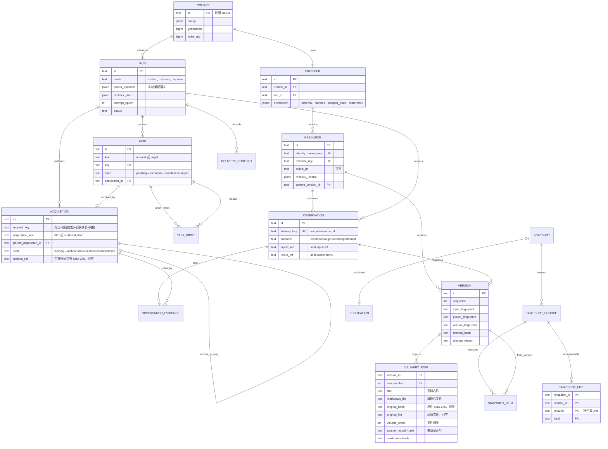

# SEAL

SEAL 以原生 Source Adapter 采集公开法规与政务来源：受控 Acquisition 先把每个实际参与解析的外部原始字节（HTML、渲染 DOM、TXT、PDF、DOC/DOCX/RTF、XLS/XLSX、ZIP）完整归档到私有 S3 CAS 并读回校验，再在短事务内以 attempt fencing 提交数据库事实。内置 Office 结构化直提、越南语 TCVN3 历史字体逐行恢复、PDF 逐页墨迹扫描判定、`tesseract` / `br-ocr-v1` 双引擎 OCR 与客观质量门禁，统一产出 `seal.document.v1` 与不可变 Version，并投影为对齐[法规案例元数据上传模板](docs/reference/法规案例元数据上传模板.xlsx)的 15 列业务字段及 `original_hash` / `markdown_hash` 交付行。

命令：`init`、`collect`、`recheck`、`reparse`、`worker` 负责采集与离线重解析，`snapshot create / list / inspect / publish` 冻结并人工发布全局集合，`serve` 只对下游暴露 `GET /results`（15 列业务字段 + `original_hash` / `markdown_hash`）与 `GET /files/{sha256}`（原件或解析后 `.md` 直取）。来源使用[地图稳定编号](docs/reference/尽职调查核验入口地图.md)，配置与数据合同见[唯一 Plan](docs/plans/source-adapters-delivery.md)。

## 全链路执行图

```text
[0] ENTRY & DISPATCH
cli.py: main() → dispatch(args)
├── seal serve → api.py: serve() → 私有配置、S3 桶与当前 schema 校验 → 进入阶段 [6]
├── seal init → migration.py: initialize()
│   ├── [CHECK] S3 桶可用；数据库对象清单；历史升级前停止客户端与校验备份
│   ├── [DB] schema.sql → 顺序执行未登记的 0002–0015 并校验已登记摘要
│   │   └── [CHECK] 0015 仅接受空的新数据库，否则 source_adapter_contract_requires_new_database
│   └── [DB] Procrastinate schema；新库发布指针为空
├── seal snapshot create / list / inspect / publish → snapshots.py → 进入阶段 [5]
├── [CHECK] 采集命令校验 S3 桶与当前 schema
├── seal worker [--once] → queue.py: worker()
│   ├── recover_stalled() / recover_unqueued() → 心跳恢复与补入队
│   └── [ASYNC] Procrastinate → crawl_job() → runs.py: execute_run() → 进入阶段 [2]
└── seal collect / recheck / reparse source.yaml → configuration.py: prepare_run() → 进入阶段 [1]

[1] PREPARE
configuration.py: prepare_run()
├── config.py: load_file() → [CHECK] 闭合 Source YAML：Adapter、fetch、budget、metadata、documents、parser、ocr
│   └── [CHECK] 拒绝旧 recipe / crawl4ai 键；归档许可、公开地址、域名与路径范围；adapters: validate_options()
├── [DB] Source 行锁 → 配置变化时 generation+1 与 control decision → Source 唯一 Frontier
├── runs.py: create_run()
│   ├── [CHECK] 暂停/冷却；recheck → recheck.py: plan_recheck() 冻结到期 Resource；reparse → reparse.py: plan_reparse() 冻结当前 Version 归档输入
│   ├── parsing.py: manifest() → [CONFIG] 冻结 Adapter 合同/规则摘要、Markdown、Office/LibreOffice、TCVN3、ZIP、PDF 阈值、OCR 引擎与模型、quality 路由
│   └── [DB] Run 不可变 config/config_hash/parser_manifest/recheck_plan/reparse_plan/deadline
└── [CHECK] --enqueue → queue.py: enqueue() 事务内入队；否则 progress.py: ProgressPanel → 进入阶段 [2]

[2] EXECUTE
runs.py: execute_run()
├── [DB] Run 与 Frontier session advisory lock；同 Source 单执行者
├── [LOOP] _execute_attempt() → begin_attempt()
│   ├── [CHECK] config_hash、generation、write_seq、deadline、max_attempts；parsing.py: require_runtime()
│   ├── [DB] 新 Run 接管 Frontier 并清空 checkpoint；旧 attempt 的 running Acquisition → abandoned
│   ├── [STATE] attempt_epoch+1、status=running
│   └── [SPAWN] 独立进程组 python -m seal.runtime run_id epoch；Markdown 生成器缓存隔离到 work 目录
├── [PARALLEL]
│   ├── CHILD: runtime_process.py: run() → Runtime.execute() → 进入阶段 [3]
│   └── PARENT: 轮询 owner 连接、generation/epoch/暂停/时间预算；TTY 只读进度
├── [CLEANUP] stop_process() → SIGTERM / 有界等待 / SIGKILL
├── [ERROR] Ctrl+C 或 Worker cancel_event → 子进程停止，Run=retryable；旧 epoch 写入被 fenced() 拒绝
└── completion.py: finish_run() → progress.py: terminal_report()
    ├── [STATE] complete / failed（Run 内任一错误码即 failed）
    └── [RETURN] stdout 单份 receipt.v4 JSON；退出 0/1/2，中断 130

[3] ADAPTER RUNTIME
runtime.py: Runtime.execute()
├── plan() → [CHECK] checkpoint.planned
│   ├── collect → Adapter.plan()；recheck → Adapter.plan_recheck(冻结 Resource)；reparse → frozen_targets() 离线复用 CAS 输入
│   └── register() → [DB] 请求任务、文档目标与 task_input 同事务登记 → save() checkpoint
├── [LOOP] 直到无可解析、无可交付、无待取请求或预算截断
│   ├── parse_archived() → Adapter.parse(ctx, task, acquisition) 读 CAS 原文
│   │   ├── web.py: 范围内链接发现（仅 collect 且 depth < max_depth）；详情页附件成为必需输入
│   │   ├── [DB] register(parent)：后续请求/目标先登记、合并入未交付目标，再把父请求标 done
│   │   └── [ERROR] 解析异常 → 请求 failed + 运行错误码，不中断 Run
│   ├── deliver_ready() → 输入全部 done/failed/skipped 的目标 → deliver()
│   │   ├── [CHECK] 任一必需输入非 archived/ok → resources.py: fail() 失败交付
│   │   ├── Adapter.build() → Context.read() / Context.extract() → 进入阶段 [4]
│   │   ├── document.py: build() → [IO] .md / seal.inputs.v1 / seal.document.v1 写入 CAS 并读回 → 四重指纹与交付行
│   │   └── resources.py: commit() → [DB] Source → Run → Resource 锁与 fence → Observation / Version / delivery_row / 目标 done
│   └── fetch_batch() → 按 seq 取并发数个 pending 请求
│       ├── reuse() 同 request_key 已归档的最终响应 → 直接复用，不重复外部请求
│       ├── transport.py: Transport.acquire()（http）或 browser.py: Browser.acquire()（rendered_dom）
│       │   ├── [CHECK] scope.guard()、robots（经同一受控传输）、Budget.request() 计数每次真实请求
│       │   ├── [DB] Recorder.start() → running Acquisition（短 fenced 事务）
│       │   ├── [IO] HTTP 实体字节有界读取 → Objects.put() + get() 读回 → Recorder.finish() archived/failed/cancelled
│       │   └── [RETRY] 重定向逐跳独立事实（parent=redirect）；网络失败/5xx 有界退避重试（parent=retry）
│       └── [STATE] 请求任务 archived / failed；预算耗尽记 truncated
├── close_unfinished() → 无法完成的目标 skipped（预算截断或输入不可得），不伪造失败或成功
├── save(watermark) → [DB] frontier.checkpoint：schema、planned、adapter_state、watermark
└── runtime_report.py: build_report() → [STATE] status=finishing；请求/目标/观察计数、failures、truncated、coverage（site_population=UNKNOWN）

[4] EXTRACTION & QUALITY
pdf_runtime.py: run_extraction(bytes, kind) → pdf_slots.py 主机级 4 槽
├── [SPAWN] 独立进程组 python -m seal.extract_worker；超时、取消轮询、输出上限；stderr 丢弃
├── office_runtime.py: detect() → 魔数与容器结构识别真实类型（伪装为 .doc/.docx 的表格、ZIP）
├── office_runtime.py: extract_office()
│   ├── xls / xlsx → xlrd / openpyxl → Markdown 表格
│   ├── docx → python-docx 段落、标题层级、横向合并去重表格
│   ├── rtf → 纯 Python 状态机（剥离 fonttbl/stylesheet/pict/header/footer）→ 失败回退 LibreOffice
│   ├── doc → 隔离 profile 的 headless LibreOffice txt → 失败转 PDF 再取文字
│   ├── normalize_detected_tcvn3() → 含 Unicode 越南语字母的行受保护，其余命中 TCVN3 特征的行逐行转换
│   └── legal_markdown() → Phần/Chương #、Mục/Tiểu mục ##、Điều ###
├── office_runtime.py: unpack_zip() → 内部真实文档逐个提取并返回派生成员（血缘 zip_path）
├── pdf_scan.py: extract_pdf()
│   ├── analyze() → 逐页 native_text_chars、embedded_images、0.5x 灰度 ink_ratio；<30 字且 >0.003 为 suspected_scan
│   ├── 无扫描页 → 原生文字；有扫描页 → tesseract 仅识别扫描页 / br-ocr-v1 整份版面解析
│   └── quality.py: quality_check() → 页级/篇级原因与 accept_ocr / accept_with_warning / vision_reparse_pages / legacy_font_encoding_recovery
└── [CHECK] 路由不在 parser.quality_accept_routes → quality_check_failed，不形成成功版本

[5] SNAPSHOT & MANUAL PUBLICATION
snapshots.py: create() / listing() / inspect() / publish()
├── create() → [DB] REPEATABLE READ 冻结全部 Source、当前（或覆盖）Version
│   ├── coverage() → 最近终态 Run 的计数、截断与已知缺口；未知分母 UNKNOWN
│   ├── [IO/CHECK] snapshot_file 闭包：每个 Version 的 seal.document.v1、输入清单、原件与 .md 经 Objects.get() 读回校验 SHA-256，缺失或损坏则不能封存
│   └── [STATE] 计数触发器核对后 sealed；映射不可变；不改变发布指针
├── listing() / inspect() → [DB] 只读统计、覆盖描述与有界分页映射
└── publish() → verify() → [IO/CHECK] 全部 seal.document.v1 闭包与可下载文件读取复算 SHA-256
    └── [DB] publication 行锁 → 原子切换 + 不可变 snapshot_publication；可切回旧 Snapshot

[6] READ-ONLY RESULTS API
api.py: application() → boundary middleware
├── [CHECK] 未注册路径（含 /sources、/attachments/*）对任何调用方 404；/healthz 免鉴权
├── [CHECK] Service.authenticate() → 每请求重读私有 callers → Bearer 摘要与 Source 许可
├── GET /results → result_query.py: results()
│   ├── [DB] 同一只读事务读取 published_snapshot_id；为空 503；source_id 未授权 403
│   ├── public_results.py: snapshot_rows() → snapshot_item ⋈ delivery_row，按索引直接分页（source_id/resource_id/行号 C 序）
│   └── [RETURN] {snapshot_id, items(15 列中文键 + source_id/resource_id/version_id/row_number/original_hash/markdown_hash), next_cursor} + Link；游标绑定调用方/来源/快照
└── GET /files/{sha256} → result_query.py: file()
    ├── [DB] public_results.py: file_entry() → 当前快照 snapshot_file ∩ 调用方授权来源，否则 404
    └── [IO/RETURN] Objects.get() 复算 SHA-256 → 真实 Content-Type、Content-Length、ETag、RFC 5987 文件名
```

## 数据模型 ER 图



## 运行示例：从公开来源采集到 API 查询

以下命令在仓库根目录执行，演示公开 HTML 与 PDF（文字层 + 扫描件 OCR）从采集、存储核验、人工发布到 API 取回结果与文件的最小闭环：

```text
sources/dd-xxx.yaml → seal collect → Acquisition/CAS → 提取与 quality_check → seal.document.v1 → Version + delivery_row
  → seal snapshot create → inspect → publish → seal serve → GET /results → GET /files/{sha256}
```

### 1. 准备本地存储与运行环境

```bash
uv sync --frozen
uv run --no-sync python -m seal.local_storage
set -a; source .env.local; set +a
uv run --no-sync seal init      # 0015 只接受空的新数据库
mkdir -p work/readme-demo artifacts/readme-demo
```

> 对象读取统一走 S3 API，不要直接操作根目录 `minio/`。`.doc` 与 RTF 兜底需要 LibreOffice（macOS：`brew install --cask libreoffice`）；扫描页 OCR 需要 Tesseract（`brew install tesseract`）。

下载越南语 `tessdata_fast` 模型，并生成 [dd-492](docs/reference/尽职调查核验入口地图.md#dd-492) 两份固定 PDF 的有界配置（文字层 `07-ttcp.signed.pdf`，扫描件 `140-vbhn-vpqh.signed.pdf`）：

```bash
mkdir -p work/readme-demo/tessdata
curl --fail --location --silent --show-error \
  https://raw.githubusercontent.com/tesseract-ocr/tessdata_fast/main/vie.traineddata \
  --output work/readme-demo/tessdata/vie.traineddata
export TESSDATA_PREFIX="$PWD/work/readme-demo/tessdata"

uv run --no-sync python - <<'PY'
from pathlib import Path
import yaml

config = yaml.safe_load(Path("sources/dd-492.yaml").read_text())
config.update({
    "adapter": "web", "adapter_options": {},
    "entry_urls": [
        "https://datafiles.chinhphu.vn/cpp/files/vbpq/2026/10/07-ttcp.signed.pdf",
        "https://datafiles.chinhphu.vn/cpp/files/vbpq/2026/10/140-vbhn-vpqh.signed.pdf",
    ],
    "scope": "越南政府公开附件的两份固定 PDF；验证原生文字与逐页扫描 OCR。",
    "budget": {"requests": 10, "seconds": 1200, "response_bytes": 134217728},
    "fetch": {"mode": "http", "max_depth": 0, "page_timeout_ms": 300000},
    "documents": {}, "ocr": {**config["ocr"], "timeout_seconds": 900},
})
Path("work/readme-demo/dd-492.yaml").write_text(yaml.safe_dump(config, allow_unicode=True))
PY
```

### 2. 采集与入库核验

```bash
set -o pipefail
uv run --no-sync seal collect sources/dd-017.yaml --no-progress | tee artifacts/readme-demo/dd-017-run.json
uv run --no-sync seal collect work/readme-demo/dd-492.yaml --no-progress | tee artifacts/readme-demo/dd-492-run.json
```

回执 `report` 区分真实外部请求数、请求任务与文档目标状态、观察结果及 `coverage`；`site_population` 恒为 `UNKNOWN`，有界样本不代表全站覆盖。下面通过 SQL 与 S3 API 核对 Acquisition、交付行与 CAS：

```bash
uv run --no-sync python - <<'PY' | tee artifacts/readme-demo/storage-check.json
import json
from pathlib import Path
from seal.db import connect
from seal.objects import Objects

runs = {s: json.loads(Path(f"artifacts/readme-demo/{s}-run.json").read_text())["run_id"]
        for s in ("dd-017", "dd-492")}
with connect() as c:
    c.execute("SET TRANSACTION READ ONLY")
    rows = c.execute("""
        SELECT o.run_id,d.title,d.original_hash,d.markdown_hash,d.original_file,d.role,v.result_ref
        FROM seal.observation o JOIN seal.version v ON v.id=o.version_id
        JOIN seal.delivery_row d ON d.version_id=v.id
        WHERE o.run_id=ANY(%s) ORDER BY o.run_id,d.title""", (list(runs.values()),)).fetchall()
    acquisitions = c.execute("""SELECT run_id,state,count(*) AS n FROM seal.acquisition
        WHERE run_id=ANY(%s) GROUP BY run_id,state""", (list(runs.values()),)).fetchall()
assert {r["run_id"] for r in rows} == set(runs.values()), "source_without_delivery"
objects = Objects()
for row in rows:  # S3 读取时复算 SHA-256
    if row["original_hash"]:
        objects.get(row["original_hash"])
    objects.get(row["markdown_hash"])
    assert json.loads(objects.get(row["result_ref"]))["schema"] == "seal.document.v1"
print(json.dumps({"acquisitions": acquisitions, "rows": len(rows),
                  "sample": rows[:3]}, ensure_ascii=False, indent=2, default=str))
PY
```

### 3. 创建、核对和手动发布

```bash
uv run --no-sync seal snapshot create | tee artifacts/readme-demo/snapshot.json
snapshot_id=$(uv run --no-sync python -c 'import json; print(json.load(open("artifacts/readme-demo/snapshot.json"))["snapshot_id"])')
uv run --no-sync seal snapshot inspect "$snapshot_id" --limit 100   # 核对映射与 coverage
uv run --no-sync seal snapshot publish "$snapshot_id"
```

再次采集或创建快照不改变对外集合，必须再次 `publish`；回切时对旧 Snapshot 执行同一命令。

### 4. 启动 API 服务

```bash
uv run --no-sync python - <<'PY'
import hashlib, json, os, secrets
from pathlib import Path
from cryptography.fernet import Fernet

root, key = Path("work/readme-demo"), secrets.token_urlsafe(32)
config = {"public_base_url": "http://127.0.0.1:8090", "token_key": Fernet.generate_key().decode(),
          "request_timeout_seconds": 60,
          "callers": [{"id": "demo", "key_sha256": hashlib.sha256(key.encode()).hexdigest(),
                       "sources": ["dd-017", "dd-492"]}]}
for name, body in (("api-config.local.json", json.dumps(config, indent=2)),
                   ("headers.local.txt", "Authorization: Bearer " + key + "\n")):
    with os.fdopen(os.open(root / name, os.O_WRONLY | os.O_CREAT | os.O_TRUNC, 0o600), "w") as f:
        f.write(body)
PY
uv run --no-sync seal serve --config work/readme-demo/api-config.local.json --host 127.0.0.1 --port 8090
```

### 5. 客户端查询结果并按哈希取文件

另开终端：

```bash
curl --fail-with-body --silent --show-error --get http://127.0.0.1:8090/results \
  --header @work/readme-demo/headers.local.txt \
  --data-urlencode source_id=dd-492 --data-urlencode limit=50 \
  --output artifacts/readme-demo/dd-492-results.json

uv run --no-sync python - <<'PY'
import hashlib, json
from pathlib import Path
from urllib.request import Request, urlopen

out, work = Path("artifacts/readme-demo"), Path("work/readme-demo")
auth = (work / "headers.local.txt").read_text().strip().split(": ", 1)[1]
items = json.loads((out / "dd-492-results.json").read_text())["items"]
assert len(items) == 2 and all(i["资料类型"] and i["采集时间"] for i in items)
for item in items:
    for column, digest in (("原始文件", item["original_hash"]), ("解析后文件", item["markdown_hash"])):
        if not digest:
            continue
        with urlopen(Request("http://127.0.0.1:8090/files/" + digest,
                             headers={"Authorization": auth}), timeout=60) as response:
            body = response.read()
        assert hashlib.sha256(body).hexdigest() == digest
        (out / item[column]).write_bytes(body)
    print(json.dumps({k: item[k] for k in ("资料名称", "解析后文件", "原始文件", "original_hash", "markdown_hash")},
                     ensure_ascii=False))
PY
```

`items` 每项含 15 列中文业务键及 `original_hash`（无独立原件时为 `null`）与 `markdown_hash`；`original_hash` 取回 PDF 原件，`markdown_hash` 取回解析后 `.md`，字节 SHA-256 均与哈希一致。旧 `/sources`、`/attachments/*` 返回 404。示例依赖公开站点可用性，处理成功不代表识别准确或业务事实已核验。

#### 停止服务与清理

在服务终端按 `Ctrl+C` 停止 API；停止本地存储容器（保留数据）：

```bash
docker compose --env-file .env.local down
```
