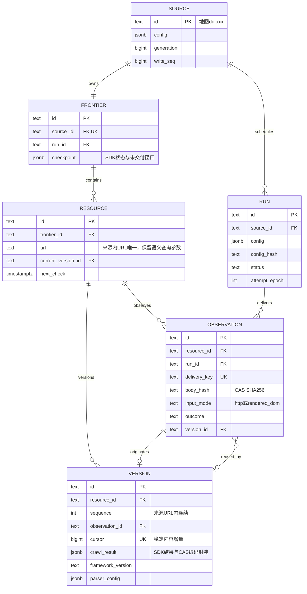

# SEAL

SEAL 以 Crawl4AI 采集来源、归档响应正文并维护 URL 资源版本库。每个 Source 拥有独立 Frontier，响应变化且目标有效、解析成功时追加不可变 Version，下游直接消费 CrawlResult。

## 全链路执行图

```text
[0] ENTRY & DISPATCH
cli.py: main() → dispatch(args)
├── seal init → migration.py: initialize()
│   ├── [CHECK] 对象清单、历史升级前停止客户端与校验备份
│   ├── [DB] schema.sql → 已登记0002–0009 → 追加0010；历史文件不重写
│   └── [DB/IO] Procrastinate schema 与 CAS 目录
├── seal worker [--once] → queue.py: worker()
│   ├── recover_stalled() / recover_unqueued() → 任务心跳恢复与补入队
│   └── [ASYNC] Procrastinate → crawl_job() → 进入阶段 [2]
└── seal collect / recheck source.yaml → configuration.py: prepare_run()
    └── 进入阶段 [1]

[1] PREPARE
configuration.py: prepare_run()
├── config.py: load_file() → [CHECK] 闭合 Source/Crawl4AI YAML、归档许可与范围
├── [DB] Source 行锁 → 配置代际/config_hash → Source 唯一 Frontier
├── runs.py: create_run()
│   ├── [CHECK] 暂停/冷却；collect 使用入口，recheck.py: plan_recheck() 冻结到期资源
│   └── [DB] Source run_seq → Run 不可变配置快照、seeds、deadline
└── [BRANCH] --enqueue → queue.py: enqueue() 事务内入队 → pending JSON
    └── foreground → progress.py: ProgressPanel → 进入阶段 [2]

[2] EXECUTE
runs.py: execute_run()
├── [DB] Run 与 Source session advisory lock；同 Frontier 单执行者
├── [LOOP] _execute_attempt() → begin_attempt()
│   ├── [CHECK] generation、write_seq、deadline、max_attempts
│   ├── [DB] epoch递增、status=running；同Run保留checkpoint，新Run重建visited
│   └── [SPAWN] 独立进程组 python -m seal.crawl；输出不泄露到CLI
├── [PARALLEL]
│   ├── CHILD: crawl.py: run()
│   │   ├── SDK AsyncWebCrawler；collect: BFSDeepCrawlStrategy / recheck: arun_many
│   │   ├── sdk.py: HttpAdapter / BrowserAdapter
│   │   │   ├── [CHECK] scope、robots、重定向/子请求、次数/时间/字节预算
│   │   │   ├── [IO] HTTP Response.read()捕获bytes / Browser获取阶段DOM → CAS
│   │   │   └── InputScraper → SDK HTML/TXT或同次归档PDF临时副本解析
│   │   ├── [LOOP] streaming CrawlResult → outcome() → archive.py: serialize_result()
│   │   │   └── resources.py: persist() → 进入阶段 [3]
│   │   ├── State.checkpoint_changed() → 补当前层未交付URL → SDK pending持久化
│   │   └── [STATE] status=finishing；watch_parent()父亡终止子进程组
│   └── PARENT: 检查owner连接、generation/epoch/暂停/预算；stderr TTY只读进度
├── [CLEANUP] stop_process() → SIGTERM / 有界等待 / SIGKILL
├── [RETRY] 进程失败retryable，有界attempt恢复；旧epoch不能提交
└── completion.py: finish_run() → manifest.py: terminal_report()
    ├── [STATE] complete / failed；资源已各自独立提交
    ├── [IO] CAS运行manifest，覆盖/质量始终有界
    └── cli.py: main() → stdout单份receipt.v3 JSON；退出0/1/2，Ctrl+C保留恢复状态退出130

[3] RESPONSE & VERSION COMMIT
resources.py: persist()
├── [IO/CHECK] 原文CAS可读取、SHA256复算；落盘后才引用
├── [DB] Source → Run → Resource锁；fenced()检查代际/epoch/状态
├── [CHECK] frontier_id+URL唯一资源；run+resource交付幂等
├── [DB] 不可变Observation：状态/模式/正文哈希/归档引用/实际URL
├── [BRANCH] 失败、登录或挑战 → 保留原文；不生成内容版本
├── [BRANCH] 等于当前成功版本正文 → Observation关联旧Version
└── [BRANCH] 响应变化且解析成功
    ├── [DB] 全局事务锁保护稳定增量cursor；连续Version+原生CrawlResult
    ├── [DB] 复合FK保护Resource/Observation/Version归属；推进current_version_id
    └── [DB] next_check → recheck；current_resource_version / version_delta → 下游SQL
```

## 数据模型 ER 图


