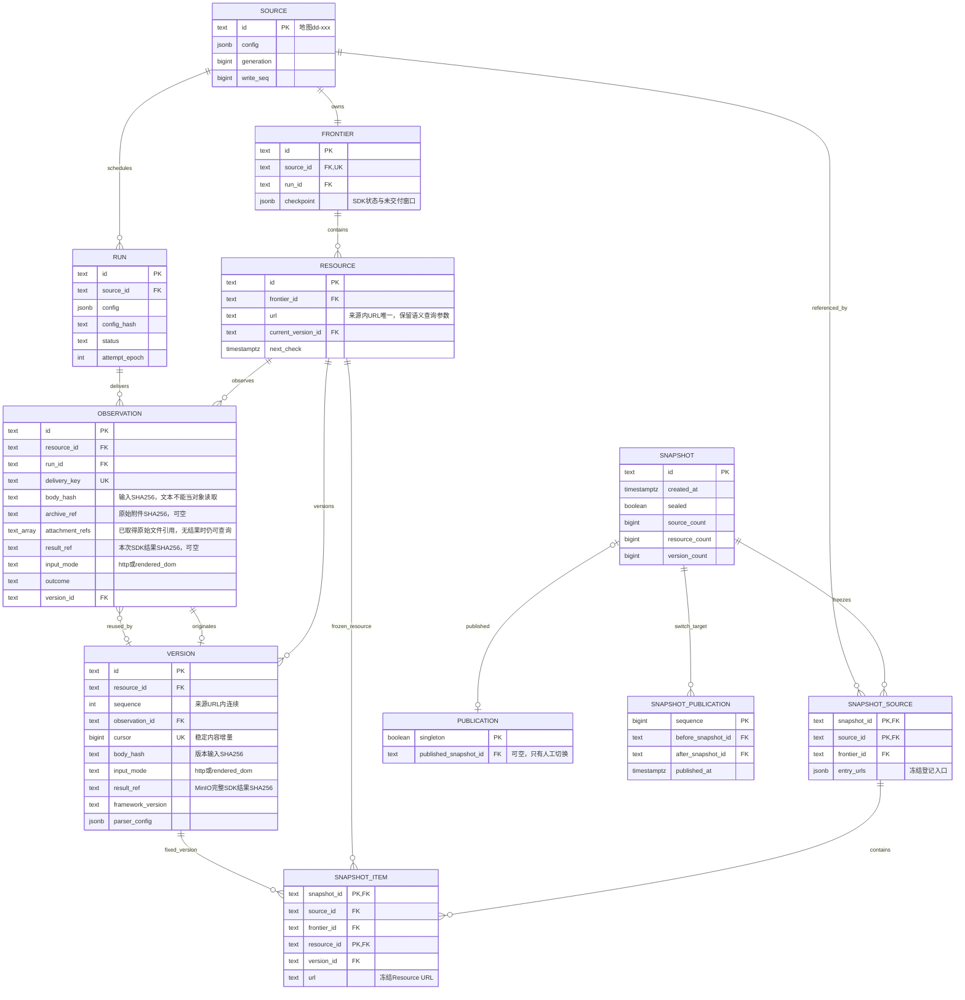

# SEAL

SEAL 以 Crawl4AI 采集来源并维护 URL 资源版本库。每个 Source 拥有独立 Frontier，输入或显式 PDF 文字合同变化且目标有效、解析成功时追加不可变 Version；私有 MinIO 仅保存完整 CrawlResult JSON 与原始下载附件，PostgreSQL 保存来源、运行、资源版本和对象引用。下游通过 result_ref 读取并重建本轮结果，文本原始 HTTP 字节不再独立归档。

当前支持 HTML/TXT、文本层 PDF 与动态 DOM；使用 `init`、`collect`、`recheck`、`worker` 操作采集，`snapshot create / inspect / publish` 控制全局人工发布；`serve` 从已发布 Snapshot 提供来源发现、成功内容和原始附件。来源配置采用[地图稳定编号](docs/reference/尽职调查核验入口地图.md)，接口、配置与全链路使用示例见[全局 Snapshot 合同](docs/plans/global-snapshots.md)。

## 全链路执行图

```text
[0] ENTRY & DISPATCH
cli.py: main() → dispatch(args)
├── seal serve → api.py: serve() → 私有配置、S3桶与当前schema校验 → 进入阶段 [5]
├── [CHECK] 采集命令校验 S3 桶与当前 schema；snapshot 命令校验 schema
├── seal init → migration.py: initialize()
│   ├── [CHECK] S3 桶可用后再查数据库对象清单、历史升级前停止客户端与校验备份
│   ├── [DB] migrations/schema.sql → 顺序执行未登记的0002–0013，校验已登记摘要；旧归档升级仅接受空内容，0012→0013保留全部内容
│   └── [DB] Procrastinate schema；对象桶由部署初始化；新/升级发布指针为空
├── seal snapshot create / list / inspect / publish → snapshots.py → 进入阶段 [4]
├── seal worker [--once] → queue.py: worker()
│   ├── recover_stalled() / recover_unqueued() → 任务心跳恢复与补入队
│   └── [ASYNC] Procrastinate → crawl_job() → 进入阶段 [2]
└── seal collect / recheck source.yaml → configuration.py: prepare_run()
    └── 进入阶段 [1]

[1] PREPARE
configuration.py: prepare_run()
├── config.py: load_file() → [CHECK] 闭合 Source/Crawl4AI YAML、归档许可与范围
├── [DB] Source 行锁 → 配置代际/config_hash → Source 唯一 Frontier
├── runs.py: create_run()
│   ├── [CHECK] 暂停/冷却；collect 使用入口，recheck.py: plan_recheck() 冻结到期资源
│   └── [DB] Source run_seq → Run 不可变配置快照、seeds、deadline
└── [CHECK] 执行方式
    ├── --enqueue → queue.py: enqueue() 事务内入队 → pending JSON
    └── foreground → progress.py: ProgressPanel → 进入阶段 [2]

[2] EXECUTE
runs.py: execute_run()
├── [DB] Run 与 Source session advisory lock；同 Frontier 单执行者
├── [LOOP] _execute_attempt() → begin_attempt()
│   ├── [CHECK] 冻结config_hash、generation、write_seq、deadline、max_attempts
│   ├── [CHECK/DB] 同Run保留checkpoint；新Run替换前校验未交付附件，将证据留原Run.report；重建visited
│   ├── [DB] epoch递增、status=running
│   └── [SPAWN] 独立进程组 python -m seal.crawl；SDK缓存/log隔离到 work 的 run/epoch目录；输出不泄露到CLI
├── [PARALLEL]
│   ├── CHILD: crawl.py: run()
│   │   ├── SDK AsyncWebCrawler；collect: BFSDeepCrawlStrategy / recheck: arun_many
│   │   ├── sdk.py: HttpAdapter / BrowserAdapter
│   │   │   ├── [CHECK] scope、robots、重定向/子请求、次数/时间/字节预算
│   │   │   │   └── robots_redirect_urls仅许可robots政策获取的精确跳转，不扩大内容范围
│   │   │   ├── [IO] HTTP bytes / Browser DOM → 内容指纹与临时输入；原始附件 → S3 CAS + checkpoint引用
│   │   │   └── InputScraper → SDK HTML/TXT或同次PDF bytes在 work/ 的临时副本解析；不再请求另一份输入
│   │   ├── [LOOP] streaming CrawlResult → outcome() → archive.py: serialize_result() → 结果JSON CAS
│   │   │   └── resources.py: persist() → 进入阶段 [3]
│   │   ├── State.checkpoint_changed() → 补当前层未交付URL → SDK pending持久化
│   │   └── [STATE] status=finishing；watch_parent()父亡终止子进程组
│   └── PARENT: 无写锁轮询owner连接、generation/epoch/暂停/预算；stderr TTY只读进度
├── [CLEANUP] stop_process() → SIGTERM / 有界等待 / SIGKILL
├── [ERROR] 前台Ctrl+C / Worker显式cancel_event → 子进程停止、checkpoint保留、Run=retryable
├── [RETRY] 进程失败retryable，有界attempt恢复；Worker按30秒心跳窗口回收，旧epoch不能提交
└── completion.py: finish_run() → manifest.py: terminal_report()
    ├── [STATE] complete / failed；资源已各自独立提交
    ├── [DB] 运行统计/错误/配置留关系库；覆盖/质量始终有界，无manifest对象
    └── cli.py: main() → stdout单份JSON（collect/recheck为receipt.v3）；退出0/1/2，中断退出130

[3] RESPONSE & VERSION COMMIT
resources.py: persist()
├── [IO/CHECK] 结果JSON与全部原始附件可读取、SHA256复算；验证后才引用
├── [DB] Source → Run → Resource锁；fenced()检查代际/epoch/状态
├── [CHECK] frontier_id+URL唯一资源；run+resource交付幂等
├── [DB] 不可变Observation：状态/模式/输入指纹/可空附件引用/result_ref/实际URL
├── [DB/IO] Observation.result_ref → 本次成功/失败SDK结果CAS；同事务关联
├── [CHECK] 失败、登录或挑战 → 保留实际SDK结果和已取得附件；不生成内容版本
├── [CHECK] 返回结果前中断/异常 → checkpoint或失败Observation，result_ref可空，不伪造结果
├── [CHECK] 解析成功且输入body_hash与PDF文字合同等于当前成功版本 → Observation关联旧Version
└── [CHECK] 首次解析成功或输入body_hash/PDF文字合同变化且解析成功
    ├── [DB] 全局事务锁保护稳定增量cursor；连续Version+result_ref（与原始Observation一致）
    ├── [DB] 复合FK保护Resource/Observation/Version归属；推进current_version_id
    └── [DB] next_check → recheck；current_resource_version / version_delta → 下游SQL取result_ref → MinIO读取CrawlResult

[4] SNAPSHOT & MANUAL PUBLICATION
snapshots.py: create() / listing() / inspect() / publish()
├── create() → [DB] REPEATABLE READ事务冻结全局来源入口、Resource URL与当前成功Version
│   ├── [DB] snapshot_source / snapshot_item复合FK验证来源、资源、版本归属
│   └── [STATE] 统计核对后sealed；提交后快照和映射不可变；不改变发布指针
├── listing() / inspect() → [DB] 只读快照统计、发布指针和有界分页映射
└── publish() → verify() → [IO/CHECK] 原结果/附件读取并复算SHA256；不复制对象
    ├── [DB] 唯一publication行锁 → 原子指针切换 + 不可变snapshot_publication记录
    ├── [CHECK] 已发布当前ID幂等；无效快照/坏归档/故障失败保留原指针
    └── [RETURN] 切换前后ID、顺序与时间；可切回任意旧Snapshot，内部新Version保留

[5] READ-ONLY RESULTS API
api.py: application() → HTTP /sources、/results 或 /attachments/{id}
├── [CHECK] Service.authenticate() → 每请求重读私有callers → Bearer摘要与实时Source许可
├── [DB] result_query.py: 同一只读事务读取一次published_snapshot_id；为空503 snapshot_not_published
├── [DB] /sources → 获授权Snapshot来源的无歧义入口 → 下游选择source_url
├── [DB] /results → Snapshot入口与固定snapshot_item → Version.result_ref
│   └── [CHECK] 加密游标绑定Snapshot/Caller/Source/C序位置/首次时间；续页保持原快照及期限
├── [IO/CHECK] Objects.get() → 结果/原始附件读取、大小/超时上限、SHA256复算
├── [RETURN] public_results.py: 白名单 → JSON数组 + Link下一页；坏归档整页报错
└── [CHECK/IO] 加密附件ID → 实时Caller许可 + Snapshot/Resource/Version成员资格 → 原始字节
    └── 发布切换仍可读原快照；只读，不采集、不新增对象
```

## 数据模型 ER 图


