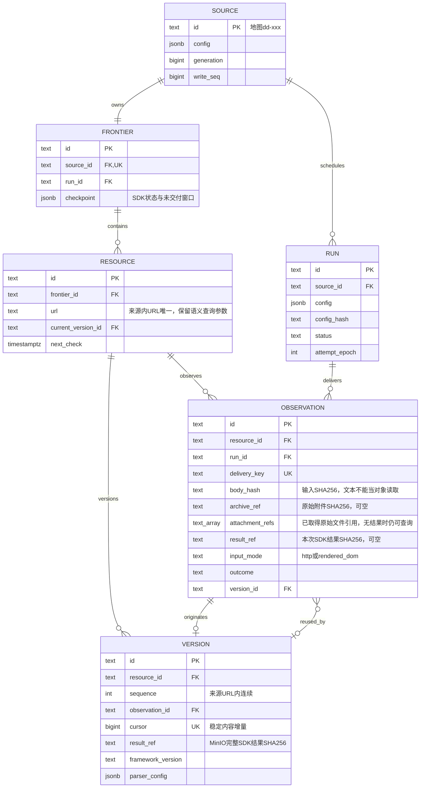

# SEAL

SEAL 以 Crawl4AI 采集来源并维护 URL 资源版本库。每个 Source 拥有独立 Frontier，输入变化且目标有效、解析成功时追加不可变 Version；私有 MinIO 仅保存完整 CrawlResult JSON 与原始下载附件，PostgreSQL 保存来源、运行、资源版本和对象引用。下游通过 result_ref 读取并重建本轮结果，文本原始 HTTP 字节不再独立归档。

当前支持 HTML/TXT、文本层 PDF 与动态 DOM；使用 init、collect、recheck、worker 操作采集，serve 提供来源发现、按来源入口查询成功内容和下载附件的只读 API。

## 全链路执行图

```text
[0] ENTRY & DISPATCH
cli.py: main() → dispatch(args)
├── seal serve → api.py: serve() → 私有配置、S3桶与当前schema校验 → 进入阶段 [4]
├── [CHECK] 非 init/serve 采集命令先校验 S3 桶与当前数据库 schema
├── seal init → migration.py: initialize()
│   ├── [CHECK] S3 桶可用后再查数据库对象清单、历史升级前停止客户端与校验备份
│   ├── [DB] schema.sql → 已登记0002–0011 → 追加0012；仅接受空旧内容库升级，不回填旧结果
│   └── [DB] Procrastinate schema；对象桶由部署初始化，minio/ 仅服务管理
├── seal worker [--once] → queue.py: worker()
│   ├── recover_stalled() / recover_unqueued() → 任务心跳恢复与补入队
│   └── [ASYNC] Procrastinate → crawl_job() → 进入阶段 [2]
└── seal collect / recheck source.yaml → configuration.py: prepare_run()
    └── 进入阶段 [1]

[1] PREPARE
configuration.py: prepare_run()
├── config.py: load_file() → [CHECK] 闭合 Source/Crawl4AI YAML、归档许可与范围
├── [DB] Source 行锁 → 配置代际/config_hash → Source 唯一 Frontier
├── runs.py: create_run()
│   ├── [CHECK] 暂停/冷却；collect 使用入口，recheck.py: plan_recheck() 冻结到期资源
│   └── [DB] Source run_seq → Run 不可变配置快照、seeds、deadline
└── [BRANCH] --enqueue → queue.py: enqueue() 事务内入队 → pending JSON
    └── foreground → progress.py: ProgressPanel → 进入阶段 [2]

[2] EXECUTE
runs.py: execute_run()
├── [DB] Run 与 Source session advisory lock；同 Frontier 单执行者
├── [LOOP] _execute_attempt() → begin_attempt()
│   ├── [CHECK] 冻结config_hash、generation、write_seq、deadline、max_attempts
│   ├── [DB] epoch递增、status=running；同Run保留checkpoint，新Run重建visited
│   └── [SPAWN] 独立进程组 python -m seal.crawl；SDK缓存/log隔离到 work 的 run/epoch目录；输出不泄露到CLI
├── [PARALLEL]
│   ├── CHILD: crawl.py: run()
│   │   ├── SDK AsyncWebCrawler；collect: BFSDeepCrawlStrategy / recheck: arun_many
│   │   ├── sdk.py: HttpAdapter / BrowserAdapter
│   │   │   ├── [CHECK] scope、robots、重定向/子请求、次数/时间/字节预算
│   │   │   ├── [IO] HTTP bytes / Browser DOM → 内容指纹与临时输入；原始附件 → S3 CAS + checkpoint引用
│   │   │   └── InputScraper → SDK HTML/TXT或同次PDF bytes在 work/ 的临时副本解析；不再请求另一份输入
│   │   ├── [LOOP] streaming CrawlResult → outcome() → archive.py: serialize_result() → 结果JSON CAS
│   │   │   └── resources.py: persist() → 进入阶段 [3]
│   │   ├── State.checkpoint_changed() → 补当前层未交付URL → SDK pending持久化
│   │   └── [STATE] status=finishing；watch_parent()父亡终止子进程组
│   └── PARENT: 无写锁轮询owner连接、generation/epoch/暂停/预算；stderr TTY只读进度
├── [CLEANUP] stop_process() → SIGTERM / 有界等待 / SIGKILL
├── [CANCEL] 前台Ctrl+C / Worker显式cancel_event → 子进程停止、checkpoint保留、Run=retryable
├── [RETRY] 进程失败retryable，有界attempt恢复；Worker按30秒心跳窗口回收，旧epoch不能提交
└── completion.py: finish_run() → manifest.py: terminal_report()
    ├── [STATE] complete / failed；资源已各自独立提交
    ├── [DB] 运行统计/错误/配置留关系库；覆盖/质量始终有界，无manifest对象
    └── cli.py: main() → stdout单份JSON（collect/recheck为receipt.v3）；退出0/1/2，中断退出130

[3] RESPONSE & VERSION COMMIT
resources.py: persist()
├── [IO/CHECK] 结果JSON与全部原始附件可读取、SHA256复算；验证后才引用
├── [DB] Source → Run → Resource锁；fenced()检查代际/epoch/状态
├── [CHECK] frontier_id+URL唯一资源；run+resource交付幂等
├── [DB] 不可变Observation：状态/模式/输入指纹/可空附件引用/result_ref/实际URL
├── [DB/IO] Observation.result_ref → 本次成功/失败SDK结果CAS；同事务关联
├── [BRANCH] 失败、登录或挑战 → 保留实际SDK结果和已取得附件；不生成内容版本
├── [BRANCH] 返回结果前中断/异常 → checkpoint或失败Observation，result_ref可空，不伪造结果
├── [BRANCH] 解析成功且正文等于当前成功版本 → Observation关联旧Version
└── [BRANCH] 响应变化且解析成功
    ├── [DB] 全局事务锁保护稳定增量cursor；连续Version+result_ref（与原始Observation一致）
    ├── [DB] 复合FK保护Resource/Observation/Version归属；推进current_version_id
    └── [DB] next_check → recheck；current_resource_version / version_delta → 下游SQL取result_ref → MinIO读取CrawlResult

[4] READ-ONLY RESULTS API
api.py: application() → HTTP /sources、/results 或 /attachments/{id}
├── [CHECK] api_security.py: Bearer摘要 → Caller → Source许可；结果查询校验登记入口唯一匹配
├── [DB] result_query.py: /sources → 获授权 Source 的唯一登记入口 → 下游选择 source_url
├── [DB] result_query.py: /results → Resource.current_version_id → Version.result_ref
│   └── [PAGE] 首次成功版本水位 + C序Resource.id → 加密游标 → 同一快照续页
├── [IO/CHECK] Objects.get() → 结果/原始附件读取、大小/超时上限、SHA256复算
├── [OUTPUT] public_results.py: 白名单 → JSON数组 + Link下一页；坏归档整页报错
└── [DOWNLOAD] 加密附件ID → 当前Source许可与Version归属 → 原始字节
    └── 下游消费内容/下载地址；不启动采集、不新增结果存储
```

## 数据模型 ER 图



## API 对外接口

SEAL 提供轻量只读 HTTP 内容服务（`seal serve`），供下游发现获授权的来源入口（`GET /sources`）、基于登记入口查询最新成功抓取内容（`GET /results`）以及下载原始附件（`GET /attachments/{attachment_id}`）。服务仅消费已有 SQL 与 S3 归档对象，不触发实时采集，不产生额外数据副本。

### 1. 服务启动与认证

```bash
# 启动结果服务（默认仅监听本地环回）
seal serve --config <api-config.json> --host 127.0.0.1 --port 8080
```

- **认证方式**：HTTP Bearer Token（`Authorization: Bearer <API_KEY>`）。
- **权限模型**：服务端通过常数时间比对调用方 `key_sha256` 摘要，严格限定调用方可访问的 Source 白名单（如 `["dd-017"]`）。
- **配置与安全**：服务配置详情参见[结果服务 Plan](docs/plans/results-api.md)。响应默认包含 `Cache-Control: no-store` 与 `X-Content-Type-Options: nosniff`。

### 2. 接口定义

#### 2.1 发现可用来源 (`GET /sources`)

查询当前调用方获授权且无入口歧义的来源列表，供下游获取合法的 `source_url` 参数。

- **请求方式**：`GET /sources`
- **请求参数**：无（不接受任何 Query 参数，传入参数将返回 `400 invalid_parameters`）。
- **请求头**：携带 `Authorization: Bearer <API_KEY>`。
- **响应格式**：`application/json`，顶级为 JSON 数组，按来源 `id`（C 字节序）升序排序：
  | 字段 | 类型 | 说明 |
  | --- | --- | --- |
  | `id` | string | 来源稳定编号（如 `dd-017`） |
  | `entry_urls` | array[string] | 该来源下已登记且无歧义的入口 URL 列表（按登记顺序去重） |

- **响应示例**：
  ```json
  [
    {
      "id": "dd-017",
      "entry_urls": ["https://www.court.gov.cn/shenpan/gengduo/77.html"]
    }
  ]
  ```
- **特性与边界**：
  - 纯数据库只读查询，不产生网站访问或 S3 读取。
  - 严格排除跨来源重复登记的歧义入口（避免下游请求 `/results` 时触发 `source_ambiguous`）。
  - 若调用方未授权任何来源、来源尚未入库或所有入口均存在歧义，返回空数组 `[]`。

#### 2.2 查询成功内容列表 (`GET /results`)

按来源入口查询最新成功版本快照，支持游标分页。

- **请求参数**（Query Params）：
  | 参数 | 类型 | 必填 | 说明 |
  | --- | --- | --- | --- |
  | `source_url` | string | 是 | 来源登记入口 URL（严格匹配来源配置中的 `entry_urls`） |
  | `limit` | int | 否 | 每页返回资源数，默认 `20`，范围 `1–100` |
  | `cursor` | string | 否 | 分页游标，从上一页响应头 `Link` 中获取（Fernet 认证加密令牌，有效期 1 小时） |

- **响应格式**：`application/json`，顶级为 JSON 数组。字段遵循严格白名单：
  | 字段 | 类型 | 说明 |
  | --- | --- | --- |
  | `url` | string | 资源最终目标 URL |
  | `markdown` | string | 提取的 Markdown 正文（无则为空字符串） |
  | `metadata` | object | 元数据，包含 `title`、`author`、`description`、`keywords`（均为 `string \| null`） |
  | `links` | object | `internal` 与 `external` 链接数组（每项含 `href`、`text`、`title`） |
  | `media` | object | `images`、`videos`、`audios` 媒体数组（每项含 `src`、`alt`、`desc`、`type`、`format`、`width`） |
  | `tables` | array | 表格数组（每项含 `headers`、`rows`、`caption`、`summary`） |
  | `attachments` | array | 原始下载附件列表，每项含 `url`（绝对下载链接）、`name`（`null`）、`media_type`（`null`） |

- **分页响应头**：
  若存在下一页，响应头包含标准 `Link` 标头；最后一页无此标头：
  ```http
  Link: <http://127.0.0.1:8080/results?source_url=...&limit=20&cursor=...>; rel="next"
  ```

#### 2.3 下载原始附件 (`GET /attachments/{attachment_id}`)

下载采集过程中获取的原始二进制附件（如 PDF、文档等）。

- **路径参数**：`attachment_id`（由 `/results` 响应的 `attachments[].url` 路径中提供，为 Fernet 认证加密令牌，有效期 24 小时，绑定来源与版本）。
- **请求头**：需携带与调用方相同的 `Authorization: Bearer <API_KEY>`。
- **响应格式**：`application/octet-stream` 二进制流（响应头 `Content-Disposition: attachment; filename="attachment"`），下载时实时复算 SHA-256 校验。

### 3. 错误响应与状态码

错误响应统一为 JSON 对象：`{"error": "<error_code>"}`。

| HTTP 状态码 | 错误代码 (`error`)                                                                                 | 触发场景                                                             |
| ----------- | -------------------------------------------------------------------------------------------------- | -------------------------------------------------------------------- |
| 400         | `invalid_parameters` / `invalid_cursor`                                                            | 参数缺失、格式非法、包含多余参数、超界或游标篡改/过期                |
| 401         | `unauthenticated`                                                                                  | 未提供 Bearer Token 或 Token 无效（附带 `WWW-Authenticate: Bearer`） |
| 403         | `source_forbidden`                                                                                 | 调用方无权访问该来源                                                 |
| 404         | `source_not_found` / `attachment_not_found` / `not_found`                                          | 来源未登记、附件令牌失效或路由不存在                                 |
| 409         | `source_ambiguous`                                                                                 | 入口 URL 匹配到多个来源                                              |
| 500         | `archive_corrupt` / `archive_invalid` / `archive_missing` / `archive_too_large` / `internal_error` | 归档对象损坏、字段不合法、对象缺失或超出大小限制                     |
| 503         | `database_unavailable` / `object_storage_unavailable` / `request_timeout` / `server_busy`          | 数据库/S3 不可用、请求超时或并发工作线程已满                         |

### 4. 调用示例

```bash
# 1. 发现可用来源及登记入口
curl -s "http://127.0.0.1:8080/sources" \
  -H "Authorization: Bearer your-api-key"

# 2. 查询内容列表（使用上一步获取的 entry_urls 之一）
curl -s -G "http://127.0.0.1:8080/results" \
  -H "Authorization: Bearer your-api-key" \
  --data-urlencode "source_url=https://example.com/portal" \
  --data-urlencode "limit=20" \
  -D -

# 3. 下载附件（使用返回的附件 URL）
curl -s "http://127.0.0.1:8080/attachments/<encrypted_attachment_id>" \
  -H "Authorization: Bearer your-api-key" \
  -O -J
```
