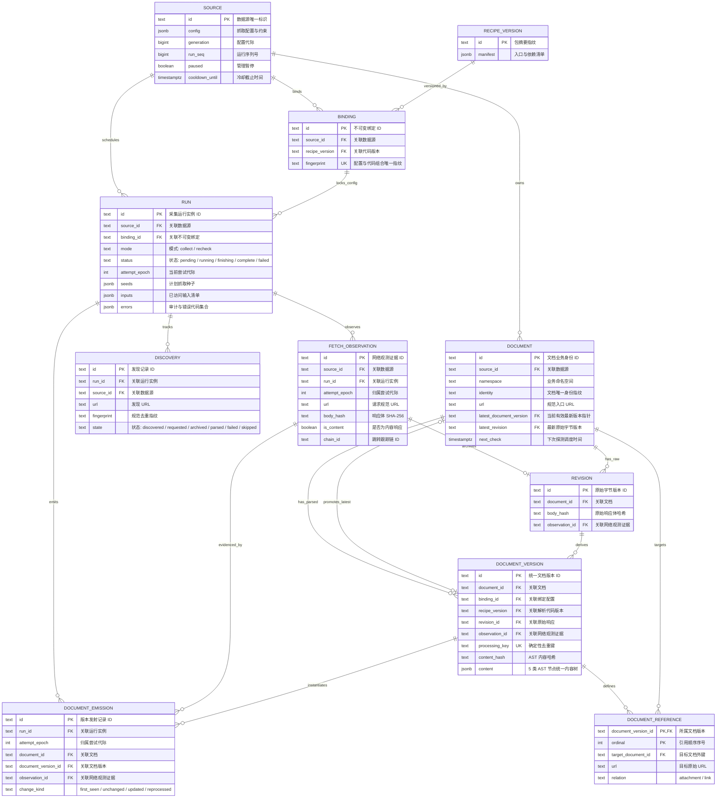

# SEAL

SEAL 从公开来源采集信息、归档原文，并将 HTML、文本 PDF、DOCX、XLS/XLSX、CSV、TXT、JSON 和图片保存为统一 Document。内容仅包含 `article`、`image`、`table`、`json`、`document_ref` 五类 AST 节点。

来源发现与内容解析完全解耦，Runtime 统一归档、解析、校验和保存。相同输入与规则复用确定性 Version，各 Run 独立记录观测血缘，成功 Run 原子推进当前文档指针。

---

## 1. 全链路执行图 (Canonical Execution Map)

```text
[0] ENTRY & DISPATCH
cli.py: main()
└── cli.py: dispatch(args)
    ├── seal init ──► migration.py: initialize() ──► [DB] PostgreSQL Schema 初始化与升级
    │
    ├── seal worker ──► queue.py: worker(once) ──► 消费 Procrastinate 持久队列
    │   ├── queue.py: recover_stalled() ──► [CHECK/DB] 咨询锁防竞争，自愈未入队与僵死任务
    │   └── procrastinate.App: run_worker(queues=["seal", "seal-control"])
    │       ├── [seal-control] (Cron: * * * * *) ──► recover_stalled() 巡检心跳超 30s 任务
    │       └── [seal] (业务队列) ──► queue.py: crawl_job(run_id) ──► [ASYNC] 进入阶段 [2]
    │
    └── seal collect / recheck (source.yaml)
        ├── migration.py: require_current() ──► [CHECK] 校验数据库迁移已是最新版本
        └── configuration.py: prepare_run(source_path, mode, enqueue) ──► 进入阶段 [1]


[1] PREPARE (配置解析与不可变绑定)
configuration.py: prepare_run(source_path, mode, enqueue)
├── config.py: load_file() ──► [CHECK] Pydantic 校验 CollectionConfig (预算/域名/种子/范围)
├── recipes.py: pack_recipe(recipe_path)
│   ├── [CHECK] 静态 AST 检查 (禁止包含 requests/urllib/socket/subprocess 等网络库)
│   └── [IO] 打包 Spider 源码并计算 recipe_version ──► 写入本地 .seal/packages/ 对象库
├── recipes.py: load_bundle() ──► [CHECK] jsonschema.validate(params, params_schema)
├── core.py: digest() ──► 计算 config + params + recipe_version 的 SHA-256 指纹
├── [DB] INSERT INTO seal.source (自动注册/更新 generation)
├── [DB] INSERT INTO seal.binding (不可变绑定记录，触发器保护)
├── runs.py: create_run(binding_id, mode)
│   ├── [CHECK] 检查源状态: source.paused 与 cooldown_until 冷却限制
│   ├── 种子生成分流:
│   │   ├── collect 模式: seeds = source.config.entry_urls
│   │   └── recheck 模式: recheck.py: plan_recheck() (规划存量文档探测种子与配额)
│   ├── [DB] 递增 source.run_seq
│   └── [DB] INSERT INTO seal.run (status='pending', 写入 seeds, deadline, recheck_plan)
└── 调度与执行分流:
    ├── --enqueue ──► queue.py: enqueue(c, run_id)
    │   ├── [DB] 事务内 defer_job() 原子入队
    │   ├── [RETURN] 输出 pending 回执
    │   └── [ASYNC] 后台 worker 消费触发 crawl_job(run_id) ──► 进入阶段 [2]
    └── foreground (前台执行)
        └── runs.py: execute_run(run_id, progress=ProgressPanel) ──► 进入阶段 [2]


[2] EXECUTE (会话锁保护、重试循环与双进程并发)
runs.py: execute_run(run_id, progress)
├── [DB] pg_try_advisory_lock(run_id) ──► 获取会话级咨询锁 (防多端并发抢占同一 Run)
│
├── [LOOP] 尝试循环 (while True，支持 retryable 瞬态故障自动重试):
│   └── runs.py: _execute_attempt(run_id, progress)
│       ├── [CHECK] 若已处于 status='finishing' ──► 直接进入阶段 [3] finish_run()
│       ├── runs.py: begin_attempt(run_id)
│       │   ├── [DB] 递增 attempt_epoch，归档上一轮 inputs 与 errors 历史
│       │   └── [STATE] UPDATE seal.run SET status='running', attempt_epoch=epoch
│       ├── runs.py: run_context(run_id, epoch) ──► [DB] 聚合读取只读 Run + Binding 配置快照
│       │
│       ├── [SPAWN] subprocess.Popen: python -m seal.crawl <run_id> <epoch> <parent_pid>
│       │   ├── [CONFIG] stdout/stderr=DEVNULL (杜绝源数据泄漏)
│       │   └── [CONFIG] start_new_session=True (创建独立进程组)
│       │
│       ├── [PARALLEL]
│       │   ├── [A] CHILD: Scrapy 隔离沙箱抓取、归档与实时解析
│       │   │   ├── crawl.py: watch_parent(parent_pid) ──► 后台守护线程，父亡则 killpg 自杀
│       │   │   ├── recipes.py: import_recipe(recipe_version) ──► 动态加载 Spider 类
│       │   │   ├── [CHECK] 安全合规门禁: 检查 seeded_robots_required，禁止覆盖系统策略
│       │   │   ├── crawl.py: settings_for(context) ──► 装配 Scrapy 中间件、Pipeline 与 Extension
│       │   │   └── CrawlerProcess.crawl(recipe) 启动 Twisted Reactor:
│       │   │       ├── [Request 链路 (从小到大)]
│       │   │       │   ├── archive.py: RequestGuard (40) ──► [CHECK] 规范化/Scope/防SSRF/脱敏
│       │   │       │   ├── robots.py: ArchivedRobotsMiddleware (45) ──► [CHECK/IO] 拦截并归档规则
│       │   │       │   ├── inputs.py: InputMiddleware (575) ──► 前置上下文准备
│       │   │       │   └── archive.py: ResponseArchiveMiddleware (605) ──► [IO] 网络请求等待响应
│       │   │       ├── [Spider 拓扑发现链路]
│       │   │       │   └── discovery.py: DiscoverySpiderMiddleware (200) ──► 新请求过滤去重与深度控制
│       │   │       ├── [Item 数据过滤链路]
│       │   │       │   └── items.py: ItemPipeline (100) ──► 丢弃非 diagnostic Item (Runtime独占解析权)
│       │   │       ├── [Response 链路 (从大到小)]
│       │   │       │   ├── 1. 响应体物理归档落盘: ResponseArchiveMiddleware (605)
│       │   │       │   │   ├── 计算 response.body 的 SHA-256
│       │   │       │   │   ├── [IO] core.Objects().put() ──► 写入本地磁盘 CAS
│       │   │       │   │   └── [DB] INSERT INTO seal.fetch_observation (记录网络证据与 chain_id)
│       │   │       │   └── 2. 实时文档解析与暂存: InputMiddleware (575) -> process_content()
│       │   │       │       ├── inputs.py: register_input() ──► [DB] 写入 seal.run.inputs 血缘
│       │   │       │       └── [CHECK] 若 is_content ──► documents.py: stage_document()
│       │   │       │           ├── parse_snapshot() ──► [IO] CAS Objects().get(body_hash)
│       │   │       │           │   └── parse_document() ──► 纯函数投影为 5 类 AST (article/image/table/json/ref)
│       │   │       │           ├── [CHECK] validate_content() ──► 校验 AST 契约
│       │   │       │           ├── documents.py: _identity() ──► 解析 document_ref 外链并绑定 target_document_id
│       │   │       │           ├── [CHECK] 计算 processing_key ──► 确定性断言与版本去重
│       │   │       │           ├── [DB] INSERT INTO seal.document_version (仅新版本写入 AST)
│       │   │       │           └── [DB] INSERT INTO seal.document_emission (记录发射并标注 change_kind)
│       │   │       └── [Extension 阶段收敛]
│       │   │           └── crawl.py: Completion (100) ──► 捕获 spider_closed 信号
│       │   │               └── [STATE] UPDATE seal.run SET status='finishing', report=...
│       │   │
│       │   └── [B] PARENT: Supervisor 巡检与看护 (每 200ms 快照轮询)
│       │       ├── [CHECK] 超时熔断 (单调时钟 > budget.seconds + 15 或达到 deadline)
│       │       ├── [CHECK] 源状态核验 (检查 Source 是否被管理员暂停或冷却)
│       │       └── progress.update(run_id) ──► [IO] 驱动 TTY 实时终端面板
│       │
│       ├── [JOIN] 进程退出或异常中断 (process.poll() != None)
│       │   └── [CLEANUP] finally: 若进程未退出 ──► killpg(SIGTERM) ──3s超时──► killpg(SIGKILL) 确保回收
│       │
│       └── 退出状态判定与分流:
│           ├── 正常抓取完成 (status='finishing') ──► 进入阶段 [3] finish_run(run_id, epoch)
│           └── 异常/超时退出 (status='running'):
│               ├── completion_status() 评估瞬态错误 (5xx/timeout) ──► status='retryable'
│               ├── 评估致命/耗尽错误 ──► status='failed'
│               └── [DB] UPDATE seal.run SET status=%s, errors=%s
│
├── [RETRY DECISION] 重试决策:
│   ├── 若 attempt 返回 status == 'retryable' ──► sleep(1) ──► 重新进入下一轮 attempt (递增 epoch)
│   └── 若 attempt 返回 status in ('complete', 'failed') ──► 跳出循环
│
└── [CLEANUP] finally: [DB] pg_advisory_unlock(run_id) ──► 释放会话锁 ──► [RETURN] receipt


[3] FINISH (收尾完整性审计与终态提交)
completion.py: finish_run(run_id, epoch)
├── [DB] locked_run() 加行级锁，[CHECK] fenced() 检查代际与配置栅栏 (防过期 attempt 提交)
│
├── [CHECK] 完整性审计:
│   ├── 种子入口覆盖审计: 校验 run.seeds 是否均在 run.inputs (未访问记 unresolved_seed)
│   ├── 观测链路审计: 检查 4xx/5xx/429/截断重定向 (豁免 robots 与 optional 条目)
│   ├── 抓取终态审计: 确认 Scrapy 属于 finished 正常结束 (超时记 incomplete_crawl)
│   └── CAS 完整性哈希校验: 验证磁盘 .seal 中所有 inputs 的 body_hash 物理文件存在
│
├── [CHECK] 文档提交前审计与版本冻结:
│   └── documents.py: finish_documents(c, source, run)
│       ├── 聚合本轮 seal.document_emission 发射记录
│       ├── [CHECK] 校验文档版本冲突: document_identity_conflict (同 run 产出多版本)
│       ├── [CHECK] 校验过期输入: stale_document_input (并发被其他 run 修改最新 body_hash)
│       └── 冻结生成合法文档指针 outputs 列表
│
├── [CHECK] 文档发射覆盖审计: 检查所有 is_content 记录是否均已发射 (防漏解析 document_parse_missing)
├── completion.py: completion_status() ──► 评估终态: complete / retryable / failed
├── manifest.py: terminal_report() ──► 生成包含完整审计证据的终端报告
│
├── 终态提交分流:
│   ├── [分支 A] status == 'complete' (全量审计通过):
│   │   ├── documents.py: accept_documents() ──► [DB] UPDATE seal.document (原子推进 latest_document_version)
│   │   └── recheck.py: complete_dates() ──► [DB] 推进存量文档 next_check 时间并重置失败计数
│   └── [分支 B] status != 'complete' (审计失败/需重试):
│       └── recheck.py: failed_dates() ──► [DB] 记录失败次数并计算指数退避重试时间
│
├── [DB/STATE] UPDATE seal.run SET status=%s, report=%s, errors=%s, completed_at=now()
│
└── cli.py: main()
    ├── [IO] stdout 输出单份最终 JSON 回执 (Receipt)
    └── [RETURN] 退出码: 0 成功 / 1 业务失败 / 2 参数错误 / 130 用户中断
```

---

## 2. 数据模型关系图 (Entity-Relationship Diagram)


