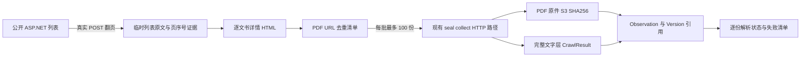

# dd-492 越南政府文献 PDF 采集

## 目标与范围

来源身份登记在[入口地图](../reference/尽职调查核验入口地图.md#dd-492)，运行配置为 [dd-492.yaml](../../sources/dd-492.yaml)。目标是发现该门户公开历史列表中每个文书详情关联的全部 PDF，保存原件并解析完整文字层。用户授权该来源忽略 robots；HTTP 403、认证挑战、TLS、公开地址与域名路径边界仍正常处理。没有可用正文文字层、损坏或加密的 PDF 必须明确失败，不使用 OCR；仅能提取数字签章外观元数据不能算法律正文解析成功。

本次先验收十个列表页及其全部 PDF；不把这次测试解释为历史全量完成。实际首页每页 50 份文书，2026-10-14 通过公开 `Page$Last` 表单实测末页编号 1991，末页有 1945 年文书。该数量只描述当时的列表分页，不是 PDF 总数或完整性证明。

## 边界与数据流



可视化产物：[采集链路](../generated/dd-492-pdf-harvest.html)。`seal.vietnam_discovery` 仅负责该真实来源的 ASP.NET 表单与详情发现，不引入通用配方引擎；`seal.vietnam_documents` 负责本地 SQLite 断点、分批 CLI 编排与汇总。PDF 下载、原件归档、解析结果、版本与错误仍由现有采集模块负责，不在来源脚本中实现第二套 PDF 解析器。

列表和详情发现原文只保存在 work/artifacts 的临时证据中，不能另写 MinIO 原始 HTML，也不伪造 SDK CrawlResult。页级工件保留请求方法、公开事件目标与参数、本地 HTML 路径及 SHA-256、文书 URL、PDF URL 及详情证据；不保存 Cookie、凭据或隐藏表单请求载荷。SQLite 与冻结批次配置位于 `work/`，验收证据位于 `artifacts/`；均不入库。列表发现证据不冒充 GET Resource 的版本或 POST URL。

## 配置与命令

- `robots: false`：仅该 Source 的显式选择，不改变其他来源默认策略。
- 并发 8、延迟 0、每批最多 100 PDF、请求预算 10000、时间预算 3600 秒、单响应最多 128 MiB、单页请求超时 300 秒。Source 默认仍为 10 MiB，只有该来源显式调高。
- 批次冻结同一个 `dd-492` ID 的 PDF 入口配置，使用 HTTP、深度 0，避免 PDF 内部超链接扩大范围。选定范围处理结束后恢复 Source 的登记门户入口；旧 Run 保留批次配置。Source 行锁下核对当前配置属于本 state 且当前代际没有非终结 Run，外部改配置或在途工作报错，不能覆盖。
- SDK 已升级至 0.9.5，接入上游 #2320 的显式页码传参修复；页调度恢复 SDK 原生 process_batch 并行，不再覆写为顺序处理；接受 SDK 逐页重建 reader 的现状，不实施 reader 复用（不同 PDF 仍按配置并发），页正文用原始文字层 `<pre>` 保留章节编号、数值与范围。SDK 的标题/列表猜测会删掉真实数值（例如 `165 < R ≤ 185 170`），不能用于法律正文。PDF 策略处理实际全部页面，禁止使用 SDK 默认页数上限悄悄截断；没有文字层记录 `pdf_text_layer_required`，损坏或加密记录 `pdf_invalid_or_encrypted`，SDK 漏页记录 `pdf_page_parse_failed`。失败原件已取得时仍归档。

执行前需要已同步 Python 环境、可用 PostgreSQL 当前 schema、可用 S3 桶和 `.env.local`。本次验收使用独立数据库，不能在默认业务库执行 `seal init` 作为验收准备。

```bash
set -a
source .env.local
set +a

# 十个列表页及其所有 PDF；同一个 state 重跑恢复，成功文件不再下载。
uv run --no-sync python -m seal.vietnam_documents sources/dd-492.yaml \
  --max-pages 10 --state work/dd-492-ten-pages \
  --artifacts artifacts/dd-492-ten-pages

# 恢复已完成首轮的网络失败子集（正常完整运行已自动最多两轮复验）。
uv run --no-sync python -m seal.vietnam_documents sources/dd-492.yaml \
  --max-pages 10 --state work/dd-492-ten-pages \
  --artifacts artifacts/dd-492-ten-pages --retry-network

# 已核对十页效果后，全历史不设置 max-pages。
uv run --no-sync python -m seal.vietnam_documents sources/dd-492.yaml \
  --state work/dd-492-full --artifacts artifacts/dd-492-full
```

`seal collect sources/dd-492.yaml` 只发现普通链接，不提交历史分页表单；全历史必须使用上面的分页入口。`--max-pdfs` 仅供定位问题的小范围诊断，十页验收不能设置它。

## 并发、断点与失败

公开列表 POST 的同一载荷在复用连接断开后，用新连接实测成功；发现阶段不复用 HTTP 连接，内容 URL、POST 参数与分页断言不变。

来源编排用文件锁阻止同一 state 并行写入，已有 Source/Frontier 锁继续阻止 SQL 同来源并发采集。详情网络请求有界并发、超时与单响应上限；一页所有详情验证完成后才提交页序号。详情局部成功先保存，失败不被吞掉。连接断开、响应中断与超时最多重试三次，退避 0.5/1 秒；公开列表查询 POST 可幂等重放。POST 页必须递增且文书集合不能重复；缺失表单或分页结构、出界 PDF 链接和非 HTML 响应均报错。

采集完成状态以本 state 登记批次配置哈希对应的 SQL Observation 为准（旧配置的 robots 阻断不算本次交付），进程在提交后崩溃也能在重跑时核对 S3 引用并恢复成功状态。逐份失败继续其他文件，不无限重试；汇总列出失败原因。HTTP 适配器在 SDK `before_request` 边界设置 Source 声明的总超时，避免 SDK 0.9.4 固定 30 秒 socket-read 提前中断；真实 35 秒延迟/45 秒预算成功、5 秒延迟/2 秒预算失败，不能把总超时改为无限。

完整选定范围首轮结束后自动有限复验网络失败的子集；显式 `--retry-network` 可用于恢复已完成首轮的运行。复验并发 2、延迟 0.5 秒，每个 URL 跨同一 state 最多追加两次下载；无文字层、损坏和硬 HTTP 错误不重试。成功文件不重抓。新的复验观察按批次配置哈希与开始时间匹配，旧失败不冒充本次交付。缺少某批 Observation 时停止并要求重跑，不谎报完成。

state 绑定冻结配置、数据库与 S3 环境的哈希，不包含连接凭据。选定页面枚举完成后恢复只校验冻结本地证据，不重新读取移动中的列表；不能缩小已有页范围。枚举未完成时重跑发现某页文书集合变化会停止并要求新 state，避免把旧分页位置与新列表混为同一次全量枚举。配置回滚恢复原有 HTTP/robots 选项，已有资源及 S3 原件不删除。

## 验收要求

fresh 子 agent 先声明失败边界，再独立编写并执行根目录 `tests/dd492_pdf_acceptance.py`。验证真实十页 POST 翻页、全部文书详情对应的 PDF 清单、逐份原件 S3 字节与 SHA-256、独立文字提取与 SDK 完整正文、实际页数，以及相同 state 重跑不重复成功下载。隔离的长文 PDF 和无文字 PDF 验证不截断与明确失败。

汇总必须区分：选定十页枚举和处理完成、PDF 成功解析、已归档但解析失败、下载失败、仍未处理、全历史是否到达末页。HTTP 200、CLI 退出码、成功数量或存在 Markdown 均不能单独证明全量完成。

工件合同：`page-NNNN.html/json` 保存列表与详情发现证据；`batch-*.json` 保存命令、冻结入口及运行回执；`pdf-manifest.json` 保存每份 PDF 的状态与 Observation 引用；`summary.json` 保存范围、总数、成功/失败/待处理以及全历史完成标志。当前结果以实际验收工件为准。

## 文字合同纠正

PDF 声明稳定 `pdf_text_contract=verbatim_v1`；保留原始文字层和逐页边界。原件无效 UTF-16 字体映射先合并合法代理对，孤立码元保留成显式转义并记录数量，不猜测符号。合同变化时同原件追加新不可变 Version，旧 Snapshot 不变；同合同复查不因时间戳新增版本。取舍见 [ADR 0005](../adr/0005-pdf-text-representation.md)。

已成功但使用旧格式化器的文件可显式 `--reparse-successful`，每个 URL/文字合同仅一次，与网络失败追加两次的上限独立；保留原件哈希并发布新的内部当前版本，不能隐含发布 Snapshot。该动作仅纠正原成功集合，不重抓无文字层或原网络失败集合。纠正重下载中的网络失败可用 `--retry-reparse-network`，每个 URL/合同最多追加两次、并发 2，单独计数并核对开始时间；不消耗或突破原网络失败集合的两次上限。

首次十页冻结配置为 50 MiB/60 秒，后续仅对失败集合做不同预算的有限诊断：单文件与 11 份网络缺口使用 300 秒，最后两份超过 50 MiB 的原件使用 128 MiB/300 秒、并发 1。最终交付配置为 128 MiB/300 秒；既有 state 始终使用其冻结 `runner/dd-492.yaml` 复现，不能用新配置覆盖旧 state。Source 可配置上限、Snapshot 附件验证上限和 API 可配置上限统一为 128 MiB，API 默认仍为 50 MiB；有正文大附件需要调用方显式配置更大下载预算。无自动发布或权限扩大。

`summary.json` 另有 `failure_counts`、`latest_archived_pdfs` 与 `all_latest_originals_archived`，从本 state 每个 URL 的最新 Observation 引用区分原件归档与正文解析。仅 `body_hash` 非空不能算原件取得；字节预算拒绝可能只有不完整输入指纹，必须有 `archive_ref` 并经 S3 SHA 验证。

## 本次最终验收（2026-10-14 至 15）

仅十个列表页：500 份文书、550 个唯一 PDF。550 份原件全部取得并经 S3 SHA-256 核验；299 份逐页正文完整，251 份无可用正文文字层（部分只能提取数字签章/页码），明确记录 `pdf_text_layer_required`，不运行 OCR。没有剩余网络或字节预算失败，未启动全历史采集。

原 539 份做完整审计，新 9 份和最后 2 份做独立增量审计，保留历次失败工件。最后两份原件为 67,954,764 和 56,560,080 bytes，均在扩展字节预算并修正 SDK 读取超时后成功。初始失败不是全部 PDF 没有文字，也不能将截断输入的 body_hash 当作已归档原件。

最终交付核验 7/7，守卫恢复 6/6：550/550 归档、299 当前内容及历史 Version 不变、门户入口恢复；没有公网 DNS/socket 请求、没有新增 Run/Observation/Version，冻结页证据保持不变。64 MiB 有正文 PDF 的真实 collect → Snapshot create/publish → 鉴权 API 原件下载 17/17；超时回归 5/5；2001 页边界 7/7；两份大原件增量核验 7/7。

综合工件：`artifacts/dd-492-pdf-acceptance/20261014_160902/final-acceptance-report.json`。全套证据包括命令回执、环境及源码哈希、原件指针与 SHA、逐页正文比较、历史失败及最终解决状态；不记录凭据。复核需要 `.env.local` 指向相同 PostgreSQL/S3 服务、保留隔离数据库 `seal_dd492_acceptance_20261014_160902`、对应 work/artifacts 与 S3 对象。归档型结果组合复核不会重新抓取公网：

```bash
uv run --no-sync python tests/dd492_combined_report.py

# 验证恢复行为：使用 state 冻结配置，不会使用随后放宽的根配置覆盖它。
uv run --no-sync python tests/dd492_resume_audit.py

# 独立新库验证大附件贯通与权限；本地 fixture，不请求实际门户。
uv run --no-sync python tests/dd492_large_pdf_e2e.py
```

最终根配置相对本次 state 的冻结配置，仅 `budget.response_bytes` 从 50 MiB 改为 128 MiB、`crawl4ai.page_timeout_ms` 从 60 秒改为 300 秒；差异工件为 `delivered-config-diff.json`。普通采集遇无正文依然退出 1，这是明确的数据解析错误；`all_latest_originals_archived=true` 与 `failure_counts` 用于区分原件覆盖与正文可提取性。没有自动发布本次真实来源，也未验收生产部署。


## 2026-10-15 SDK 修复同步验收

依赖与锁文件固定 Crawl4AI 0.9.5，页码显式传参，保留当前串行页处理。独立 agent 使用本地 HTTP PDF fixture、独立 PostgreSQL 数据库与 S3 桶验证；需 `.env.local` 中可用服务配置，不使用默认业务库，不运行公开来源采集。

- `uv run --no-sync python tests/dd492_pdf_acceptance.py --fixtures-only`：2001 页正文、页序、原件与空白失败 14/14 PASS，工件 `artifacts/dd-492-pdf-acceptance/20261015_141012/summary.json`。
- `uv run --no-sync python tests/pdf_sdk_batch_acceptance.py`：公开 SDK 四线程、25 页重复六次，正文与页码 6/6 PASS，工件 `artifacts/pdf-sdk-batch-0.9.5-20261015_141053/summary.json`；链接另存独立证据，未将其计入并行断言。
- `uv run --no-sync python tests/pdf_upgrade_acceptance.py`：5 页混排正文、空白与损坏失败、原件归档 23/27 PASS；4 个 URI 注解在输出丢失，工件 `artifacts/dd-492-pdf-acceptance/20261015_141007/summary.json`。升级前代码副本与 0.9.4 在相同 fixture 下完全复现相同四项失败，基线工件 `artifacts/dd-492-pdf-acceptance/20261015_141142/summary.json`。两版本公开 processor 均保留链接，scraping 输出均未保留；这是既有 scraping 层限制，本次未扩展修复；上游为用户提交的 [Crawl4AI #2374](https://github.com/unclecode/crawl4ai/issues/2374)，本项目在 [SEAL #26](https://github.com/nanzhi84/SEAL/issues/26) 跟踪。

本次未验证生产部署、公开来源全量采集、性能提升或 reader 复用。静态代码检查与本文档检查通过；全库 `seiso check` 另有 global-snapshots 既有历史工件引用缺失，原始检查结果见 `artifacts/crawl4ai-095-upgrade/static-checks.json`。


## 2026-10-15 恢复 SDK 原生页面并行

移除适配器将 `process_batch` 转向 `process` 的覆写，沿用 SDK 0.9.5 默认有界线程池、结果排序与显式页码传递；SEAL 只保留原文字层 `<pre>` 正文转换，正文合同不变。SDK 每页重建 reader 的行为接受现状，不实施 reader 复用；前一节 2001 页验收属于恢复并行之前的历史结果，不作为本次并行性能证据。

PDF URI 注解丢失的上游 [#2374](https://github.com/unclecode/crawl4ai/issues/2374) 在本项目 [#26](https://github.com/nanzhi84/SEAL/issues/26) 跟踪；待上游确认合同并发布后再升级验收，不增加临时链接提取分支。


本次恢复并行后的 fresh 独立验收为 37 PASS、4 个已知上游链接失败：20 页 CLI 正文/页序/重复采集不新增 Version、含中间空白页、全空白和损坏失败、S3 原件与结果哈希均通过。报告 `artifacts/dd-492-pdf-acceptance/20261015_144825/native-parallel-independent-report.json`；第二轮补充工件 `artifacts/dd-492-pdf-acceptance/20261015_144829`。环境仍需已同步 uv、`.env.local` 的 PostgreSQL 建库权限及 S3 服务；每次使用独立数据库与临时目录。复跑命令：

```sh
uv run --no-sync python -c "import sys; sys.path.insert(0, 'tests'); from dd492_pdf_acceptance import Acceptance; a=Acceptance(); a.long_pages=20; a.fixtures(); raise SystemExit(a.finish())"
uv run --no-sync python tests/pdf_upgrade_acceptance.py
```

第二条因已知 URI 问题退出 1。未验证线上来源、超过 2000 页、性能或实际并行度；继承的个别断言名称提及 2000 页，本次实际仅为 20 页，不能据此声称长文验收。
