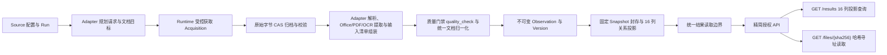

# 原生 Source Adapter 与统一文件交付

状态：阶段 1（[#31](https://github.com/nanzhi84/SEAL/issues/31)）已实现，见[阶段 1 实现合同](#阶段-1-实现合同31)；阶段 3 已实现，阶段 4 已实现并完成独立验收，2026-10-20。
本轮以本地开发为前提，直接采用新数据与结果合同，不设计历史数据迁移、双格式读取或兼容 shim。
设计基线为 `85a36b5`；未标注已实现的模块、字段和命令仍为待实现设计。
[唯一可视化](../generated/source-adapters-delivery.html)随本计划同步更新。

用户于 2026-10-20 [取消整个 #32 本地文件包导出能力](https://github.com/nanzhi84/SEAL/issues/32#issuecomment-6285651052)。#32 按 not planned 关闭，PR #36 撤回；不交付导出 CLI、工作簿/文件包物化、包 manifest 或离线包校验。#33、#34 直接依赖下述主链与两个 API。Office/XLSX 原件解析及模板定义的 16 列模型继续保留。

## 目标与完整数据流

下游通过授权 API 取得固定 `Snapshot` 的结果：`GET /results` 返回与 [法规案例元数据上传模板](../reference/法规案例元数据上传模板.xlsx) 对齐的 16 列关系投影与文件哈希，`GET /files/{sha256}` 返回原件或解析后 Markdown 的已归档字节。
同时，将 [office_text_extract.py](../reference/office_text_extract.py)（Office/压缩容器探测、结构化直提、越南语 TCVN3 历史字体恢复与法律条文层级归一）与 [production_document_parse.py](../reference/production_document_parse.py)（逐页墨迹扫描件判定、`tesseract`/`br-ocr-v1` 双引擎版面 OCR 与客观质量门禁 `quality_check`）的核心逻辑重构并入 `src/seal/` 主链。
成功入库、Snapshot 封存与完整文件交付分别记录结果。一个业务文档可以使用多个外部输入（如列表页 + 详情页 + 多个分卷或附件），一个外部响应也可以产生多个业务文档或分卷交付行。



数据只沿此链路产生；Adapter 不另设数据库、SQLite 队列、对象归档或交付真相。
运行数据位于根目录 `work/`，交付与验收工件位于 `artifacts/<运行名>/`，均不入库。
原始对象统一通过 S3/CAS API 访问，禁止直接读写根目录 `minio/`。

## 领域边界与依赖方向

| 边界 | 输入 | 职责与输出 |
|---|---|---|
| Source / Run | 已登记来源、配置、运行模式 | 冻结 Adapter、身份规则、解析器（含 Office/OCR/质量参数）及预算；运行控制与 attempt fencing |
| Source Adapter | 冻结配置、已归档输入、文档目标 | 来源发现、分页、定位、请求描述、解析与字段映射 |
| Acquisition / Transport | 请求描述或其他受控外部获取描述 | 外部 I/O、限流与预算、CAS 归档、数据库获取事实；不创建内容 Version |
| 文档提取与质量门禁 | CAS 物化原件（HTML/PDF/DOC/DOCX/RTF/XLS/ZIP） | 重构并入 `src/seal/` 的 Office 结构化直提、TCVN3 字体恢复、PDF 逐页墨迹扫描判定、OCR 路由与 `quality_check` |
| 统一文档与输入清单 | 解析候选、实际 Acquisition 引用、质量判定 | 校验来源身份、16 列映射字段、分卷/附件角色、定位与 Markdown，计算确定性指纹 |
| resources | 已校验候选与引用 | 独占 Resource 锁、幂等判定、Observation / Version 与当前指针事务 |
| Snapshot | 已提交成功 Version | 在一致视图冻结来源及 Resource → Version 映射，校验引用闭包，封存后不可变 |
| 统一结果读取与 16 列投影 | 固定 Version 与 result_ref | 校验唯一新格式及其对象闭包，生成与 [法规案例元数据上传模板](../reference/法规案例元数据上传模板.xlsx) 对齐的 16 列交付行与可寻址哈希集合 |
| API（`GET /results`、`GET /files/{sha256}`） | `published_snapshot_id`、调用方授权 | 仅暴露 16 列结果分页查询与 64 位 SHA-256 文件直取两个接口 |

依赖为 `configuration / runs → runtime → adapters / acquisition → extraction / quality / document / resources`，
以及 `snapshots / API → 统一结果读取与 16 列投影 → CAS`。采集模块不依赖 API；
来源逻辑复用已有 HTTP、PDF/OCR 和范围控制能力，
移除被替代的内部运行路径与旧接口。

## Acquisition：受控外部原始数据获取

Acquisition 是一次受控的外部原始数据获取动作。绝大多数对应 HTTP 请求；
它负责取得并保存外部输入，业务文档解析与 Version 生成由后续边界负责。
同 URL 的两次实际获取是两条事实；相同字节可复用同一个 CAS 对象。
同一响应拆分出多个文档时复用 Acquisition，不为每篇文档伪造一次外部请求。

首期支持 `http` 与 `rendered_dom` 获取种类，不实现通用传输插件框架。
HTTP 保存传输层交付的完整响应实体字节，位于字符解码及内容清洗之前；
记录内容解压等表示规则，不宣称保存 TLS、分块传输或压缩前的逐字节网络流。
DOM 保存实际交给解析器的渲染后 UTF-8 字节，明确其表示种类，不称其为原始 HTTP 响应。浏览器主响应、脚本与每个重定向 hop 均通过共享 Transport 独立归档 HTTP 原件，再交给 Chromium；HTTP 获取元数据关联对应的 rendered Acquisition。DOM 是附加表示，不重复计入真实 HTTP 请求预算。预算、必需子请求 HTTP 错误或字节超限阻止部分正文提交，失败请求不报告枚举完整。
PDF、HTML、TXT、JSON、XML、DOC、DOCX、RTF、XLS、XLSX、ZIP 等所有实际参与解析的输入均须完整归档并读回校验。

### 获取记录与状态机

| 数据组 | 必需语义 |
|---|---|
| 归属 | id、source_id、run_id、attempt_epoch、request_key、acquisition_kind |
| 请求 | 安全 request_url / actual_url、http_method、request_meta、父获取引用；非 HTTP 字段允许为空 |
| 表示 | mime_type、charset、representation、实际字节数、body_hash、archive_ref |
| 状态 | state、HTTP status / 获取 outcome、结构化错误码、started_at、acquired_at |

`request_key` 绑定方法、规范请求定位、影响响应的非敏感参数摘要及角色；不是只按 URL 去重。
需要会话的 Cookie、凭据、令牌和敏感表单载荷只进入受控运行内存，不写入记录、日志或响应。
重定向、重试等实际外部请求需要独立事实与关联，不混淆为一次从未发生过的响应。
未完整取得的字节不得填入表示完整原件的 archive_ref。

```text
planned → running → archived
                  → failed
                  → cancelled
                  → abandoned
```

`archived` 仅表示完整原始字节已归档且引用已在数据库提交；HTTP 错误页也可以完整归档，
是否可解析另由 outcome 判定。失败前未产生完整响应时 body_hash / archive_ref 允许为空。
终态获取事实不可原位修改；重试创建新 Acquisition 并关联前次请求。
接管者可在事务内将失效 attempt 的 running 动作标为 abandoned，再创建自己的动作；
失效进程不得自行完成旧动作或推进队列。

外部 I/O 不持有数据库长事务。先取得与校验 CAS，再在短事务里检查当前 Source / Run / epoch，
提交获取状态。对象成功而数据库提交失败时允许存在尚无引用的 CAS 对象；不能出现成功记录
引用不存在或损坏原件。当前不引入对象 GC。

### Transport 的共同控制

请求、重定向、分页、robots 获取和重试全部计入冻结请求数与时间预算；
同时执行公开地址、域名与路径范围、robots、单响应字节数、并发、延迟和取消控制。
Source 显式配置的 robots 策略继续生效。重试有次数、退避和总预算上限，
可重放 POST 必须由 Adapter 明确声明其查询幂等语义。渲染页面脚本只允许 GET/HEAD/OPTIONS；其未声明的 POST 以 `post_replay_semantics_required` 拒绝，其他不安全方法明确拒绝，不允许接管时重发来源动作。来源需要查询 POST 时由原生 Adapter 显式规划并走 HTTP 获取路径。
JSON/XML 是否可处理由 Adapter 能力决定，增加 MIME 白名单本身不代表完成解析支持。

## 文档解析、Office/TCVN3 提取与 PDF/OCR 质量门禁（重构入 `src/seal/`）

将参考脚本 [office_text_extract.py](../reference/office_text_extract.py) 与 [production_document_parse.py](../reference/production_document_parse.py) 的核心逻辑重构并入 `src/seal/`，所有解析器统一通过 `Objects.get(archive_ref)` 从已归档的 CAS 对象读取输入，严禁在解析阶段直接读取未归档内存或重发外部网络请求：

### 1. Office、伪装容器与越南语历史字体提取（源自 `office_text_extract.py`）

- **容器真实类型探测与解包**：在启动解析前校验文件魔数与容器结构，识别后缀为 `.doc`/`.docx` 但实际为 `.xls`/`.xlsx` 的电子表格（使用 `xlrd`/`openpyxl` 转为 Markdown 表格）或 `.zip` 嵌套压缩包（解包提取内部真实文档并登记派生血缘，不将外层容器误交 LibreOffice）。
- **结构化直提优先（`office_text_policy = "prefer"`）**：
  - `.docx`：使用 `python-docx` 直接按文档块顺序提取段落、标题层级与表格（对横向合并单元格去重并输出规范 Markdown 表格）。
  - `.rtf`：内置纯 Python 确定性状态机提取正文（剥离 `fonttbl`、`stylesheet`、`pict`、`header`、`footer` 等控制组，零 GUI 弹窗风险），失败或过短时回退至隔离的 headless LibreOffice（`soffice -env:UserInstallation=... --headless`）。
  - `.doc`：在受控进程组与超时预算内通过隔离的 headless LibreOffice（`txt:Text` 或转 PDF 后按页提取）提取文本。
- **越南语 TCVN3 历史字体检测与行级恢复**：
  - 自动检测 RTF 字体表或文本中的 TCVN3 传统编码特征（如 `.VnTime`、`.VnTimeH`、`.VnArial` 等及强特征字形计数 `TCVN3_STRONG_GLYPHS >= 3`）。
  - 支持混合编码文档的**逐行判定与转换**（`normalize_detected_tcvn3`）：仅转换命中 TCVN3 特征的行，保护同一文件中已采用 Unicode 编码的发文机关抬头、文号与日期不被误转损坏。
  - 针对越南法律文本恢复结构化 Markdown 层级（合并段中软断行，将 `Phần / Chương`、`Mục / Tiểu mục`、`Điều N.` 规范映射为 `#`、`##`、`###` 标题）。

### 2. PDF 逐页扫描判定、双引擎 OCR 与客观质量门禁（源自 `production_document_parse.py`）

- **逐页墨迹扫描件判定（`analyze_pdf`）**：废除整份 PDF 仅凭 `any(page.extract_text().strip())` 一刀切判断的做法；逐页统计 `native_text_chars`、`embedded_images` 与 0.5x 灰度渲染下的深色像素比 `ink_ratio`（阈值 `< 210`），当 `native_text_chars < 30` 且 `ink_ratio > 0.003` 时判定该页为 `suspected_scan`。解决“含少量数字签章原生文字但正文全为扫描图像”或“原生页与扫描页混排”的漏 OCR 问题。
- **可插拔 OCR 引擎路由**：
  - `tesseract`：本地受控进程组逐页或整份识别，支持 `ocr_lang`（如 `vie`、`chi_sim`、`eng`）配置。
  - `br-ocr-v1`：对接远程版面分析与 OCR 服务（`/file_parse` 提交 → `/status/{uuid}` 轮询 → `/result/{uuid}` 取回 `whole_text_md`、`page_content_json` 与含 `bbox`/`table_body` 的 `page_parse_json`），还原多栏排版、复杂表格与印章区域的阅读顺序。
- **客观质量检查与路由（`quality_check`）**：
  - 对解析/OCR 产物执行页级与篇级客观核验，检测：页码映射失真（`page_number_mapping_unreliable`）、历史字体疑似乱码（`legacy_vietnamese_font_encoding_suspect` / `legacy_vietnamese_font_garbled`）、扫描页缺字（`scan_page_with_little_ocr_text` / `nonblank_page_without_ocr_text`）、低墨迹疑似空白页（`low_ink_blank_page_candidate`）、原生页 OCR 丢字（`native_text_page_with_little_ocr_text`）、空白页伪影（`blank_page_with_spurious_text`）、替换字符与异语种乱码（`replacement_character` / `non_vietnamese_garbage` / `foreign_diacritic_garbage`）、表格内容或结构缺失（`table_content_missing` / `table_structure_missing`）、阅读顺序失稳（`reading_order_unstable`）及落款签章块缺失（`signature_block_missing`）。
  - 产出确定性动作路由（`accept_ocr`、`accept_with_warning`、`vision_reparse_pages`、`legacy_font_encoding_recovery`）并记入文档 `extraction.quality_report`。未通过必需质量门槛的正文不得伪造为可交付成功 Version。

## Adapter、持久任务与恢复

Adapter 的逻辑合同包括 `plan`、`parse` 与 `plan_recheck`。
`plan` 接收配置、checkpoint、到期资源，产出请求描述和文档目标；Runtime 统一执行 acquisition。
`parse` 读取已归档输入，返回后续请求、文档目标或 0..N 个文档候选。
候选只声明实际使用的输入、角色和定位，不能直接写数据库或改变成功状态。
如果实现提供 `acquire` 便利接口，它只能委托 Runtime，不能执行另一条绕过控制的 I/O 路径。

一个持久目标键由 `run_id + 规范文档身份` 确定；发现阶段尚无文档身份时使用稳定请求目标键，
解析后绑定身份并校验重复。Runtime 为请求及文档目标分别管理有界队列和阶段状态，
checkpoint 只保存队列水位、活动任务引用和带 schema 版本的 adapter_state，
不把无限增长的 completed_acquisitions 全量列表放入 Frontier JSON。

```text
原文已归档 ≠ 文档目标已登记 ≠ 每个目标已形成成功或失败交付
```

列表页解析产生的后续请求及目标必须先持久登记，再推进页码或 cursor；
若分批登记，中途状态必须能从已归档页确定性重建剩余目标。
批量响应解析到一半或提交到一半退出，接管后重新读取原文，跳过已持久交付目标，补齐其余目标。
任何任务、水位、获取状态与内容提交均执行 attempt fencing；正常结束生成器不代表枚举完整。
已知失败、待处理、预算截断、选定范围枚举完成和全来源覆盖分别计数。
取消后不再提交成功内容；失败不能覆盖现有成功 Version。

到期 Resource 携带稳定身份、展示 URL、重检 locator 和当前 Version 交给 Adapter，
允许合并批量请求，再对各目标形成独立观察。预算按实际请求与输出目标分别限额，
不再把到期文档数等同于请求数。增量接口声明其覆盖范围、水位及失败语义；
没有可靠覆盖保证时，空更新列表不能替代已到期文档的复查。
判例、立法等类型的周期由来源证据与配置确定，不按类型一律永久免检。

## 身份、统一文档与输入清单

Resource 身份为 `frontier_id + identity_namespace + external_key`，三者均非空；
external_key 禁止空字符串。通用网页可以用保守规范化 URL 作键，专用来源优先官方稳定 ID。
public_url 是可空展示地址；重检通过独立 locator，不以展示 URL 或标题替代稳定身份。
不同输入表示可属于同一个业务 Resource；获取表示记录在 Acquisition 与输入清单，
不再要求一篇业务文档只有一个 body_hash 或 input_mode。

新结果只写入并读取 `seal.document.v1`，Version.result_ref 指向该对象。
不保留 CrawlResult 双格式兼容分支；原始 CrawlResult 可选存入诊断引用，
不参与下游公开模型，也不作为公开读取的必要前提。

| 统一文档字段 | 合同 |
|---|---|
| schema / identity | `seal.document.v1`；`namespace`、`external_key`、可空 `public_url`、64 位 `source_record_hash`（对应模板 `来源记录号`） |
| metadata | `title`（`资料名称`）、`document_type`（受控枚举映射至 `资料类型`）、`document_number`（`文号/案号`）、`issuer`（`发布机构`）、`status`（`状态`）、`source_name`（`来源名称`）、`language`、`jurisdiction`；不推断填补未知值 |
| dates | `published_at`（`发布日期`）、`effective_at`（`生效日期`）、`expired_at`（`失效日期`）、`acquired_at`（`采集时间`）等具名日期；来源更新日不能冒充发布日 |
| content.markdown | 主文档或单文件候选必需的非空规范 Markdown 正文；它的 UTF-8 字节同步存入 CAS 并记录 64 位 `markdown_hash` |
| deliverables | 1..N 个交付单元（对应 [法规案例元数据上传模板](../reference/法规案例元数据上传模板.xlsx) 的每一行）：含单文件、同一资料连续分卷（`volume_order = 1, 2...`）或同源独立附件，每项绑定各自的 `markdown_ref`（64 位 SHA-256）、`original_file_ref`（可空，64 位 SHA-256）、规范化文件名与质量报告 |
| extraction | 原解析输出格式 `text` / `markdown`、实际 Adapter / Office / OCR parser 身份、TCVN3 恢复标记、`quality_check` 报告及 Markdown 转换合同 |
| tables / links / media | 经类型与边界校验的结构化内容，保持真实来源语义 |
| files | `ref`、`role`（`primary` / `volume` / `independent_attachment` / `source_response` / `derived`）、`original_name`、`media_type`、`byte_size`、`source_url`、`volume_order`、实际 `locator` |
| lineage | `inputs_ref`；可选 `native_result_ref`；诊断与运行信息不进入正文 |
| extensions | 经过来源 schema 校验的扩展字段，不直接公开任意上游字典 |

Adapter 产出纯文本时，由统一归一化边界执行固定的 Markdown 转换，保留文字、换行与段落，
转义影响呈现的元字符，不猜测标题或列表结构；转换合同进入 `parser_fingerprint`。
每个可交付单元的 Markdown 正文固定以 UTF-8 字节写入 CAS，`GET /files/{sha256}` 只读已封存字节，不依赖当前转换器重生成旧 Version 正文。

输入清单采用 `seal.inputs.v1`，每项记录 `acquisition_id`、`archive_ref`、`role`、
实际 `locator` 与影响解析的上下文。定位支持真实 JSON Pointer、带命名空间的 XML 路径、
PDF 页码、压缩包内路径及明确 HTML 选择范围；同一原件可以被多个文档引用，不编造独立官方原件。
定位规则、字符解码、基地址、输入角色及有语义的顺序都必须可复算。
整份原文归档用于审计，文档局部输入摘要用于版本比较；两者分别保存。
清单校验包含 Acquisition 归属、原件完整性、定位可解析、文档稳定键匹配与引用闭包。
正常采集只使用当前 Source / Run 的输入；离线重解析必须显式冻结同来源已有输入集，
记录复用事实，不伪造新的外部 Acquisition 或悄悄访问网络。

## 指纹、不可变提交与数据库合同

所有摘要使用带算法版本的具名 canonical JSON，固定 UTF-8、键排序与数值编码，拒绝 NaN。
无语义顺序的集合去重排序，有语义顺序的输入（如连续分卷 `文件顺序`）保留顺序；请求 ID、抓取时间与列表位置
不进入文档语义身份。局部切片还须纳入确实参与解析的外层元数据、编码与基地址，
不能用整个列表页摘要或最终 Markdown 摘要替代完整输入身份。

| 指纹 | 覆盖范围 |
|---|---|
| input_fingerprint | 当前文档实际输入切片、相关外层上下文、角色及分卷顺序、附件摘要、解码与基地址 |
| parser_fingerprint | Adapter / Office 提取器 / TCVN3 恢复 / PDF 扫描检测 / OCR 引擎与模型（`tesseract` 或 `br-ocr-v1`） / `quality_check` 规则及 Markdown 转换合同 |
| version_fingerprint | 算法版本 + input_fingerprint + parser_fingerprint |
| content_hash | 规范业务内容，包括 16 列核心业务元数据（剔除 `采集时间`）、具名日期、各交付单元 Markdown、结构字段及业务原件哈希；剔除纯血缘描述与运行噪声 |

只与当前 Version 比较：版本指纹相同则 unchanged；变化则追加 Version，A→B→A 保留三版。
`source_response` 的整份响应 CAS 哈希、原文位置与 `acquisition_id` 属于血缘，不能作为局部文档
输入或业务内容摘要的替代；其他文档变化引起整个批量原件变动时，当前文档可以保持 unchanged。
业务正文文件与业务附件的字节身份参与比较，纯输入证据引用不冒充业务附件身份。
unchanged 的新 Observation 保留本轮清单与结果；当前 Version 仍固定其创建时的原文及定位，
不会因本轮新原件而重写。交付包逐字节一致性由固定 Snapshot 与 manifest 另行保证。
`content_hash` 相同仅表示规范业务内容未变；来源重排或解析器重算仍保留可解释的版本原因，
不据此断言法律效力或全部原始文字不变。同输入、同解析器而不同规范内容属于非确定性冲突。

`resources.py` 事务内执行 Source → Run → Resource 锁与 fence，提交 Observation、
新 Version、当前指针及目标交付标记；CAS 对象（含原件与规范化 `.md` 字节）在事务前完成写入与校验。
同一 `run_id + resource_id` 保留一次规范交付；重放时同时校验输入、解析器与内容身份，
不能只比较 `content_hash`。后续相同语义的 Acquisition 作为追加的目标证据关联，
不合并或改写已提交 Observation、`inputs_ref`、Version 或 `result_ref`。
同键异输入或异内容明确记录冲突，不静默覆盖；多输入（如主页面与多卷 PDF）必须在首次提交前组装完整。

Observation 与 Version 均保留不可变规则。Version 通过
`(observation_id, resource_id, result_ref)` 约束其创建者与产物，
`input_fingerprint` / `parser_fingerprint` / `content_hash` 与实际清单和结果在提交边界核对。
成功观察有 `inputs_ref` 与 `result_ref`；失败可只有取得的原文证据，不伪造成功统一文档。
Snapshot 固定 Resource / Version、16 列关系投影行与可下载文件 SHA-256 闭包，URL 可空；引用闭包失败则不能封存。

开发 schema 直接采用新合同，删除单响应外键及被替代的内部路径；不做存量回填、旧封装读取
或迁移过渡字段。已有 SQL 及 S3 内容不会因编写方案而被删除；实施验证使用独立新建环境。

## 交付模型与精简 API（仅保留 `GET /results` 与 `GET /files/{sha256}`）

### 1. 交付行规范模型（对齐 [法规案例元数据上传模板](../reference/法规案例元数据上传模板.xlsx)）

`GET /results` 返回的记录在移除中文 `文件哈希` 列后保留 15 列中文业务字段，并统一暴露 `original_hash`（对应原件 SHA-256，无独立原件时为 `null`）与 `markdown_hash`（对应解析后的 Markdown SHA-256）：

- **行粒度**：**一行对应一个解析后 `.md` 文件（`markdown_hash`）+ 一个可选原件（`original_hash`）**。
  - **单文件资料**：占 1 行，`文件顺序` 留空。
  - **同一资料的连续分卷（如某部法律的正文卷 1、卷 2）**：拆分为多行，重复填写相同的 `资料名称` 与 `来源记录号`，`文件顺序` 依次填 `1`、`2`…，每行对应各自的 `解析后文件`（`<资料名称>_<markdown_hash前8位>_01.md`）、`原始文件`（`<资料名称>_<original_hash前8位>_01.<ext>`）、`original_hash` 与 `markdown_hash`。若多卷顺序无法可靠判定，阻止装配并报错，禁止按返回顺序猜测卷序。
  - **同来源下的独立附件（如配套通知、修订说明、独立附表）**：拆分为独立行，填写各自的 `资料名称`、`解析后文件`、`原始文件`、`original_hash` 与 `markdown_hash`，`文件顺序` 留空，共享同一 `来源记录号` 与 `来源详情页`。

| 列序 | 字段名称 | 是否必填 | 规范语义与格式 |
|---|---|---|---|
| 1 | `资料名称` | 必填 | 资料正式名称或来源标题；连续分卷重复填写相同名称，独立附件填写各自名称 |
| 2 | `解析后文件` | 必填 | 实际交付的 Markdown 文件名并保留 `.md`（按 `<资料名称>_<markdown_hash前8位>[_<卷序>].md` 命名） |
| 3 | `资料类型` | 必填 | 受控枚举：`法律法规`、`政策文件`、`案例`、`行业标准`、`通知公告`、`财务报告`、`会计准则`、`税务资料`、`其他` |
| 4 | `采集时间` | 必填 | 实际采集时间，固定格式 `YYYY-MM-DD HH:MM:SS` |
| 5 | `原始文件` | 可选 | 有原件时填写重命名后的原始文件名并保留扩展名（`<资料名称>_<original_hash前8位>[_<卷序>].<ext>`）；无独立原件留空，不编造 |
| 6 | `文件顺序` | 可选 | 仅用于同一 `资料名称` 同一版本的连续分卷，填写正整数 `1`、`2`…；单文件或独立附件留空 |
| 7 | `文号/案号` | 可选 | 按资料类型填写官方文号、案号、标准号或报告编号；无则留空 |
| 8 | `发布机构` | 可选 | 制定机关、发布机构、裁判法院或报告出具机构的正式名称 |
| 9 | `发布日期` | 可选 | 正式公布、发布或裁判日期，格式 `YYYY-MM-DD`；来源更新日不得冒充发布日 |
| 10 | `生效日期` | 可选 | 明确施行、生效或适用起始日期，格式 `YYYY-MM-DD`；不适用留空 |
| 11 | `失效日期` | 可选 | 来源明确记载的失效或终止日期，格式 `YYYY-MM-DD`；未记载留空 |
| 12 | `状态` | 可选 | 来源明确记载的效力状态（如 `有效`、`已废止`、`失效` 等）；未记载留空 |
| 13 | `来源名称` | 可选 | 实际取得资料或元数据的官方数据库、机构网站名称 |
| 14 | `来源详情页` | 可选 | 可核验的原始发布详情页完整 URL，优先官方来源，不填搜索结果页；无独立详情页留空 |
| 15 | `来源记录号` | 可选 | 来源记录稳定标识的 64 位小写十六进制 SHA-256（同一来源详情页下可包含多份不同名称资料或多个连续分卷） |

### 2. 删除旧接口，仅暴露 `GET /results` 与 `GET /files/{sha256}`

彻底删除 `src/seal/api.py`、`src/seal/result_query.py` 与 `src/seal/public_results.py` 中的 `GET /sources`、旧 `GET /results`、`GET /attachments/{attachment_id}` 三个接口及 `attachment_id` 令牌机制（保留内部探针 `GET /healthz`），对下游只暴露以下两个接口：

1. **`GET /results`**：
   - **鉴权与快照**：要求有效的调用方 Bearer token；仅读取当前已发布 `Snapshot`（`published_snapshot_id`）内调用方已授权 `source_id` 集合的数据。未发布快照时返回 `503 Service Unavailable`。
   - **查询参数**：支持 `source_id`（可选，过滤单个已授权来源）、`limit`（默认 `50`，最大 `100`）、`cursor`（基于交付行稳定序直接按索引分页，无全局窗口消歧）。
   - **响应结构**：`items` 数组每项对应上述 15 列中文规范字段，同时提供 `source_id`、`resource_id`、`version_id`、`row_number`、`original_hash`（原件 64 位 SHA-256，无独立原件时为 `null`）与 `markdown_hash`（解析后 Markdown 的 64 位 SHA-256），以便下游调用 `GET /files/{sha256}` 下载原始文件与解析后 `.md` 文件。
2. **`GET /files/{sha256}`**：
   - **路径参数**：`{sha256}` 为 64 位小写十六进制 SHA-256（可以是 `GET /results` 中的非空 `original_hash`，也可以是解析后 `.md` 的 `markdown_hash`）。
   - **授权与快照闭包校验**：校验调用方 Bearer token，并确认该 `sha256` 属于当前 `published_snapshot_id` 下该调用方已授权来源的可交付文件集合（严禁通过任意 CAS 哈希越权读取未发布、未授权或内部 `inputs_ref` 诊断对象；未命中一律返回 `404 Not Found`）。
   - **响应**：从 CAS 校验并流式返回文件字节，设置真实的 `Content-Type`、`Content-Length`、`ETag: "<sha256>"` 与规范文件名的 `Content-Disposition`。

### 3. 必须同步修改的模块

| 模块 | 实施要求 |
|---|---|
| `resources.py` | 接收稳定身份、输入清单和统一文档；移除 URL-only 写入与单响应版本假设；同步维护交付投影与可下载文件哈希闭包 |
| `office_runtime.py` / `pdf_runtime.py` / `parsing.py` | 将 [office_text_extract.py](../reference/office_text_extract.py) 与 [production_document_parse.py](../reference/production_document_parse.py) 核心逻辑重构入 `src/seal/`；统一从 CAS 物化输入，执行容器探测、TCVN3 恢复、逐页扫描判定、`tesseract`/`br-ocr-v1` OCR 与 `quality_check` |
| `public_results.py` | 直接按索引分页查询 `snapshot_item ⋈ delivery_row`，输出 15 列中文业务字段及 `original_hash`、`markdown_hash` |
| `result_query.py` / `api.py` | 删除 `GET /sources`、旧 `GET /results`、`GET /attachments/{attachment_id}` 及 `attachment_id` 编解码；仅实现新 `GET /results` 与 `GET /files/{sha256}` |
| `archive.py` / `document` 边界 | 唯一结果与输入清单校验器；校验引用的每个原件与每个交付 `.md` 对象完整存在 |
| `configuration.py` / `runs.py` / `recheck.py` | 冻结 Adapter、Office/OCR/质量参数、队列与重检计划；取消 `input_mode` 绑定整条资源时间线的旧假设 |
| `snapshots.py` | 只读新模型并验证对象闭包（含原件与 `.md` 哈希），固定版本集合、交付行投影与来源覆盖描述 |

## 阶段 1 实现合同（#31）

本节记录阶段 1 已落地的可执行合同；与上文设计冲突时以本节为准。

### 运行环境与初始化

- 新合同由迁移 `0015_source_adapters.sql` 建立；它只接受空的新数据库（`seal.source`、`seal.run`、`seal.resource`、`seal.snapshot` 均无记录），否则 `seal init` 以 `source_adapter_contract_requires_new_database` 拒绝，绝不改写既有内容。
- 依赖新增 `python-docx`、`openpyxl`、`xlrd`；`.doc` 与 RTF 兜底需要可执行的 LibreOffice（`soffice`，可用 `SEAL_SOFFICE` 指定路径），缺失时相关文档以 `libreoffice_unavailable` 明确失败。扫描页 OCR 使用本机 `tesseract`（可用 `SEAL_TESSERACT`）或 `br-ocr-v1`（服务根地址取自 `SEAL_BR_OCR_URL`，如 `http://host:7555/api/v1`）。
- 隔离验收可设 `SEAL_ALLOW_LOOPBACK=1` 采集 `127.0.0.1` 来源；正式来源仍拒绝非公网地址。

### Source 配置（`sources/dd-xxx.yaml`）

保留既有 `id`、`entry_urls`、`allowed_hosts`、`allowed_path_prefixes`、`host_path_scopes`、`archive_approved`、`scope`、`robots`、`robots_redirect_urls`、`user_agent`、`recheck_seconds`、`concurrency`、`delay`、`blocked_patterns`；旧 `crawl4ai:` 键以 `legacy_crawl4ai_config_requires_migration` 拒绝。新增或改名字段：

| 字段 | 默认 | 语义 |
|---|---|---|
| `adapter` | `web` | `web`（通用网页）；`vietnam_law`、`federal_register` 属阶段 3 |
| `adapter_options` | `{}` | 由 Adapter 校验的来源专用参数 |
| `budget.requests` / `seconds` / `response_bytes` | 100 / 120 / 10 MiB | 真实外部请求数（含 robots、每个重定向跳、每次重试）、单次尝试时间、单响应字节上限 |
| `budget.documents` | 10000 | 每个 Run 接受处理的文档目标上限；超出目标持久记为 skipped / `document_budget_exceeded` 以保留覆盖缺口，已接受目标继续取得必需输入 |
| `fetch.mode` | `http` | `http` 归档 HTTP 响应实体字节；`rendered_dom` 归档渲染后 DOM UTF-8 |
| `fetch.max_depth` / `page_timeout_ms` / `wait_until` | 3 / 30000 / `domcontentloaded` | 链接发现深度（仅 collect）与单请求超时；`wait_until` 为 `commit` / `domcontentloaded` / `load` |
| `fetch.retries` / `retry_backoff_seconds` | 2 / 0.5 | 网络失败与 5xx 的有界重试，每次重试是关联前次的独立 Acquisition |
| `metadata.source_name` / `document_type` / `language` / `jurisdiction` | 空 / `其他` / 空 / 空 | 16 列 `来源名称`、`资料类型`（受控枚举）；`language` 以 `vi` 开头时启用越南语质量规则 |
| `documents.detail_url_patterns` | `[]` | 正则（匹配完整 URL）。为空时每个范围内响应各为一份单文件资料；非空时仅匹配页为资料，其余页只做导航 |
| `documents.attachment_url_pattern` | PDF/DOC/DOCX/RTF/XLS/XLSX/ZIP 后缀 | 详情页中作为必需输入的附件链接（仅当 `detail_url_patterns` 非空时生效） |
| `documents.volume_pattern` | 匹配 `Phần/Quyển/Tập/Part/Vol/卷/第 N` | 依次作用于链接文字与文件名；≥2 个附件命中时成为连续分卷（`文件顺序`），序号重复或不连续即 `volume_order_ambiguous` |
| `documents.attachment_title` | `link_text` | 独立附件 `资料名称` 取链接文字（为空时取文件名）或 `file_name` |
| `documents.detail_body` | `auto` | `auto`：无附件时详情页本身为单文件原件；`always`：详情页总为主文件；`never`：仅附件 |
| `documents.content_xpath` | 空 | HTML 正文区域 XPath；为空取 `<body>` |
| `documents.fields.<名>` | 空 | `title`、`document_number`、`issuer`、`status`、`published_at`、`effective_at`、`expired_at` 的声明式规则：`xpath`（取首个命中文本）、`regex`（取 `value` 命名组或第 1 组）、`date_format`（`strptime`，输出 `YYYY-MM-DD`）或常量 `value`；未命中留空，不推断 |
| `parser.office_text_policy` | `prefer` | `prefer` 结构化直提优先；`off` 直接走 LibreOffice |
| `parser.libreoffice_timeout_seconds` | 120 | 单次 LibreOffice 转换超时（独立 profile、独立进程组） |
| `parser.quality_accept_routes` | `accept`、`accept_ocr`、`accept_with_warning` | 允许形成成功版本的 `quality_check` 路由；其余以 `quality_check_failed:<route>` 失败 |
| `ocr.engine` | `tesseract` | `tesseract` 或 `br-ocr-v1`；另有 `languages`、`dpi`、`model`、`timeout_seconds`、`poll_seconds`、`max_pages`、`max_page_pixels`、`max_result_bytes` |

资料标题缺省依次取 `fields.title`、页面首个 `<h1>`、`<title>`（非 HTML 取文件名）。分卷与附件规则：≥2 个分卷时详情页只作 `context` 输入；无分卷时，`detail_body=auto` 且有附件则首个附件为主文件、其余为独立附件。每个附件都是必需输入：任一附件获取失败、类型不支持、解析或质量门禁失败，该资料整体失败，不提交部分成功。

### 数据库与不可变事实

| 表 | 职责 |
|---|---|
| `seal.acquisition` | 每次真实外部请求一条：`request_key`、`acquisition_kind`（`http`/`rendered_dom`）、`role`（`content`/`policy`）、`parent_acquisition_id` + `parent_relation`（`redirect`/`retry`）、表示信息、`state`（`running → archived/failed/cancelled/abandoned`）；终态由触发器禁止修改，接管时旧 attempt 的 `running` 记为 `abandoned` |
| `seal.task` / `seal.task_input` | 请求任务（`pending → archived → done`/`failed`）与文档目标（`pending → done/failed/skipped`）及其输入；后续请求与目标在完成父请求的同一事务内登记 |
| `seal.resource` | `frontier_id + identity_namespace + external_key`（非空），可空 `public_url`，独立 `recheck_locator` |
| `seal.observation` / `seal.observation_evidence` / `seal.delivery_conflict` | 每 `run_id + resource_id` 一次交付（`created`/`changed`/`unchanged`/`failed`），追加的获取证据与同键冲突记录；全部只追加 |
| `seal.version` / `seal.delivery_row` | 不可变版本（四重指纹、`result_ref`、`inputs_ref`、`change_reason`）及其 16 列交付行 |
| `seal.snapshot*` / `seal.publication` | 固定版本映射、冻结覆盖描述（`snapshot_source.coverage`）、可下载文件闭包（`snapshot_file`）与显式发布指针 |

`change_reason` 取 `first_success`、`source_changed`、`parser_changed`、`both_changed`（离线重解析为 `parser_recomputed`）。版本指纹相同而 `content_hash` 不同记为 `nondeterministic_parser_output` 失败观察与冲突记录；同轮同键而三指纹不同记为 `delivery_key_conflict`，均不覆盖已有结果。Web Adapter 的资源身份为 `identity_namespace=url`、`external_key=` 规范化请求 URL；`来源记录号` 为 `{source_id, namespace, external_key}` 的具名 SHA-256。`采集时间` 取该行原件 Acquisition 的完成时间，按 UTC 输出。

`seal.inputs.v1` 保留完整 `locator` 供审计，并冻结 Adapter 输入选择供后续离线重解析。输入指纹使用 `semantic_locator`（未指定时等于真实 locator）与文档切片哈希：稳定文档选择器参与语义，列表数组位置与分页游标只保留在血缘中。同身份的后续候选继续进入三指纹重放校验，不能仅因已存在目标而跳过冲突。

Snapshot 封存前读回并复算每个 unified document、输入清单、清单内原件和交付文件的 SHA-256；存在但损坏的对象同样阻止封存。外部获取期间仅保留 Source 会话锁，SQL 心跳使用自动提交，不持有空闲事务。

### 命令与 API

```sh
seal init
seal collect sources/dd-xxx.yaml [--enqueue] [--no-progress]
seal recheck sources/dd-xxx.yaml          # 冻结到期 Resource 的 recheck_locator 重检
seal worker [--once]
seal snapshot create [--version-overrides overrides.json]
seal snapshot list | inspect <id> | publish <id>
seal serve --config api.json
```

API 配置在原有 `public_base_url`、`token_key`、`callers`、`workers`、`request_timeout_seconds`、`page_max_bytes` 之外以 `file_max_bytes`（默认 128 MiB）取代 `result_max_bytes` / `attachment_max_bytes`。除不鉴权的 `GET /healthz` 外，仅有两个接口；其他路径（含 `/sources`、`/attachments/*`）对任何调用方都返回 `404`：

- `GET /results?source_id=dd-xxx&limit=50&cursor=...`：返回 `{"snapshot_id", "items", "next_cursor"}`，并在有下一页时附 `Link: <...>; rel="next"`。`items` 按 `source_id`、`resource_id`、行号索引直接稳定分页，每项依模板顺序含 15 列中文键（缺失值为空串），另含 `source_id`、`resource_id`、`version_id`、`row_number`、`original_hash`（无独立原件时为 `null`）、`markdown_hash`。`limit` 为 1–100；未授权的 `source_id` 返回 `403`；游标绑定调用方、来源过滤与快照，翻页期间固定在起始快照，篡改或换用返回 `400 invalid_cursor`；未发布返回 `503 snapshot_not_published`。
- `GET /files/{sha256}`：哈希须属于当前发布快照中调用方授权来源的文件闭包（行原件 `original_hash` 或 `markdown_hash`），否则 `404 file_not_found`。响应字节经 CAS 校验，带真实 `Content-Type`（Markdown 为 `text/markdown; charset=utf-8`）、`Content-Length`、`ETag: "<sha256>"` 和 RFC 5987 `Content-Disposition`（规范文件名）。

## 阶段 3 实现合同（#33）

`VietnamLawAdapter` 收编 [dd-492](../reference/尽职调查核验入口地图.md#dd-492)：列表 GET / ASP.NET DoPostBack POST、详情、原件与多附件全部经 Acquisition；请求、目标、Adapter 页序及截断由持久任务和 Frontier checkpoint 管理。移除 `seal.vietnam_discovery` / `seal.vietnam_documents` 及其 SQLite 编排路径，当前入口只使用 `seal collect` / `--enqueue` + `seal worker`。

[dd-499](../reference/尽职调查核验入口地图.md#dd-499) 登记官方 Federal Register API 入口。JSON 列表元数据保留真实 JSON Pointer，单篇官方 XML 生成完整 Markdown，官方 PDF 作为原件；无官方 PDF 明确失败，不将目录摘要作为全文。单响应多篇完整正文、无展示 URL / 无独立原件的合同，由受控 `listing_body_field` 完整正文夹具补齐，不宣称官方列表提供全文。

两个 Adapter 的 `max_pages` 达限且仍有下一页时持久报告 `page_limit_exceeded`，快照冻结 incomplete / UNKNOWN。`per_page`、`max_pages`、查询条件只决定规划范围，不进入解析器指纹；字段映射等解析语义仍入指纹。逐文档切片哈希和稳定语义选择器避免重排/无关文档变化误升版，真实 locator 始终保留。重复候选使用合法 SHA-256 任务键继续检查同轮输入/内容冲突。JSON 片段正文同样必须通过质量门禁。

复跑需调用者显式提供隔离 PostgreSQL/S3 管理环境，加 LibreOffice、Tesseract `vie` 模型及公开站点网络；每轮自行建新数据库/桶，真实来源范围由测试冻结配置明确限制。调用者传入 `SEAL_DATABASE_URL`、`SEAL_S3_ENDPOINT`、`SEAL_S3_ACCESS_KEY`、`SEAL_S3_SECRET_KEY`，模型不在默认路径时传入 `TESSDATA_PREFIX`；也可用 `SEAL_TEST_ENV_FILE` 显式选择环境文件。测试使用启动它的 Python 解释器，不读取个人默认环境文件。

```sh
PYTHONPATH=src uv run --no-sync python tests/issue33_blind_acceptance.py prepare
PYTHONPATH=src uv run --no-sync python tests/issue33_blind_acceptance.py controlled --fresh
PYTHONPATH=src uv run --no-sync python tests/issue33_blind_acceptance.py real --fresh
PYTHONPATH=src uv run --no-sync python tests/issue33_blind_scope.py
PYTHONPATH=src uv run --no-sync python tests/issue33_blind_final.py
```

最终 API 范围独立验收：19/19 受控断言、4/4 重复/范围稳定场景通过；重新采集真实越南 3 篇与 Federal Register 2 篇（含真实越南语扫描 OCR）。受控 6 行、真实 5 行全部 16 列逐字段与 SQL 对账，两侧各 10 个文件 API 字节与 CAS/SHA-256 全量一致；共享原件真实定位可解析，73 个 Acquisition 原件哈希通过，敏感扫描零命中。

工件 `artifacts/issue33-api-blind/final-summary.json`、`controlled/`、`real/`、`scope/` 保存实际命令、隔离前提、SQL/CAS/API 与定位证据。源码首尾 SHA-256 为 `b72eefeb0c8b295a85610c92be0ac2bdfb628185140d48ad822d246873183aa2`。Federal Register 两篇目标成功但 Run 因仍有下一页而以 `page_limit_exceeded` 失败；越南仅选择 3 篇且其余目标按预算跳过，分页与目标缺口随 Snapshot 保留 incomplete / UNKNOWN。受控完整正文不代表官方列表有全文；不宣称全历史覆盖、法律准确性或 OCR 字符准确率。

## 阶段 4 实现合同（#34）

`seal recheck` 在创建 Run 时冻结到期 Resource、稳定身份与 `recheck_locator`。Federal Register 按 `adapter_options.per_page` 合并查询；预算分别限制实际 HTTP 请求和文档目标，单篇尾批支持官方裸对象响应，不编造 `/results/0` 定位。每篇目标独立形成成功、未变或失败观察；批量响应遗漏目标明确失败。

新增 `seal reparse sources/dd-xxx.yaml [--enqueue] [--no-progress]`：只选择同来源当前成功 Version，冻结其 `inputs_ref`、原 Version 与 Adapter 输入。新 Run 使用当前冻结解析器，逐个校验旧 Acquisition 与 CAS，完全禁止来源获取；复用事实写入 `input_reuse`，不伪造新 Acquisition。解析器/OCR/TCVN3 参数变化后的新版本标记 `parser_recomputed`；同输入同解析器异内容仍以冲突失败，不能覆盖成功结果。文档预算截断明确保留缺口。

上下文详情页只参与元数据与已声明文件关系时，指纹取实际选中的标题、字段和文件 URL/名称/卷序，忽略 DOM 排列；原件全文和实际 locator 仍完整保存。若 HTML 本身就是交付原件，其实际字节变化仍属于来源变化。Web/Vietnam Adapter 合同升级为 v2，不能将上述两种情况混为一谈。

Run 报告 `failures` 分开计数：`network_failed`、`required_input_missing`、`quality_check_failed`、`parse_failed`、`cancelled`、`enumeration_incomplete`、`budget_truncated`。请求、文档和观察计数保持各自含义；正常退出、空增量或达到预算不能代表全站完整覆盖。Snapshot 冻结覆盖结论与已知缺口，全站分母未知时保持 `UNKNOWN`。

最终 API 独立验收：主套件 437/437、四类指纹矩阵 221/221，共 658 条断言通过。测试实际覆盖三个崩溃点的 SIGKILL/worker 接管、失效进程恢复后 fencing、同轮重放/冲突、来源停服后零来源网络重解析、单篇尾批与空增量、各类失败、固定 A 游标跨 B 发布及坏 CAS 拒绝。16 列与所有授权文件逐字节核对 CAS、SHA-256、长度、ETag 和媒体类型。

前提：安装当前 Python 依赖；调用者显式传入独立 PostgreSQL/S3 管理环境，具备 CREATE DATABASE / CreateBucket 权限；Tesseract `eng`、LibreOffice、测试用 macOS Arial 字体。每案例自行新建数据库与桶，不读取业务环境。所有源码/测试首尾逐文件一致；测试清单 SHA-256 为 `62734d43a1f656b8eda9912c26796e91b0a4d4f70ab33cd7cd5103a992706ff5`，Python/SQL 源码清单 SHA-256 为 `5f96d0e84f2e1d54d2580acdcab3b3e0370a6dbe31d06ee680cd7651b2466042`。全部 tracked 源码清单为 `2c6db309ca1ee5d11a0d444c5ff34c481813132e9d941ba4f2e41048b16b2f99`。

```sh
PYTHONPATH=src uv run --no-sync python tests/accept34_suite.py
PYTHONPATH=src uv run --no-sync python tests/accept34_fingerprint_matrix.py
```

工件 `artifacts/accept34/suite-20261020T074752/` 含完整命令、环境前提、逐项断言、源码/测试固定证明和 442 文件零敏感命中报告；四类矩阵位于 `artifacts/accept34/20261020T074753_8e90b2/matrix-report.json`，真实进程恢复位于 `artifacts/accept34/20261020T074753_1fda1b/`。本轮只使用 API 对账，已取消的文件包能力未执行或计入结论；没有验证生产故障恢复、全历史覆盖或任意文档准确率。

## API 文件命名与完整性

每行对应一个非空 Markdown。单文件或独立附件使用 `<安全化资料名称>_<markdown_hash前8位>.md`（有独立原件时原件名为 `<安全化资料名称>_<original_hash前8位>.<ext>`），连续分卷追加两位卷序（`_01`、`_02`…）。`/results` 直接按索引分页返回持久化的 `markdown_file` 与 `original_file`，不执行全局窗口重命名；同一哈希被多行引用时，下载响应在获授权引用中稳定选择一个规范文件名。

有独立原件时 `original_hash` 为原件 SHA-256；只有接口响应切片生成的正文时，`原始文件` 留空，`original_hash` 为 `null`，不伪造官方原件。扩展名来自真实容器和已校验媒体类型。必需输入缺失、质量不合格或卷序不明均阻止形成成功版本。

## 实施顺序与目标命令

| 阶段 | 对应 Issue | 可运行交付单元 | 完成条件 |
|---|---|---|---|
| 1 | `#31` | 新合同、Office/PDF/OCR 重构与双接口 API | 新 schema、Acquisition、输入清单、`office_text_extract.py` 与 `production_document_parse.py` 核心逻辑并入 `src/seal/`、16 列关系投影、删除旧 3 接口并切换为 `GET /results` + `GET /files/{sha256}` |
| 2 | `#32` | 已取消 | 用户取消整个本地文件包导出能力；不进入后续 PR |
| 3 | `#33` | 来源原生收编（`dd-492` + API/XML 来源） | `VietnamLawAdapter` 取代外部 SQLite 编排并验证 TCVN3/扫描 PDF/多附件分卷；再用一个真实 API/XML 来源验证多输入与单响应多文档，端到端通过两个 API |
| 4 | `#34` | 批量重检、零网络重解析与崩溃恢复 | `recheck_locator` 批量重检、零网络离线重解析（如 OCR/TCVN3/解析器升级）、三完成点半程崩溃接管、同轮重放与冲突、预算截断和覆盖报告通过 |

新来源先在[唯一入口地图](../reference/尽职调查核验入口地图.md)登记稳定 ID，再写配置运行。
已登记的 [dd-492](../reference/尽职调查核验入口地图.md#dd-492) 继续使用原 ID。

当前基础命令如下；来源专用配置在阶段 3 交付：

```sh
seal collect sources/dd-492.yaml
seal snapshot create
seal snapshot publish <snapshot-id>
# 下游 API 仅暴露两个接口：
# GET /results?source_id=dd-492&limit=50
# GET /files/<64位sha256>
```


## 验收要求与当前证据

主 agent 检查 diff、文档链接并运行 `seiso check`。
实质实现由完全 fresh 子 agent 仅依据以下业务目标先定义失败方式，再在根目录 `tests/`
独立编写并运行端到端验收；使用独立 PostgreSQL / S3 环境、可控 HTTP 来源及真实 CLI。
测试代码不以实现内部结构为断言，CI 只做静态检查。

| 场景 | 外部可观察断言 |
|---|---|
| HTML / TXT / Office（DOC/DOCX/RTF/XLS/ZIP） / 越南语 TCVN3 | 原文进入 CAS，伪装容器正确识别，TCVN3 混合编码逐行恢复不伤 Unicode 抬头，法律章节标题层级正确 |
| 原生 PDF / 混合扫描 PDF / 双引擎 OCR 与 `quality_check` | 逐页墨迹比识别“仅签章含文字”的扫描页；`tesseract` / `br-ocr-v1` 路由与 15 项客观质量原因可核验，低质坏页不静默算作成功 |
| 16 列 API 行：单文件 / 连续分卷 / 同源独立附件 | 16 列与 [法规案例元数据上传模板](../reference/法规案例元数据上传模板.xlsx) 完全一致；连续分卷共享 `资料名称` 与 `来源记录号` 且 `文件顺序 = 1, 2...`；独立附件各自成行且 `文件顺序` 为空；顺序不明阻止装配 |
| 精简 API（仅 `GET /results` 与 `GET /files/{sha256}`） | 旧 `/sources`、`/attachments/{id}` 已移除（返回 404）；`GET /results` 返回 15 列中文业务字段与 `original_hash` / `markdown_hash`；`GET /files/{sha256}` 凭 `original_hash` 或 `markdown_hash` 直接取回原件或 `.md`，未授权或非当前发布快照哈希返回 404 |
| 单 XML / JSON 响应产生多文档 | 16 列结果表无漏项无重复，各文档 `来源记录号` 与内容哈希独立，输入清单保留共享原件真实 `locator` |
| 列表重排 / 无关项变化 | 当前文档语义输入不变不升版；日期、编码、基地址、分卷顺序等真实依赖变化可检出 |
| 归档后 / 提交半程 / 推进游标前崩溃 | 接管补齐剩余目标，失效进程不能写入，不改既有不可变结果 |
| 同轮重复与同键冲突 | 真正重放幂等；新获取证据可追溯；异内容失败而不覆盖 |
| 解析器 / OCR / TCVN3 升级与离线重解析 | 零来源网络，新版本可解释；同输入同解析器异输出明确失败 |
| 固定 Snapshot A 翻页期间采集或发布 B | A 的游标与版本固定，不混入 B；新请求读取新发布快照 |

当前分支阶段 1 独立验收已通过：核心 56 场景 + 补充 22 场景 + 渲染预算/获取事实 5 场景 + 请求方法 2 场景，共 491 条断言全部通过。覆盖真实 CLI、HTTP/渲染 DOM、Office/TCVN3/ZIP、双引擎 PDF/OCR、SQL/CAS、Snapshot 与双接口字节、失败/信号取消/失效接管、外部等待无长事务；无展示 URL 的原生来源正向链路在阶段 3 验收。阶段 2 已取消，阶段 3 已实现，阶段 4 已实现并完成独立验收。上述结果不代表全站覆盖、生产升级或 OCR 全文准确率。

复跑前提：`uv sync --frozen`，Docker 中存在 `postgres:17-alpine` 与项目 MinIO 镜像 `seal-minio:RELEASE.2025-10-15T17-29-55Z`，安装 LibreOffice、Tesseract 的 `eng/vie` 模型及 Crawl4AI 浏览器。四个脚本自行创建和销毁随机端口、随机凭据的隔离容器，不读取业务数据库。

```sh
uv run --no-sync python tests/issue31_acceptance.py
uv run --no-sync python tests/issue31_supplement.py
uv run --no-sync python tests/issue31_browser_budget.py --run final-methods
uv run --no-sync python tests/issue31_browser_methods.py --run final
```

本次工件为 `artifacts/issue31-20261020T074909Z/`、`artifacts/issue31-supplement-20261020T074909Z/` 与 `artifacts/issue31-browser-budget/final-methods/` 与 `artifacts/issue31-browser-methods/final/`，包含实际命令、环境、331 + 76 + 48 + 36 条断言、SQL/CAS/API 逐字节核对与源码/测试哈希；敏感扫描零命中。源码组合 SHA-256 为 `09a682a04579efd02577574a7a53ff7926b3c5551543d1cc0b5011c8283195e4`，工件不入库且可由以上命令重新生成。

## 相关设计与合同替代范围

实现后，本 Plan 的新原文归档、Office/PDF/OCR 质量门禁、统一结果、16 列关系投影、双接口 API（`GET /results`、`GET /files/{sha256}`）合同替代
[现有 CrawlResult 主链](unified-document-pipeline.md)对应部分，
[全局 Snapshot](global-snapshots.md)的固定版本与显式发布原则继续沿用，
并新增固定覆盖描述与统一读取校验。
[结果服务](results-api.md)同步切换为仅暴露 `GET /results` 与 `GET /files/{sha256}` 的新模型；
[dd-492 发现与 PDF 编排](dd-492-pdf-harvest.md)由原生 Adapter 与内置 Office/PDF/OCR 解析链路收编。
旧文档记录的是现有或历史实现，不作为本计划已经落地的证据。
