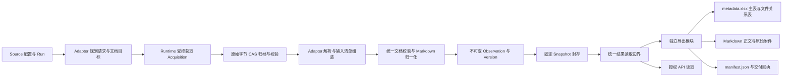

# 原生 Source Adapter 与统一文件交付

状态：设计合同，2026-10-19；代码实现与业务验收尚未开始。
本轮以本地开发为前提，直接采用新数据与结果合同，不设计历史数据迁移、双格式读取或兼容 shim。
当前代码基线为 `85a36b5`；本文中的新模块、字段和命令均为待实现设计。
[唯一可视化](../generated/source-adapters-delivery.html)随本计划同步更新。

## 目标与完整数据流

下游统一取得一份 `metadata.xlsx`、元数据对应的 Markdown 正文、原始正文及附件文件、
以及机器可校验的 `manifest.json`。成功入库、Snapshot 封存与完整文件交付分别记录结果。
一个业务文档可以使用多个外部输入，一个外部响应也可以产生多个业务文档。



数据只沿此链路产生；Adapter 不另设数据库、SQLite 队列、对象归档或交付真相。
运行数据位于根目录 `work/`，交付与验收工件位于 `artifacts/<运行名>/`，均不入库。
原始对象统一通过 S3/CAS API 访问，禁止直接读写根目录 `minio/`。

## 领域边界与依赖方向

| 边界 | 输入 | 职责与输出 |
|---|---|---|
| Source / Run | 已登记来源、配置、运行模式 | 冻结 Adapter、身份规则、解析器及预算；运行控制与 attempt fencing |
| Source Adapter | 冻结配置、已归档输入、文档目标 | 来源发现、分页、定位、请求描述、解析与字段映射 |
| Acquisition / Transport | 请求描述或其他受控外部获取描述 | 外部 I/O、限流与预算、CAS、数据库获取事实；不创建内容 Version |
| 统一文档与输入清单 | 解析候选、实际 Acquisition 引用 | 校验来源身份、字段、文件角色、定位与 Markdown，计算确定性指纹 |
| resources | 已校验候选与引用 | 独占 Resource 锁、幂等判定、Observation / Version 与当前指针事务 |
| Snapshot | 已提交成功 Version | 在一致视图冻结来源及 Resource → Version 映射，封存后不可变 |
| 统一结果读取 | 固定 Version 与 result_ref | 校验唯一新格式及其对象闭包，为 API、快照检查与导出提供相同内容模型 |
| Export | 显式 Snapshot、来源范围、输出目录 | 只读物化工作簿、Markdown、原件和 manifest，不触发采集或解析 |

依赖为 `configuration / runs → runtime → adapters / acquisition → document / resources`，
以及 `snapshots / API / export → 统一结果读取 → CAS`。采集模块不依赖导出与 API；
导出与 API 互不调用对方 HTTP 接口。来源逻辑复用已有 HTTP、PDF/OCR 和范围控制能力，
移除被替代的内部运行路径。外部来源代码仅复用端点、分页、解析与映射逻辑。

## Acquisition：受控外部原始数据获取

Acquisition 是一次受控的外部原始数据获取动作。绝大多数对应 HTTP 请求；
它负责取得并保存外部输入，业务文档解析与 Version 生成由后续边界负责。
同 URL 的两次实际获取是两条事实；相同字节可复用同一个 CAS 对象。
同一响应拆分出多个文档时复用 Acquisition，不为每篇文档伪造一次外部请求。

首期支持 `http` 与 `rendered_dom` 获取种类，不实现通用传输插件框架。
HTTP 保存传输层交付的完整响应实体字节，位于字符解码及内容清洗之前；
记录内容解压等表示规则，不宣称保存 TLS、分块传输或压缩前的逐字节网络流。
DOM 保存实际交给解析器的渲染后 UTF-8 字节，明确其表示种类，不称其为原始 HTTP 响应。
PDF、HTML、TXT、JSON、XML 等所有实际参与解析的输入均须完整归档并读回校验。

### 获取记录与状态机

| 数据组 | 必需语义 |
|---|---|
| 归属 | id、source_id、run_id、attempt_epoch、request_key、acquisition_kind |
| 请求 | 安全 request_url / actual_url、http_method、request_meta、父获取引用；非 HTTP 字段允许为空 |
| 表示 | mime_type、charset、representation、实际字节数、body_hash、archive_ref |
| 状态 | state、HTTP status / 获取 outcome、结构化错误码、started_at、acquired_at |

`request_key` 绑定方法、规范请求定位、影响响应的非敏感参数摘要及角色；不是只按 URL 去重。
需要会话的 Cookie、凭据、令牌和敏感表单载荷只进入受控运行内存，不写入记录或导出。
重定向、重试等实际外部请求需要独立事实与关联，不混淆为一次从未发生过的响应。
未完整取得的字节不得填入表示完整原件的 archive_ref。

```text
planned → running → archived
                  → failed
                  → cancelled
                  → abandoned
```

`archived` 仅表示完整原始字节已归档且引用已在数据库提交；HTTP 错误页也可以完整归档，
是否可解析另由 outcome 判定。失败前未产生完整响应时 body_hash / archive_ref 允许为空。
终态获取事实不可原位修改；重试创建新 Acquisition 并关联前次请求。
接管者可在事务内将失效 attempt 的 running 动作标为 abandoned，再创建自己的动作；
失效进程不得自行完成旧动作或推进队列。

外部 I/O 不持有数据库长事务。先取得与校验 CAS，再在短事务里检查当前 Source / Run / epoch，
提交获取状态。对象成功而数据库提交失败时允许存在尚无引用的 CAS 对象；不能出现成功记录
引用不存在或损坏原件。当前不引入对象 GC。

### Transport 的共同控制

请求、重定向、分页、robots 获取和重试全部计入冻结请求数与时间预算；
同时执行公开地址、域名与路径范围、robots、单响应字节数、并发、延迟和取消控制。
Source 显式配置的 robots 策略继续生效。重试有次数、退避和总预算上限，
可重放 POST 必须由 Adapter 明确声明其查询幂等语义。
JSON/XML 是否可处理由 Adapter 能力决定，增加 MIME 白名单本身不代表完成解析支持。

## Adapter、持久任务与恢复

Adapter 的逻辑合同包括 `plan`、`parse` 与 `plan_recheck`。
`plan` 接收配置、checkpoint、到期资源，产出请求描述和文档目标；Runtime 统一执行 acquisition。
`parse` 读取已归档输入，返回后续请求、文档目标或 0..N 个文档候选。
候选只声明实际使用的输入、角色和定位，不能直接写数据库或改变成功状态。
如果实现提供 `acquire` 便利接口，它只能委托 Runtime，不能执行另一条绕过控制的 I/O 路径。

一个持久目标键由 `run_id + 规范文档身份` 确定；发现阶段尚无文档身份时使用稳定请求目标键，
解析后绑定身份并校验重复。Runtime 为请求及文档目标分别管理有界队列和阶段状态，
checkpoint 只保存队列水位、活动任务引用和带 schema 版本的 adapter_state，
不把无限增长的 completed_acquisitions 全量列表放入 Frontier JSON。

```text
原文已归档 ≠ 文档目标已登记 ≠ 每个目标已形成成功或失败交付
```

列表页解析产生的后续请求及目标必须先持久登记，再推进页码或 cursor；
若分批登记，中途状态必须能从已归档页确定性重建剩余目标。
批量响应解析到一半或提交到一半退出，接管后重新读取原文，跳过已持久交付目标，补齐其余目标。
任何任务、水位、获取状态与内容提交均执行 attempt fencing；正常结束生成器不代表枚举完整。
已知失败、待处理、预算截断、选定范围枚举完成和全来源覆盖分别计数。
取消后不再提交成功内容；失败不能覆盖现有成功 Version。

到期 Resource 携带稳定身份、展示 URL、重检 locator 和当前 Version 交给 Adapter，
允许合并批量请求，再对各目标形成独立观察。预算按实际请求与输出目标分别限额，
不再把到期文档数等同于请求数。增量接口声明其覆盖范围、水位及失败语义；
没有可靠覆盖保证时，空更新列表不能替代已到期文档的复查。
判例、立法等类型的周期由来源证据与配置确定，不按类型一律永久免检。

## 身份、统一文档与输入清单

Resource 身份为 `frontier_id + identity_namespace + external_key`，三者均非空；
external_key 禁止空字符串。通用网页可以用保守规范化 URL 作键，专用来源优先官方稳定 ID。
public_url 是可空展示地址；重检通过独立 locator，不以展示 URL 或标题替代稳定身份。
不同输入表示可属于同一个业务 Resource；获取表示记录在 Acquisition 与输入清单，
不再要求一篇业务文档只有一个 body_hash 或 input_mode。

新结果只写入并读取 `seal.document.v1`，Version.result_ref 指向该对象。
不保留 CrawlResult 双格式兼容分支；原始 CrawlResult 可选存入诊断引用，
不参与下游公开模型，也不作为导出读取的必要前提。

| 统一文档字段 | 合同 |
|---|---|
| schema / identity | seal.document.v1；namespace、external_key、可空 public_url |
| metadata | title、document_type、language、issuer、jurisdiction 与可空来源字段；不推断填补未知值 |
| dates | published_at、effective_at、decision_at 等具名日期；来源更新日不能冒充发布日 |
| content.markdown | 成功候选必需的非空规范 Markdown 正文；是导出 .md 的固定 UTF-8 内容 |
| extraction | 原解析输出格式 text / markdown、实际 Adapter / parser 身份及 Markdown 转换合同 |
| tables / links / media | 经类型与边界校验的结构化内容，保持真实来源语义 |
| files | ref、role、original_name、media_type、byte_size、source_url、实际 locator |
| lineage | inputs_ref；可选 native_result_ref；诊断与运行信息不进入正文 |
| extensions | 经过来源 schema 校验的扩展字段，不直接公开任意上游字典 |

Adapter 产出纯文本时，由统一归一化边界执行固定的 Markdown 转换，保留文字、换行与段落，
转义影响呈现的元字符，不猜测标题或列表结构；转换合同进入 parser_fingerprint。
原始文本仍由 CAS 保留。`.md` 不使用有时效的下载能力令牌，文件对应由工作簿关系表给出。
导出器不再次解析原文、不重新清洗正文、不依赖当前最新版转换器重生成旧 Version 正文。

输入清单采用 `seal.inputs.v1`，每项记录 acquisition_id、archive_ref、role、
实际 locator 与影响解析的上下文。定位支持真实 JSON Pointer、带命名空间的 XML 路径、
PDF 页码及明确 HTML 选择范围；同一原件可以被多个文档引用，不编造独立官方原件。
定位规则、字符解码、基地址、输入角色及有语义的顺序都必须可复算。
整份原文归档用于审计，文档局部输入摘要用于版本比较；两者分别保存。
清单校验包含 Acquisition 归属、原件完整性、定位可解析、文档稳定键匹配与引用闭包。
正常采集只使用当前 Source / Run 的输入；离线重解析必须显式冻结同来源已有输入集，
记录复用事实，不伪造新的外部 Acquisition 或悄悄访问网络。

## 指纹、不可变提交与数据库合同

所有摘要使用带算法版本的具名 canonical JSON，固定 UTF-8、键排序与数值编码，拒绝 NaN。
无语义顺序的集合去重排序，有语义顺序的输入保留顺序；请求 ID、抓取时间与列表位置
不进入文档语义身份。局部切片还须纳入确实参与解析的外层元数据、编码与基地址，
不能用整个列表页摘要或最终 Markdown 摘要替代完整输入身份。

| 指纹 | 覆盖范围 |
|---|---|
| input_fingerprint | 当前文档实际输入切片、相关外层上下文、角色及顺序、附件摘要、解码与基地址 |
| parser_fingerprint | Adapter / parser、上游代码修订、统一输出与 Markdown 合同、实际生效的解析与 OCR 参数 |
| version_fingerprint | 算法版本 + input_fingerprint + parser_fingerprint |
| content_hash | 规范业务内容，包括元数据、具名日期、Markdown、结构字段及业务附件身份；剔除纯血缘描述与运行噪声 |

只与当前 Version 比较：版本指纹相同则 unchanged；变化则追加 Version，A→B→A 保留三版。
source_response 的整份响应 CAS 哈希、原文位置与 acquisition_id 属于血缘，不能作为局部文档
输入或业务内容摘要的替代；其他文档变化引起整个批量原件变动时，当前文档可以保持 unchanged。
业务正文文件与业务附件的字节身份参与比较，纯输入证据引用不冒充业务附件身份。
unchanged 的新 Observation 保留本轮清单与结果；当前 Version 仍固定其创建时的原文及定位，
不会因本轮新原件而重写。交付包逐字节一致性由固定 Snapshot 与 manifest 另行保证。
content_hash 相同仅表示规范业务内容未变；来源重排或解析器重算仍保留可解释的版本原因，
不据此断言法律效力或全部原始文字不变。同输入、同解析器而不同规范内容属于非确定性冲突。

`resources.py` 事务内执行 Source → Run → Resource 锁与 fence，提交 Observation、
新 Version、当前指针及目标交付标记；CAS 对象在事务前完成写入与校验。
同一 `run_id + resource_id` 保留一次规范交付；重放时同时校验输入、解析器与内容身份，
不能只比较 content_hash。后续相同语义的 Acquisition 作为追加的目标证据关联，
不合并或改写已提交 Observation、inputs_ref、Version 或 result_ref。
同键异输入或异内容明确记录冲突，不静默覆盖；多输入必须在首次提交前组装完整。

Observation 与 Version 均保留不可变规则。Version 通过
`(observation_id, resource_id, result_ref)` 约束其创建者与产物，
input_fingerprint / parser_fingerprint / content_hash 与实际清单和结果在提交边界核对。
成功观察有 inputs_ref 与 result_ref；失败可只有取得的原文证据，不伪造成功统一文档。
Snapshot 固定 Resource / Version 与必要来源信息，URL 可空；引用闭包失败则不能封存。

开发 schema 直接采用新合同，删除单响应外键及被替代的内部路径；不做存量回填、旧封装读取
或迁移过渡字段。已有 SQL 及 S3 内容不会因编写方案而被删除；实施验证使用独立新建环境。
本计划不增加开发库自动清空或自动重建命令。

## 统一读取、API 与必须同步修改的模块

| 模块 | 实施要求 |
|---|---|
| resources.py | 接收稳定身份、输入清单和统一文档；移除 URL-only 写入与单响应版本假设；同步调整唯一约束与 ON CONFLICT |
| public_results.py | 只校验 seal.document.v1，公开稳定来源 / 资源 / 版本 ID、Markdown、元数据及类型化文件投影 |
| result_query.py | 查询固定 Snapshot 的身份与版本；结果分页和附件下载共用新格式读取，不依赖旧 attachment_refs 封装 |
| archive / document 边界 | 唯一结果与输入清单校验器；校验引用的每个原件与可公开文件，而非仅清单对象存在 |
| sdk.py / pdf_runtime.py | 获取原文先 CAS；PDF 从校验过的 CAS 物化输入，不额外下载；DOM 表示显式记录 |
| configuration / runs / recheck | 冻结 Adapter、解析语义、队列与重检计划；取消 input_mode 绑定整条资源时间线的旧假设 |
| snapshots.py | 只读新模型并验证对象闭包，固定版本集合与来源元数据；不承担文件包生成 |
| 独立 export 模块 / CLI | 显式 Snapshot 读取、工作簿和文件物化、包校验、原子完成回执 |

统一读取模型不允许 API 与导出各自解释日期、正文或文件角色。API 继续白名单输出和实时授权；
文件能力令牌绑定 Snapshot、调用方、来源、资源、版本与逻辑文件身份，
不因数组重排改变所下载的文件。原始 CAS 存储位置与运行诊断不直接公开。
导出由本地显式 CLI 使用操作权限读取指定封存快照，无需先 publish；
它不改变 API 的 published_snapshot_id，也不通过鉴权下载 URL 反向取文件。

## 文件交付合同

```text
delivery/
├── metadata.xlsx
├── markdown/<resource_id>/<version_id>.md
├── originals/<sha256>.<ext>
└── manifest.json
```

只有一份工作簿，包含 `documents` 主表与 `files` 文件关系表；manifest 是此包的校验描述，
不是第二套来源台账或业务数据库。文件名使用稳定 ID 和摘要，标题只作元数据。
路径相对于包根目录，不含绝对工作区路径、CAS 凭据或有时效的 HTTP 下载令牌。

### metadata.xlsx

| 工作表 | 行粒度与字段 |
|---|---|
| documents | 每个选定 Resource / Version 一行；source_id、resource_id、version_id、namespace、external_key、title、document_type、language、issuer、jurisdiction、public_url、published_at、effective_at、decision_at、markdown_path、markdown_sha256、file_count、delivery_status |
| files | 每条文档版本与原文件关系一行；source_id、resource_id、version_id、file_ref、role、original_name、relative_path、media_type、byte_size、sha256、source_url、locator |

`documents` 以 resource_id + version_id 唯一；`files` 以文档版本、逻辑角色、file_ref 和 locator
区分真实关系，同字节同角色但不同定位不得丢失。file_count 统计去重后关联的物理原件数。
UUID、官方文号、前导零编码和来源文字按文本写入；缺失值留空，日期保持语义和精度，
外部字符串不作为 Excel 公式执行。超过单元格或工作表容量时明确失败，不能截断或另出第二份 Excel。
全量正文保存在 Markdown 文件，不塞进 Excel 单元格。

### Markdown、原件与文件角色

每条交付文档恰有一个固定 Markdown 正文。每条文档至少关联一份 `primary` 或
`source_response` 原件，其他文件可为 `attachment`；`derived` 明确表示派生文件，
不能替代或冒充原件。发现列表、验证码页面或登录壳不能充当正文原件。
HTML、TXT、JSON/XML、PDF 按来源真实形式保留；没有官方 PDF 不生成所谓官方 PDF。
DOM 原件明确标为 rendered_dom；不承诺其包含页面的所有图片、样式等外部资源。

一个批量响应可由多条文件关系指向同一个 originals 文件，并分别记录定位；
一篇文档的多个 PDF、附表和补充文件全部在关系表关联。扩展名来自已校验媒体类型，
不能只相信来源文件名；同一对象全包采用同一物理路径，矛盾媒体声明明确报错。
Source 必需正文附件尚未取得、必需输入解析失败或没有有效正文时，不形成可交付成功版本。
可选附件缺失记录为警告；“必需 / 可选”须在来源合同中明确，不能静默判断。
若共享响应包含超出所选授权范围的内容，导出明确失败，不能用派生切片冒充完整原件。

### manifest、校验与完成语义

`manifest.json` 使用 `seal.delivery.v1`，包含 snapshot_id、显式 source 范围、
文档 / 关系 / 原件计数、导出合同与运行时版本、所有载荷文件的相对路径 / 字节数 / SHA-256、
来源覆盖摘要与已知缺口。运行时间与包自身 manifest 哈希放入外部 CLI 回执，避免循环摘要。
manifest 的文件清单覆盖工作簿、全部 Markdown 与原件；不对自身计算内嵌哈希。

Snapshot 只含选定成功 Version，不能证明来源全量或本轮所有发现均成功。
快照同时冻结必要覆盖描述或其不可变引用；未知分母明确 UNKNOWN。
导出不得用当前可变 Run 状态补写旧 Snapshot 的覆盖结论。

导出先在同一文件系统的 `work/` 暂存目录生成，核对行数、唯一键、文件对应、定位、
字节数和哈希，所有载荷都通过后写 manifest 并原子移动至最终目录。
单文件缺失、损坏、超限或取消时退出失败，只保留明确标为未完成的暂存数据，
不发布可被误认为完整的 delivery 目录。已存在的最终目录只允许完全一致时返回幂等回执，
否则报冲突，不覆盖已有包。
同 Snapshot、来源范围与冻结导出运行时应生成相同路径及载荷字节；
工作簿内部时间戳、排序和文档属性固定，不把每次运行时间写入载荷。
导出只读 SQL/CAS，不发来源网络请求、不新增 Acquisition / Observation / Version、不切换发布指针。

## 实施顺序与目标命令

| 阶段 | 可运行交付单元 | 完成条件 |
|---|---|---|
| 1 | 新合同与完整现有路径 | 新 schema、Acquisition、输入清单、Crawl4AI 归一化、resources / public_results / result_query / Snapshot 同步切换，独立环境 collect → API 可消费 |
| 2 | 独立文件导出 | 固定 Snapshot → 一个工作簿、Markdown、原件与 manifest；离线校验、幂等和失败原子性通过 |
| 3 | 来源原生收编 | Vietnam Adapter 取代外部 SQLite 编排；再用一个真实 API/XML 来源验证多输入和多文档，并按入口地图登记配置 |
| 4 | 批量重检与恢复 | 合并重检、零网络重解析、半程崩溃接管、重复与冲突、预算截断和覆盖报告通过 |

阶段 1 中 schema 与读写模块是同一个可运行切换单元，不发布“只改唯一约束但保留旧写入”的中间态。
后续阶段每次仍通过实际最终文件交付验证，不以模块单跑或 HTTP 200 替代业务验收。
新来源先在[唯一入口地图](../reference/尽职调查核验入口地图.md)登记稳定 ID，再写配置运行。
已登记的 [dd-492](../reference/尽职调查核验入口地图.md#dd-492) 继续使用原 ID。

以下为目标 CLI 合同，当前尚不可执行：

```sh
seal collect sources/dd-492.yaml
seal snapshot create
seal export --snapshot <snapshot-id> --source dd-492 --output artifacts/<运行名>/delivery
seal export verify artifacts/<运行名>/delivery
```

`--source` 可重复；省略时选择快照全部来源，范围写入 manifest。
`export verify` 只读本地包，重新打开工作簿并核对关系、Markdown、原件和哈希，不访问 SQL/S3。
离线重解析使用显式冻结输入的新 Run，经同一校验与 resources 提交，具体 CLI 随实现确定；
不得复用会拒绝解析器漂移的旧 Run 去偷偷更换解析器。

## 验收要求与当前证据

本轮仅固化设计，由主 agent 检查 diff、文档链接及 `seiso check`。
实质实现由完全 fresh 子 agent 仅依据以下业务目标先定义失败方式，再在根目录 `tests/`
独立编写并运行端到端验收；使用独立 PostgreSQL / S3 环境、可控 HTTP 来源及真实 CLI。
测试代码不以实现内部结构为断言，CI 只做静态检查。

| 场景 | 外部可观察断言 |
|---|---|
| HTML / TXT / native PDF / OCR PDF | 原文可取回，正文与类型诚实，Excel 与 Markdown / 原件逐条对应 |
| 单 XML / JSON 响应产生多文档 | 文档主表无漏项无重复，多文档指向共享原件并能按真实 locator 复算 |
| 列表元数据 + 详情 + 多附件 | 组装同一稳定文档，必需输入齐备，文件关系与字节完整 |
| 列表重排 / 无关项变化 | 当前文档语义输入不变不升版；日期、编码、基地址等真实依赖变化可检出 |
| 无 URL / 同名原件 / 不同来源相同编号 | 稳定 ID、版本和包内路径仍唯一，API 与工作簿内容一致 |
| 归档后 / 提交半程 / 推进游标前崩溃 | 接管补齐剩余目标，失效进程不能写入，不改既有不可变结果 |
| 同轮重复与同键冲突 | 真正重放幂等；新获取证据可追溯；异内容失败而不覆盖 |
| 解析器升级与离线重解析 | 零来源网络，新版本可解释；同输入同解析器异输出明确失败 |
| Snapshot A 导出期间采集或发布 B | A 的工作簿、正文与原件一致，不混入 B；API 发布指针不被导出改变 |
| 原文 / 清单缺失、损坏、必需附件失败 | 不封存坏引用、不生成完整交付包，不把 partial 计为成功 |
| 重复导出、取消、容量及文件名边界 | 载荷可重复，工作簿不截断，既有包不被覆盖，失败无完整目录 |
| 移动包并断网验证 | 包内相对路径有效，主表与文件表及 manifest 对账，不依赖数据库或临时链接 |

验收工件至少包含实际命令、环境与数据前提、源码与测试哈希、断言结果、
SQL 状态 / CAS 摘要 / 工作簿行与文件对应证据，以及最终 delivery 和 verify 回执。
不得包含凭据、会话、私有存储路径或能力令牌。
真实来源验收另记录选定范围、已发现 / 原件取得 / 已解析 / 可交付数与未知覆盖，
不以合成用例通过代替公网来源质量证明。

当前结果：未运行上述业务验收，未生成真实交付包，未改变 schema 或运行代码。

## 相关设计与合同替代范围

实现后，本 Plan 的新原文归档、统一结果、身份和导出合同替代
[现有 CrawlResult 主链](unified-document-pipeline.md)对应部分，
[全局 Snapshot](global-snapshots.md)的固定版本与显式发布原则继续沿用，
并新增固定覆盖描述与统一读取校验。
[结果服务](results-api.md)同步切换唯一新模型；
[dd-492 发现与 PDF 编排](dd-492-pdf-harvest.md)由原生 Adapter 收编。
旧文档记录的是现有或历史实现，不作为本计划已经落地的证据。
