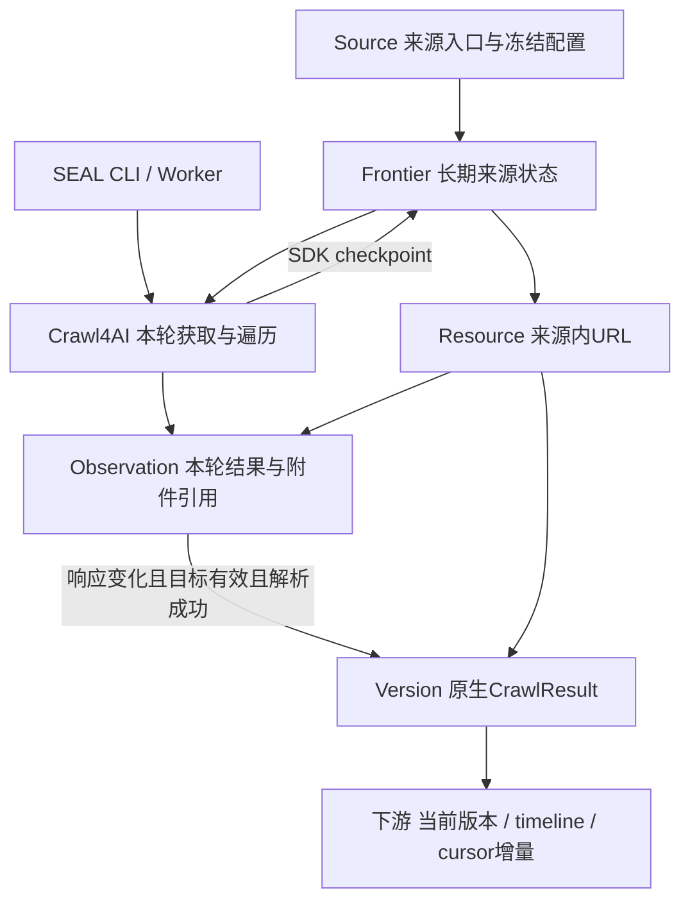

# Crawl4AI 来源采集与 URL 版本时间线

状态：Issue #17 已实施；Issue #20 已实施并通过独立业务验收。唯一派生物：[Generated](../generated/unified-document-pipeline.html)。
本计划替代 Document-only 目标；历史验收不代表本次存储合同。生产迁移未执行。

## Issue #20：本次存储合同与验收边界

业务目标是按来源入口组织完整 CrawlResult，MinIO 新写入仅包含结果 JSON 与原始下载附件。
输入 → SDK 获取阶段暂存同次输入 → SDK 解析并返回真实 CrawlResult → 结果/附件写入和读取校验
→ PostgreSQL Observation/Version 引用 → 下游按 Source/资源 URL 读取结果。

HTTP 在字符解码前计算 body_hash；rendered_dom 对获取阶段 DOM UTF-8 计算 body_hash。
两者是内容比较指纹，文本不单独归档，不能再用 Objects.get(body_hash) 读取文本原文，
也不能从重新编码 HTML 声称精确恢复原始 HTTP bytes。临时输入只留在内存或 SEAL_WORK_DIR，
PDF 从同次已捕获 bytes 的临时副本解析，不再获取第二份输入。网页 screenshot/pdf/mhtml
生成显式关闭；来源原始 PDF 属于附件，和网页导出 PDF 是不同合同。

Observation.result_ref 引用本轮完整 SDK 结果，成功、失败、unchanged 使用同一种结果编码；
Version.result_ref 与其原始 Observation 的指针相同。结果 JSON 为 result.model_dump 的
完整字段，响应头脱敏，downloaded_files 的路径替换为平铺 SHA-256 对象键列表；每个文件
可分别物化恢复。结果封装 attachment_refs 为原始文件 SHA-256 列表，包含同 Run/URL
此前 attempt 已取得但未交付的文件；不改 SDK result 的内容。Observation.attachment_refs
保存同一附件列表，SDK 未返回时也能留下可查询引用；仅为存储编码，不增加资源关联模型。
不再编码页面二进制 artifacts 字段，不兼容旧封装。HTTP 原始 PDF、
非 HTML/TXT 等附件或 Content-Disposition: attachment 的完整本体单独归档；SDK 解析失败
并丢失下载路径时仍由 Observation.archive_ref 引用原件。普通 HTML/TXT、DOM、policy
无独立 archive_ref。附件尚未完整获取时不将截断内容标成原始文件。

body_hash 与 archive_ref 不再等空，archive_ref 有值时必须等于同次输入的 body_hash。
先读回校验结果和所有附件再提交引用。失败与 unsupported 不生成成功 Version；正文相同
但本轮结果变化时 Observation 保存本轮结果、Version 保留原始结果；A→B→A 仍追加三版。
单 Run/资源交付幂等，跨 Run 新观察。完整结果不双写关系库；Run 的状态、统计、错误及
冻结配置留 PostgreSQL，不再写 manifest 对象或在 CLI 返回 manifest_id。

SDK 未返回结果前的中断/异常不造 CrawlResult。有已捕获输入时可形成 result_ref 为空的
失败 Observation，保留已取得的完整附件引用；未形成输入交付则由 Run/checkpoint 记录。
附件捕获信息进入 checkpoint，进程崩溃后不会静默丢失已取得的对象引用；恢复允许重取输入，
仍按本轮资源提交幂等。policy 只记录检查证据而不伪造结果或归档政策正文。
再次 collect 创建新 Run；恢复同一 Run 由 worker 接管。新 Run 替换 Frontier 检查点前，
旧 Run 未交付的输入与文件引用保存到旧 Run.report.undelivered_inputs；结束运行也保留
尚未交付证据。该字段只记录指纹、状态和原始文件引用，不存完整结果或临时正文，不把
旧 Run 文件混入新 Run 的 SDK 结果。未形成资源交付时可从原 Run 追溯文件。

追加 0012_minimal_archive.sql，保留已应用 SQL checksum；只允许旧内容为空的数据库升级，
不回填旧内容、重建旧结果、迁移旧对象或保持旧 timeline。删除旧结果回填和文件 CAS 导入
内部路径。旧 SQL 仅用于新库按 ledger 初始化；0011 不再调用历史内容迁移。现有空库通过
seal init --backup PATH 升级，新库和重复初始化沿用项目流程；不对本地已有服务执行升级。

实施分为临时输入/附件获取、结果与事务引用、空库 schema 升级、CLI/文档收敛；验收由
完全 fresh 子 agent 在 tests/ 独立实现，使用隔离 PostgreSQL/MinIO、work/ 与 artifacts/。
先列明文本误归档、失败推进、附件不同输入、指纹读取误用、返回前造结果、恢复重复提交、
不完整附件、对象缺失/损坏与升级部分提交等失败方式，再验证真实 CLI 全链路。覆盖 Issue
全部六项业务要求，产出复跑命令、环境数据前提、断言、SQL/对象/跨进程重建证据与源码哈希。
本次不扩展 Office/OCR、HTTP API、HTML/PDF 关联或浏览器下载交互；rendered_dom 沿用
不接受浏览器下载的配置，附件走既有 HTTP 资源路径。全站完整性始终 UNKNOWN。

## Issue #20 本次独立验收结果

完全 fresh 验收代理使用真实 CLI、独立 PostgreSQL/MinIO 和合成 loopback 来源完成
126 PASS / 0 FAIL；验收开始、结束、审核时的源码字节一致。覆盖 HTML/unchanged/失败、
同次 PDF 仅一次请求、unsupported 原件、DOM、A→B→A、已知资源复查、同 Run Worker
恢复与幂等、多 attempt 文件保留、无 SDK 返回、对象缺失/损坏/服务中断，以及空旧 schema
升级、新空库和重复初始化。新 Run 检查点交接覆盖原件缺失/损坏时拒绝切换、修复后将
证据保留于旧 Run.report，不混入新结果，并过滤已交付资源。

另对真实 E2E 导出的原字节工件复算 7 PASS / 0 FAIL：29份 CrawlResult 对象包含 SDK
全部29字段，原字节与 CAS 键一致；CLI 回执与全部 Run 行不含 manifest_id/ref/hash。
补充核验记录与原 E2E 的源码/测试字节一致，不以 SDK 重建补默认字段证明存储完整性。

```sh
uv sync --frozen
uv run --no-sync python tests/issue20_e2e.py
uv run --no-sync python tests/issue20_supplement.py artifacts/issue20-20261014-014931-f5a73d
uv run --no-sync python tests/issue20_concurrency.py --prior artifacts/issue20-20261014-014931-f5a73d
```

前提：Python3.12 冻结依赖、Docker、已安装 Chromium、pg_dump/pg_restore；预先存在
postgres:17-alpine、seal-minio:RELEASE.2025-10-15T17-29-55Z，以及测试固定摘要的 minio/mc
镜像。空旧库由基准3215759176db9240bdb0bf0b0fa6a12512c801fc的真实CLI初始化，Git须
有该提交。脚本自己启动隔离服务、创建随机凭据并清理自身容器；不读取现有SEAL环境、
不清理根minio或既有数据库。所有来源和附件为合成授权输入，无敏感信息进入工件。

主工件：artifacts/issue20-20261014-014931-f5a73d/，包含summary/assertions、commands、
environment（源码和测试SHA）、SQL、真实S3结果原字节、对象分类与哈希、跨进程重建，
同Run恢复/新Run交接/无结果/多附件和故障证据。独立审核与修复记录在
artifacts/issue20-review/；首轮错误测试前提的仲裁在artifacts/issue20-arbitration/，
它是离线证据判断，不计入业务PASS。审核发现的附件引用、Linux长文件名和空库门禁已修复。

上述126项中的多入口collect先后获取只证明资源原件不串线；独立追加公开CLI recheck
真实并发补验25 PASS / 0 FAIL，工件artifacts/issue20-20261014-015729-0b7b01/。两个请求
开始时差0.000237秒、服务各延迟3秒，证明实际重叠；相同RFC5987长Unicode建议名下，
两个PDF的原件、SDK下载文件、Markdown、Observation、V2及当前指针各自对应正确，
新进程逐字节验证。补验及原126项源码相同，原测试未改；名称解码为844 UTF-8 bytes，
实际临时路径使用摘要和短后缀。公网来源、全站完整性、
生产升级、OSS、Office/OCR和浏览器下载交互未验证；既有本地服务未升级。主代理Ruff、
seiso、打包通过，旧SQL checksum不变；CI仅做静态检查。

## 目标、领域边界与产物流向

SEAL 负责来源配置、周期触发、运行恢复、结果/附件归档与资源时间线；Crawl4AI 0.9.4
负责每轮请求调度、递归遍历、获取与通用解析。下游直接消费 CrawlResult，不转成自定义
Document AST，不新写 Document/Revision/Emission/document_reference。外部周期调度
仍通过四命令触发；不提供替代 Crawl4AI CLI 入口，不引入另一套内部 URL Scheduler。



Source:Frontier 为 1:1，Frontier:Resource、Resource:Observation、Resource:Version
均为 1:N。同 URL 在不同 Source 独立；唯一资源身份为 frontier_id + URL，保留查询参数
及其顺序，移除 fragment。重定向实际 URL 记在 Observation，不静默合并资源。
Source 使用地图 dd-xxx；UUID、cursor、内容哈希保留各自语义。地图不是采集许可。

## 模块职责与依赖方向

| 模块 | 实际职责 |
| --- | --- |
| cli / configuration / config | 四命令与严格 YAML；冻结 Source 配置及 config_hash |
| runs / queue / run_state | Source 会话锁、Run epoch/generation、子进程、取消、有限恢复 |
| crawl | 装配 SDK、消费 streaming CrawlResult、保存 framework checkpoint |
| sdk / robots / scope | 薄 HTTP/DOM 获取适配、范围与 robots 边界、SDK HTML/PDF scraper |
| resources | 来源内资源身份、事务 Observation/Version 提交与去重 |
| archive / objects / core | CrawlResult 存储编码、S3 bytes CAS、哈希校验与临时文件物化 |
| completion / manifest / progress | Run 终态、无敏感内容的 JSON 统计、stderr TTY 面板 |
| db / migration | PostgreSQL 基础与追加迁移、清单、备份校验 |

依赖方向为 CLI→配置/生命周期→SDK与资源提交→数据库/CAS；core、scope 和 run_state
不依赖上层。Scrapy、Recipe 打包、Binding 执行和旧五节点 AST 模块及其共用 recipes/
已删除，不存在 shim 或双写。历史实验、原文与迁移保持原样；实验旧源码不代表当前能力。

## Source 配置与兼容边界

[最小模板](../../examples/source.yaml) 是当前配置入口。旧 YAML 含 recipe 时明确报
legacy_recipe_config_requires_migration；不静默忽略原有分页、表单、字段或输出合同。
CLI 命令/选项保持，YAML 与 JSON receipt 是有版本的不兼容变更。

```yaml
id: dd-017
entry_urls: [https://example.org/]
allowed_hosts: [example.org]
allowed_path_prefixes: [/]
archive_approved: true
scope: Authorized bounded collection after source review
robots: true
recheck_seconds: 86400
concurrency: 2
budget: {requests: 100, seconds: 120, response_bytes: 10485760}
crawl4ai: {mode: http, max_depth: 3, page_timeout_ms: 30000, word_count_threshold: 1}
```

入口可以多个；host_path_scopes 可按 host 缩小路径。robots 默认 true；缺失政策404/410
被明确记为缺失，其余政策错误拒绝业务请求；业务与政策请求均计预算。robots:false 只能
在来源审查与授权后使用。HTTP 重定向逐跳检查范围，DNS 解析地址拒绝非公网地址；
隔离验收显式设置 SEAL_ALLOW_LOOPBACK=1。浏览器子请求与重定向通过 Chromium Fetch Request 阶段逐跳检查 host/path、robots 和
请求预算；被拒绝记录错误，不宣称整页所有 CSS/JS/图片/API 均被归档。浏览器 URL 检查
不构成操作系统网络沙箱，部署仍需网络出口约束防 DNS 重绑定。

首版仅固定公开 GET 上下文，不带用户浏览器状态或隐式登录；旧 POST/ASP.NET 表单、
来源专用分页规则尚未迁入。旧配置不能作为当前兼容入口。合法会话、可信来源 hook、
Office/OCR 等未来扩展需独立实证，不恢复 Recipe 包/Binding。

crawl4ai.mode 可选 http 或 rendered_dom。http 对 aiohttp 获取阶段 Content-Encoding
解码后的正文 bytes 计算指纹，先于字符解码与 SDK 解析；文本不作为独立对象持久化。
rendered_dom 对 SDK 获取阶段渲染 HTML 的 UTF-8 bytes 计算指纹并显式标记模式。已有成功
Version 后切换模式报 input_mode_change_requires_new_source，禁止混合比较。
配置还支持 page_timeout_ms、word_count_threshold、css_selector、wait_until；
blocked_patterns 可补充来源阻拦检测。无自动登录、凭据刷新或验证码求解。

robots 使用 Protego 的最长匹配规则，较具体 Allow 不因前面的宽 Disallow 被误拒绝；同一
Source 的政策与业务请求均发送配置 user_agent。403 政策仍拒绝业务请求；SDK 错误分类
只读取诊断前缀，不能将后附源码上下文中的其他错误码当作真实失败原因。

SDK 0.9.4 会将有正文的短 HTML 判为 minimal_text 阻拦页；仅对该尺寸启发式且有
p/h/main 正文结构的页面，以 SDK fallback 回调复用同次捕获的 HTML，不新增请求。
SDK clone 会丢失此回调，薄 RunConfig 仅修复该字段传递；升级至修复版本后可删除。
密码/挑战标记仍拒绝。CrawlResult 响应头中的Cookie/授权敏感值脱敏。

## 资源、观察与版本合同

| 对象 | 公开字段与约束 |
| --- | --- |
| source | id、config、generation、run_seq、write_seq、paused、cooldown_until；沿用旧来源身份 |
| frontier | id、source_id UNIQUE、run_id、checkpoint；长期来源状态，非框架原生服务 |
| resource | id、frontier_id、url、role、current_version_id、last_checked_at、last_outcome、next_check |
| observation | id、resource_id、run_id、attempt_epoch、delivery_key、url、actual_url、status、body_hash、archive_ref、attachment_refs、result_ref、input_mode、outcome、error、version_id、observed_at |
| version | id、resource_id、sequence、observation_id、body_hash、input_mode、result_ref、framework_version、parser_config、cursor、created_at |

结果与完整附件通过 S3 API 归档后校验 CAS 再提交关系引用；只有附件有 archive_ref，
此时 archive_ref=body_hash。对象键为完整 64 位 SHA-256，平铺于配置的私有 bucket。
文本 body_hash 是输入指纹，不能当对象读取。Source 与对象关系由数据库维护，
相同内容可跨来源复用对象；MinIO 内部磁盘布局不属于应用接口。Observation 与 Version 不可变，
复合 FK 约束资源、版本、原始观测、body_hash 与模式归属。一次 run/URL 仅提交一次；
checkpoint 恢复的重复交付不追加版本。不同 Run 每次形成新 Observation。

| 输入情况 | 结果 |
| --- | --- |
| 首次有效内容且解析成功 | Observation + V1，推进资源指针 |
| 解析成功且响应等于当前成功版本 | 新 Observation，outcome=unchanged，关联旧版本 |
| 响应变化且解析成功 | 新 Observation + 连续 Version，推进指针 |
| 响应变化但解析失败或不支持 | 保存实际返回结果及已有附件，失败 Observation 不推进；下次新 Run 重试 |
| 网络错误、403/429、登录/挑战页 | 保存失败/blocked 结果，不生成内容版本；SDK 未返回时 result_ref 可空 |
| 仅更新解析配置或框架 | 正文相同则仍关联旧版本，不追加内容增量 |

比较基准始终是当前成功 Version 的正文。A→B→A 为 V1→V2→V3，CAS 可复用 A。
版本时间是发现变化时间；不推定网站修改时间。有效资源逐个事务提交，即便本轮其他 URL
失败也保留已提交结果；Run.complete 仅表示本轮有界处理无错误，whole-site 始终 UNKNOWN。
阻拦检测组合 SDK 结果与密码输入、验证码标记、登录/挑战标题和配置规则；无证据时不宣称
任意站点挑战均可识别，人工业务质量保持 not_evaluated。

## CrawlResult 与格式边界

冻结 crawl4ai[pdf]==0.9.4 与 uv.lock。HTML/TXT 使用 SDK LXML scraper；HTTP PDF
使用同次捕获 bytes 的临时副本交给 SDK PDFContentScrapingStrategy，避免再次网络下载
不同输入。无 OCR；无文本层 PDF 不创建成功内容版本。DOCX/XLS/XLSX/
CSV/JSON/图片首版尚无语义解析保证，标记 unsupported/parse_failed 并保留完整下载本体，
不能沿用九格式 Document 的历史支持声明。动态 DOM 模式以 HTML 为目标。

完整 CrawlResult 仅保存 MinIO JSON 对象：result 为 SDK model_dump（包括完整 Markdown、links、
media 等），downloaded_files 以 CAS 哈希列表替换临时路径。网页 pdf/screenshot/mhtml
禁止生成，不写 artifacts 外置对象。Observation.result_ref 直接引用本次结果对象，Version.result_ref
引用产生版本的 Observation 的同一对象，复合外键保证原始观察与版本的结果引用一致。
下游先查询 Version.result_ref，再读取对象并重建 SDK 结果：

```python
from seal.objects import Objects
from seal.archive import deserialize_result

result = deserialize_result(Objects().json(version_row["result_ref"]))
```

下载副本放入可丢弃的 work/；这是编码封装，不是自定义内容 AST。链接只保留 SDK URL 引用，
不建立 document_reference 外键，也不承诺目标已获取或绑定历史版本。

每次 SDK 交付均保存本轮结果，包括失败与 unchanged。正文不变但结果变化时，新的 Observation
引用本次结果，Version 保留首次结果；结果字节完全相同则 CAS 复用。policy 请求不产生
SDK CrawlResult，result_ref 可空。SDK 未返回结果时不伪造诊断，已取得附件由检查点或
失败 Observation 保留引用。失败不进入内容增量。SDK 异常结果可能没有 status_code 或 html，
真实获取状态以 Observation 为准；附件可从 archive_ref 取得，文本原始字节不再持久化。
Run.report 不维护 crawl_results 映射，也不含 manifest_id。

## 历史 0011 合同与结果指针验收

以下为 Issue #20 之前的合同和验收记录，不作为当前升级、归档或复跑入口。

0011_result_references 为追加迁移：升级前停止数据库客户端并执行
`uv run --frozen seal init --backup work/result-refs-before.dump`；备份路径须尚不存在。
先将旧 Version JSON 写入 MinIO，验证结果和关联二进制对象；旧 Run 映射引用也须可读、哈希正确。
成功后在同一数据库事务内回填指针、添加约束、删除 version.crawl_result 与 Run 映射，重建两个
下游视图。ID、时间、sequence、cursor 和旧 MinIO manifest 保持原样。失败则数据库事务回滚，
可在修复对象后重试；已上传但未引用的对象可能残留，不自动删除。历史版本结果与旧观察引用冲突
时拒绝迁移。下游 SQL 必须改为查询 result_ref 并读取 MinIO，旧 JSONB 字段不保留兼容层。
回滚须停客户端、恢复升级前数据库备份并使用旧程序；对象桶须保留配套归档，不支持逆向 SQL 自动降级。
二进制外置后使用 Pydantic JSON 编码，PDF metadata 中的 datetime 保留为 ISO 日期字符串，
不因 Python 原生值无法写入 JSON 而中断采集。

2026-10-13 按 playgroud 旧业务范围进行公网有界复现：法院前10页及200详情、海仲栏目
及6PDF（424页）原文核对通过；公募17个原生JSON分页的165行和教育部2XLS原文已获取，
语义解析仍 unsupported，不能把入口HTML成功视作目录或工作表验收通过。操作脚本从
本轮归档推导显式种子，max_depth=0；不声明框架自动接替旧来源专用发现。476份本轮SDK
结果可跨进程重建；独立原文/SQL/SDK核验5009项，2项失败恰为JSON/XLS语义缺口。日常
运行及证据在根目录 work/、artifacts/，旧历史原文和配置不重写。

### 历史结果指针独立验收

业务验收由 fresh 子 agent 独立编写 `tests/result_refs_e2e.py`，先明确引用串联、unchanged
误推进、失败推进、历史映射冲突、对象缺失/损坏、迁移部分提交与历史字段漂移等失败方式。
复跑：`uv run --no-sync python tests/result_refs_e2e.py`。前提为项目已安装冻结依赖、Docker
可用且本地有 seal-minio:RELEASE.2025-10-15T17-29-55Z / postgres:17-alpine 镜像，以及
pg_dump/pg_restore。测试使用隔离服务、work 挂载和 loopback 合成来源，随机凭据不进入工件。

覆盖实际 CLI collect/recheck → SQL 指针 → MinIO JSON → 新进程 SDK 重建，正文未变而
结果变化、失败不推进、完整 Markdown/HTML 与附件字节恢复。迁移夹具来自
实际 CLI 采集的数据，并恢复为0010列与ledger合同；不是运行历史checkout的兼容证据。
验证缺失、损坏和映射冲突的原子回滚，实际 pg_restore 恢复备份并对比旧数据；升级保留
ID/时间/sequence/cursor，manifest 字节不变，重复init不改数据与对象。
最终59 PASS / 0 FAIL，工件 `artifacts/s3-storage-20261013-234757-db3f2/`：summary、assertions、
commands、environment（源码/测试/迁移哈希）、升级前后SQL、对象哈希清单与重建结果。
2026-10-14 本地空库已备份并升级至0011，桶内也无对象；无既有引用可逐条核验。本地升级回执与验证记录在
`artifacts/local-result-refs-upgrade-20261014/`，备份为 `work/local-result-refs-before-20261014.dump`。公网来源、浏览器DOM与真实附件生成路径不在本次范围；附件恢复使用
独立构造的存储封装。policy空结果及历史附件缺失导致迁移回滚尚未覆盖。

## 发现、复查、取消与恢复

collect 每轮从入口重新建立 visited；recheck 冻结 next_check 到期的已知 content Resource，
即便已从导航消失也复查。无到期资源返回空结果；超过复查预算明确拒绝，避免默默裁剪。
一个 Source 始终只有一个 Frontier，上一轮记录不作为新轮永久排除集合。

运行获取 Source 的 PostgreSQL session advisory lock，同时持有 Run 锁；不同 Source
允许独立执行。子进程只负责 SDK；父进程监控拥有者连接、generation、epoch、暂停和预算。
前台 Ctrl+C 保存 retryable 状态与 checkpoint、退出130；Worker 通过显式任务取消信号停止
执行中的子进程并保留恢复状态，也输出单JSON/130。父进程崩溃后子进程组自动终止，
Worker 按任务心跳和有限 attempt 恢复，默认超过30秒无心跳后回收；
worker --once 只消费当前就绪任务，不会在仍有效心跳窗口内抢占 doing 任务。SIGSTOP 期间锁仍有效，不能超时夺取一个仍持锁
执行者。数据库会话丢失后父进程终止子进程；接管后的旧 epoch 不得写入。

SDK 0.9.4 BFS 流式 checkpoint 只保存 next_level，会遗漏当前层尚未 yield 的 URL。
SEAL 将 visited 中尚未持久交付的 URL 和获取阶段 inflight 补回 SDK pending；已提交但尚未
保存发现状态的输入允许重复获取来重新发现链接，提交依 run/URL 幂等。checkpoint 与资源
事务不是原子提交，不声称 exactly-once 网络请求；budget 覆盖恢复重复请求。

请求次数在获取阶段有界，含错误、robots、redirect 与浏览器子请求；SDK max_pages 流式
边界会在 yield 前截掉最后一个成功结果，首版不使用该边界，实际网络预算负责上限。
有限预算、深度和范围仅界定可发现覆盖；孤立页、表单分页、鉴权阻拦均可能遗漏。

## CLI、环境、下游与迁移

```text
seal init [--backup PATH] [--acknowledge-data-loss]
seal collect source.yaml [--enqueue] [--no-progress]
seal recheck source.yaml [--enqueue] [--no-progress]
seal worker [--once]
```

Python3.12；uv sync 安装依赖；DOM 模式另运行 uv run python -m patchright install chromium。
本地使用 MinIO 对象存储与独立 PostgreSQL。根目录 `minio/` 挂载到 MinIO `/data`，仅由
服务管理；来源配置为 `sources/dd-xxx.yaml`。`work/postgres/` 为这套本地测试数据库数据，
`work/seal/` 为下载/PDF/SDK 临时文件。`work/` 与 `artifacts/` 始终是中间产物；本地测试
可重置，但需一起重置对应数据库与桶，以免遗留悬空引用。继续复查/保留历史时须配对备份。
自动验收使用另外的隔离服务与 work/artifacts 目录，不碰根 minio 数据或已有数据库。

```text
uv run --frozen python -m seal.local_storage
set -a; source .env.local; set +a
uv run --frozen seal init
uv run --frozen seal collect sources/dd-017.yaml
uv run --frozen seal recheck sources/dd-017.yaml
# 暂停服务但保留本地测试数据
docker compose --env-file .env.local down
```

构建 Dockerfile 与限定桶 policy 集中内嵌于 compose.yaml，不另建 tools/infra 目录；
辅助运行命令位于 src/seal/local_storage.py。

启动脚本不初始化/迁移数据库，不覆盖已存在的 `.env.local`，不删除数据。Compose 仅监听
127.0.0.1，默认 S3/Console/PostgreSQL 端口为19000/19001/15432。MinIO 使用官方
RELEASE.2025-10-15T17-29-55Z 源码构建，版本包含当时安全修复；应用账号仅获 seal-archive
桶 ListBucket 与 GetObject/PutObject 权限，无删除、建桶或管理权限，管理凭据仅供服务初始化。
[官方 release](https://github.com/minio/minio/releases/tag/RELEASE.2025-10-15T17-29-55Z)。

| 环境变量 | 合同 |
| --- | --- |
| SEAL_DATABASE_URL | 关系数据库连接，保持现有语义 |
| SEAL_S3_ENDPOINT | 对象 API endpoint，http/https，无账号、路径、查询或片段 |
| SEAL_S3_BUCKET | 预先建好的私有桶；init 不自动创建部署桶 |
| SEAL_S3_ACCESS_KEY / SEAL_S3_SECRET_KEY | 显式限定桶凭据，不从 AWS 凭据链隐式选账号 |
| SEAL_S3_REGION | 默认 us-east-1；S3 v4 签名与 path-style 寻址 |
| SEAL_WORK_DIR | 本地临时工作目录，默认 work/seal，不存持久原文 |

删除 SEAL_ARCHIVE 与文件 CAS 内部实现，不保留本地回退或双写。旧变量存在时明确报错。
旧文件 CAS 导入和结果回填路径已删除。本次没有旧内容兼容或旧对象迁移入口。

条件 PUT（If-None-Match: *）避免覆盖同键对象；重复/并发已存在时 GET 复算，损坏对象
明确失败而不修复覆盖。S3 connect/read timeout 为3/10秒，SDK至多2次尝试；不吞错或无限
重试，不把 ETag 当作 SHA-256。响应流必关闭；本地物化经校验与原子写入，文件权限600。
SDK 子进程在导入前设置独立 run/epoch 的 CRAWL4_AI_BASE_DIRECTORY，SDK 数据库/log 也
进入 work/，不将其当作业务关系数据库。init 及 collect/recheck/worker 先检查桶可用；
init 前置检查失败不改数据库，队列表按连接实际 search_path 查找并在回执返回实际 schema，
账号名与 seal schema 同名时重复 init 也不重复建表。跨系统不做伪
事务：先归档验证再提交 DB 引用，数据库失败可能留下无引用对象，但不得反向留下未归档的
成功版本；不自动垃圾回收。运行中服务失效会明确失败或保留待恢复状态，不宣称完成。
本轮仅验证 MinIO 的 S3 合同；阿里云 OSS 的认证及兼容性尚未验收，不宣称可直接切换。

SEAL_DATABASE_URL 与 SEAL_S3_* 通过环境传入。CLI stdout 每次仅一份
JSON；collect/recheck 使用 seal.receipt.v3，init 返回初始化与迁移清单，worker 返回停止/取消
回执。前台采集的 stderr TTY 显示资源进度；业务失败退出1，参数/配置失败退出2，中断130。
receipt 的 binding_id 移除，新增 config_hash，报告资源/Observation/Version统计；旧回执
和冻结配置保留历史语义，SQL 下游不可假定旧 Document 输出列仍代表当前写入。

```sql
-- 当前资源版本；按 Source/URL 使用参数化 SQL
SELECT * FROM seal.current_resource_version WHERE source_id=$1 AND url=$2;
-- 一个资源完整 timeline
SELECT * FROM seal.version WHERE resource_id=$1 ORDER BY sequence;
-- 失败 Observation 不进入增量；cursor分配至提交受全局事务锁保护
SELECT * FROM seal.version_delta WHERE cursor>$1 ORDER BY cursor LIMIT 100;
```

新库初始化按历史 ledger 顺序建库至0012，已登记 SQL 的名称/字节不修改。当前升级仅接受
内容表为空的旧库；非空返回 archive_contract_upgrade_requires_empty_content，不迁移内容。
空库升级须停 Worker 与所有数据库客户端并使用 seal init --backup <私有备份路径>，
pg_dump / pg_restore --list 校验成功后在事务内应用追加 schema。回滚须停客户端并恢复
升级前数据库备份、使用配套旧代码，不支持逆向 SQL 自动降级。既有本地和生产服务不在
本 PR 的升级操作范围。旧 YAML 仍需改为当前配置；不提供 AST 或旧存储兼容层。

## 历史 S3 对象存储验收（Issue #20 之前）

完全 fresh 子 agent 在 tests/ 独立编写并使用真实 loopback HTML/PDF、隔离 PostgreSQL 与
MinIO 执行。所有 CLI 与对象 API 使用限定桶 List/Get/Put 账号；管理账号仅用于独立环境
初始化、损坏/缺失注入及证据读取。固定镜像前提由 seal.local_storage 的源码构建满足；
自动验收另挂载 work/<run>/minio，不碰根 minio 数据和已有数据库。

```text
uv sync --frozen
uv run --no-sync python tests/s3_storage_e2e.py
uv run --no-sync python tests/s3_storage_restart_dom_e2e.py
uv run --no-sync python tests/s3_storage_named_owner_e2e.py
```

最终源码上的基础72项通过（0 FAIL）：collect/recheck/worker → SQL 关系 → S3 实际
原文/hash、结果跨进程重建；变化与不变；并发/重复条件写入；缺失/损坏/鉴权/不可达明确失败，
init 错误不写库；旧CAS导入保原生键与原文件且可重跑；下载本地副本删除后可重新从S3恢复。
限定账号删除、其他桶访问与用户管理被拒绝。额外以真实 rendered_dom 和 MinIO 重启验证
实际DOM字节/新进程重建及配对SQL关系；命名账号seal验证重复init与队列实际schema。

最终三组端到端结果（本轮源码哈希在每组开始/结束一致）：

| 运行 | 断言 | 工件 |
| --- | --- | --- |
| S3 全链路与故障边界 | 72 PASS / 0 FAIL | `artifacts/s3-storage-20261013-230545-25c63/` |
| seal 同名账号重复初始化与 worker | 14 PASS / 0 FAIL | `artifacts/s3-storage-20261013-230550-3ed0e/` |
| 真实 rendered_dom 与 MinIO 重启恢复 | 18 PASS / 0 FAIL | `artifacts/s3-storage-20261013-230551-fa945/` |

各组共享部分权限断言，数量不是独立业务场景数。命名账号用例先复现第二次 init 的
ConnectorException/DuplicateObject，再修复并复跑；本次不新增 SQL 迁移。实际 SDK 缓存
文件位于 work 内的独立 run/epoch 路径，见 sdk-work-files.json；本轮未产生独立 SDK
日志文件，不宣称日志落盘已获实证，命令 stderr 保留。全 SDK 系统调用级磁盘审计未执行。
根本地服务建立并初始化到新数据库，重复 init 的 applied 为空；操作回执在
`artifacts/minio-local-setup/receipt.json`，这是启动证据，不代替以上独立业务验收。

工件保存环境、固定镜像、源码哈希、各次命令回执、对象清单/hash、SQL结果与断言，均在
artifacts/<运行名>/，敏感凭据不入工件。范围不扩展到公网来源、真实浏览器下载/截图生成、
既有生产迁移或阿里云OSS；不把历史427项当作本次回归证据。

目录收敛后，主 agent 复用独立 agent 编写的 S3 端到端脚本验证新模块入口，
72 PASS / 0 FAIL，工件 `artifacts/s3-storage-20261013-232555-fb288/`；本地启动命令重跑成功。
原三组验收工件保持原样，本次未修改归档或版本业务行为。

## 历史 Crawl4AI 初次替换验收与证据

以下为文件 CAS 阶段的历史结果与运行前提，旧脚本不作为当前 S3 验收入口；当前运行命令
见上一节。历史数字与工件保持原样。


完全 fresh 子 agent 仅依据 Issue #17 业务目标在根目录 tests/ 编写真实 CLI/HTTP/PDF/
PostgreSQL 验收，临时数据 work/、工件 artifacts/。不在实现后补写单元测试；CI仅 Ruff
静态检查。应覆盖同URL来源隔离、变化/不变/A→B→A、解析失败后相同bytes重试、错误响应/
挑战页、正文hash/CAS、跨进程CrawlResult、递归新轮/孤立资源、Worker、TTY/Ctrl+C、
崩溃恢复与幂等、旧执行者栅栏、旧库备份恢复、模式/格式边界。实际命令、环境、冻结版本、
数据前提、断言和证据须可重复生成，不包含凭据；本次最终完整端到端运行 `uv run --no-sync python tests/issue17_e2e.py`：427 PASS / 0 FAIL / 0 UNVERIFIED。

验收执行分工：

| 检查 | 执行者 | 结果与含义 |
| --- | --- | --- |
| 完整真实用户路径 E2E | 完全 fresh 的独立子 agent；未阅读或修改实现源码 | 427 PASS / 0 FAIL / 0 UNVERIFIED，限于下述隔离样本 |
| 固定旧版本迁移补验 | 同一独立验收子 agent | 22 PASS，实际备份还原与原文/旧字段核对 |
| 项目 Ruff、seiso、打包和 diff | 主 agent 自验 | 静态与包装检查通过，不替代业务验收 |
| CI Ruff | GitHub Actions | 对 PR 精确 head 执行静态检查，不运行业务验收 |

上述业务证据对应运行代码提交 `62776cb`；后续纯文档同步不改运行代码，也不视为重新执行
业务验收。主 agent 根据验收失败修复实现，由独立验收子 agent 再执行真实路径。

工件目录 `artifacts/issue17-20261013-175357-a77b7/` 的 summary.json、assertions.json、
commands.json、oracle.json、各次JSON/TTY回执、fixture请求时序、数据库导出、CAS hashes、
跨进程读取回执与实际备份恢复记录构成证据。失败调试工件原样保留，不代替最终结果。

环境：Python3.12、uv.lock、Crawl4AI0.9.4、Chromium153、独立Docker PostgreSQL17、
loopback合成HTTP/TXT/PDF/JavaScript来源；不使用生产数据库、用户浏览器状态或凭据。
复跑先 `uv sync --frozen` 与 `uv run python -m patchright install chromium`，需要Docker、
pg_dump/pg_restore；脚本每轮新建 work/artifacts 和独立库，Worker崩溃恢复真实等待31秒。
迁移fixture默认固定旧提交04a50e59170dd592b4756ae9c048bd21a87f79b6，可用 --legacy-ref
显式选择其他兼容旧前提；不是用未来HEAD伪装旧环境。固定旧ref的迁移补验另通过22项，工件 `artifacts/issue17-20261013-175737-0b33f/`；
实际不带data-loss确认升级成功，pg_restore及旧字段/原文核对通过。公网真实站点适配、Office/OCR/专用
表单、全站覆盖与生产升级未验证或未支持，427项通过不扩展这些边界。

官方依据：[Deep Crawling](https://docs.crawl4ai.com/core/deep-crawling/)、
[Hooks/Auth](https://docs.crawl4ai.com/advanced/hooks-auth/)、
[CrawlResult](https://docs.crawl4ai.com/api/crawl-result/)、
[PDF](https://docs.crawl4ai.com/advanced/pdf-parsing/)。本次适配依冻结版本源码与真实样本，
文档名称不作为覆盖或保真证明。Issue #16 的旧Document-only血缘问题不扩展到新内容模型。

## PR #14 历史实现与验收结果

2026-10-13 已按用户明确要求删除该旧链路的本地原文、导出、冻结配置及验收工件。
以下数量为当时的记录，不能从当前工作区复算；当前 Crawl4AI 复现产物完整保留。

[PR #14](https://github.com/nanzhi84/SEAL/pull/14) 收敛了统一入口，删除旧输出及专属测试；
手写运行代码和本次验收脚本均小于 500 行。历史 schema.sql / 0002–0008 无改动，
历史原文、冻结配置和结果不重写。该轮验收只调用四命令与 PostgreSQL，未执行生产迁移。
以下结果是合并时的历史证据。其固定测试及验证脚本现已删除，不作为当前验收入口。

| 节点 | 输入与实际命令 | 实际结果、输出及下游用途 |
| --- | --- | --- |
| Collect / Parser | 九格式、五节点、所有保留 Adapter 的固定合成 HTTP；真实 collect YAML | 467 项 E2E 断言 PASS，SQL 保存文档与失败诊断；覆盖分页、API、iframe、POST nonce、压缩响应，后续用于 Recheck 和查询 |
| Run / Worker / TTY | --enqueue、worker --once、真实 PTY、Ctrl+C、SIGKILL 与真实心跳等待 | 版本复用、变化、不可变绑定、generation/epoch、截止时间、前台与 Worker 恢复、面板及 stdout JSON PASS |
| Migration / Backup | 含真实 CLI Document 与合成旧 Record 的隔离旧库；init 对象清单、备份和确认 | 未知依赖使迁移原子失败；重试升级移除 Record，保留 Document/Run/历史 mode 与第三方队列；备份实际恢复 PASS |
| 独立 Oracle | pg_restore final.dump，再用独立 SQL、Archive 与 canonical content hash 核验 | 1492 项断言 PASS；281 个 Observation、88 个 Version、232 个 Emission 的保存证据通过；无需 Runtime Parser 或 Replay |
| 公网有界样本 | AMAC trustee、教育部单篇通知与其 XLS；Collect → Recheck | 分别 8 / 3 个 Document、完整 JSON envelope 和 XLS 原文通过核验。新闻出版署单篇 PDF 的 robots 不可用，FAILED；全站覆盖一律 UNKNOWN |

当时本机环境为 Python 3.12.13 / PostgreSQL 17.11，uv.lock 和代码摘要记录于各工件 summary.json。
原固定样本工件路径为 `experiments/document-only/artifacts/final-reviewed/`；原公网路径为
`experiments/document-only/artifacts/reviewed-live/`，这些工件及对应 work/ 中的原文、备份现已删除。
当时的 verification.json 记录独立 Oracle 的数量、方法、备份/验证代码摘要和范围。
该轮 CI 对精确 PR head 重跑固定验收，
上传无凭据合成样本的元数据；[历史 Checks](https://github.com/nanzhi84/SEAL/pull/14/checks) 为合并前结果依据。

历史执行源码可从 [9afc72e 对应实验](https://github.com/nanzhi84/SEAL/tree/9afc72ea28a22e988244b1cea7c7d238f7ccf067/experiments/document-only)
追溯；工件内旧命令只表示当时执行环境。后续由独立子 agent 使用当前四命令验收，来源变化
可能造成新失败，不自动降低 robots 或网络范围约束。历史验收仅证明列出的有界来源与合同，
未验证生产升级、全站覆盖、掉电耐久性、真实站点长期变化或所有分区的全国许可证数据。
