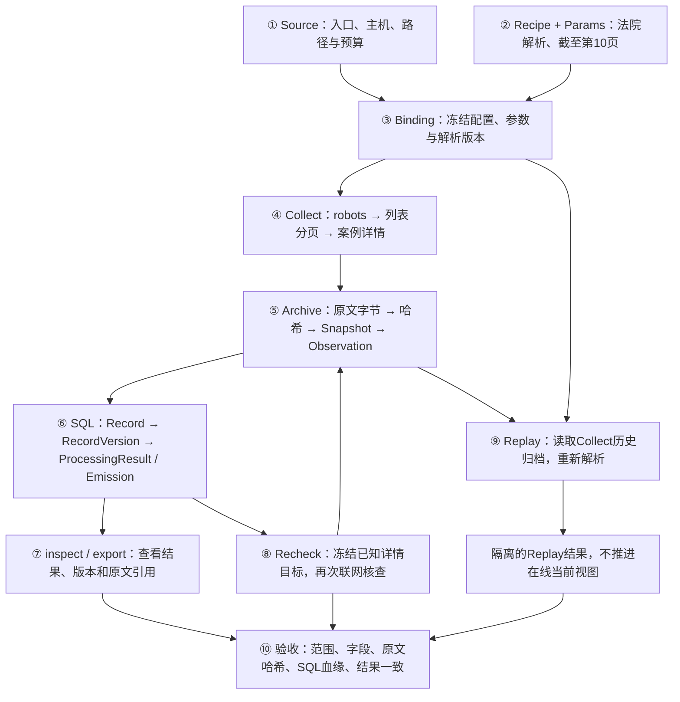

> 历史设计或验收材料：命令与 Record/Replay 合同仅对应当时版本。当前合同见 [Document-only Plan](../../docs/plans/unified-document-pipeline.md)。历史结果不代表本次验收。

# SEAL 闭环演示：法院指导案例前 10 页

演示日期：2026-10-12。入口：[最高人民法院指导案例栏目](https://www.court.gov.cn/shenpan/gengduo/77.html)。

本次范围是**前 10 页列表，以及这些列表链接的全部案例详情**。实际采集了 200 个详情，生成 200 条 Record；Collect、Recheck、Replay 均为 `complete`，错误为空。范围验收 434 项、独立原文与 SQL 验收 2228 项，共 2662 项断言通过。

这份文档按“总链路 → 节点与命令 → 结果与产物 → 复跑”组织。所有数量来自本次保存的运行回执与验收工件，不是预期值或全站覆盖声明。

## 一、先看完整链路



两个存储层承担不同职责：**归档保存可重新读取的原文字节和 Snapshot；PostgreSQL 保存运行、观测、记录、版本及其关联。** 导出组合结构化结果与原文引用，Replay 沿这些引用读取历史输入。

| 节点 | 输入 | 操作 | 输出及下游 |
|---|---|---|---|
| ① Source | 入口与采集范围 | 校验并注册配置 | Source → Binding |
| ② Recipe | 可信解析包、参数 | 打包不可变解析版本 | RecipeVersion + Params → Binding |
| ③ Binding | Source + RecipeVersion + Params | 冻结执行输入，选择默认 Binding | Binding → Collect / Recheck / Replay |
| ④ Collect | Binding 中的入口与规则 | 联网抓列表、分页和详情 | HTTP 响应 → Archive |
| ⑤ Archive | 响应原始字节 | 内容寻址归档，保存 Snapshot 与 Observation | 原文引用 → 解析 / SQL / Replay |
| ⑥ SQL | 解析结果及输入引用 | 校验身份、字段定位与血缘，保存记录和版本 | Record / Version / Result → 查询与复查 |
| ⑦ 查询与导出 | Run、Record、Snapshot 标识 | 查看运行证据并导出 | JSON 工件 → 人工查看与独立验收 |
| ⑧ Recheck | 200 条已知 Record | 冻结详情目标，重新联网核查 | 新 Observation 与本次解析结果 |
| ⑨ Replay | Collect 的历史输入与 Binding | 从归档重建输入并解析 | 隔离结果 → 与 Collect 比较 |
| ⑩ 验收 | 运行工件、归档字节、SQL | 独立复算与断言 | PASS / FAIL 与验收工件 |

## 二、演示环境与命令约定

本次使用 Python 3.12.13、PostgreSQL 17.11、`uv.lock` 锁定依赖。代码版本为 `4ae3d2c7c07c59ca984b3efbbf98e0721be6322f`；引擎文件哈希见 [environment.json](artifacts/court-10pages-20261012/environment.json)。

以下环境变量用于**查看和操作本次演示数据库**。若要重新采集并生成新一轮完整工件，请使用文末复跑脚本。

```bash
cd /Users/yoryon/SEAL
umask 077
export SEAL_DATABASE_URL='postgresql:///seal_court_10pages_20261012'
export SEAL_ARCHIVE='/Users/yoryon/SEAL/experiments/court-demo/work/court-10pages-20261012/archive'

DEMO='/Users/yoryon/SEAL/experiments/court-demo/artifacts/court-10pages-20261012'
DEMO_PROJECT='/Users/yoryon/SEAL/experiments/court-demo'
SOURCE='court_10pages_20261012'
RECIPE='04d07aab6823b645240bd07e9fc478f5ff60adbc4c36abd674ae4e35ca86d2df'
BINDING='d2a208d0835bf011188341f28c3ebcb5ec1745febaf32ee88134cf1dcb286ad9'
COLLECT='81cbae04-d814-4f0d-bf04-c50ceb6dbec8'
RECHECK='417e3445-8a5d-44f7-8c4c-527ffac80b0d'
REPLAY='dbec7bb9-17d8-4869-86f0-c533e0663e08'
```

本次前台演示由 [demo.py](https://github.com/nanzhi84/SEAL/blob/68a95c96153aa946daf014ffa1c39bfade01c148/experiments/court-demo/demo.py) 调用现有 `seal` CLI。脚本定时读取 SQL 展示运行进度，并保存 CLI JSON 回执。当前 checkout 没有 `--progress` 参数。

## 三、逐节点演示

### ① 注册 Source：明确抓取什么

```bash
uv run --frozen seal db migrate
uv run --frozen seal source apply "$DEMO/source.json"
```

**发生了什么：** 初始化运行所需的数据表，注册入口、主机、路径、robots 政策和预算。Source 允许前 10 个列表地址及 `/shenpan/xiangqing/` 详情路径。

**输出：** [migrate.json](artifacts/court-10pages-20261012/migrate.json)、[source-receipt.json](artifacts/court-10pages-20261012/source-receipt.json)。完整输入见 [source.json](artifacts/court-10pages-20261012/source.json)。这些配置随后冻结进 Binding。

### ② 打包 Recipe：明确如何解析与分页

```bash
uv run --frozen seal recipe pack "$DEMO_PROJECT/recipe"
```

**发生了什么：** 打包法院专用解析器，得到不可变 RecipeVersion。参数 [params.json](artifacts/court-10pages-20261012/params.json) 为：

```json
{"source": "dd-017", "last_page": 10}
```

本次在现有 `recipes/business` 的私有副本中增加法院分页上限：将源站尾页与 `last_page` 取较小值。原项目 Runtime 和 `recipes/` 目录未修改；这项上限不是原适配器已有的功能。迁移后的路径见 [relocation.json](artifacts/court-10pages-20261012/relocation.json)。历史回执中的旧路径保持原样。具体差异保存在 [environment.json](artifacts/court-10pages-20261012/environment.json)。

**输出：** [recipe.json](artifacts/court-10pages-20261012/recipe.json)。该版本进入下一步 Binding。

### ③ 创建 Binding：冻结本次执行输入

```bash
uv run --frozen seal binding create "$SOURCE" --recipe "$RECIPE" --params "$DEMO/params.json"
uv run --frozen seal inspect source "$SOURCE"
# 下行是本次执行时使用的 generation=1；重复选择前需重新 inspect 当前 generation。
uv run --frozen seal source select "$SOURCE" --binding "$BINDING" --expect-generation 1
```

**发生了什么：** 把 Source 配置、RecipeVersion 和参数组合为不可变 Binding，再将其选为默认运行版本。`expect-generation` 用于检测并发配置变化。

**输出：** [binding.json](artifacts/court-10pages-20261012/binding.json)、[selected.json](artifacts/court-10pages-20261012/selected.json)。Collect 随后使用这个 Binding。

### ④ Collect：联网获取列表与详情

```bash
uv run --frozen seal collect "$SOURCE"
```

**发生了什么：** 校验 robots 政策，沿真实“下一页”抓到第 10 页，发现并下载这些列表里的案例详情。

**实际结果：** 10 个列表页面、200 个详情页面、200 条 Record；含 1 次 robots 政策响应，共 211 次 HTTP 尝试和归档响应。Run 为 `complete`，错误为空。

**输出：** [collect.json](artifacts/court-10pages-20261012/collect.json)。Run ID 为 `81cbae04-d814-4f0d-bf04-c50ceb6dbec8`。

### ⑤ Archive：先保存原文，再解析

这一节点随 Collect 自动执行，没有单独的操作命令。

```text
HTTP 响应原始字节
  → body SHA-256
  → archive/objects/<哈希前两位>/<哈希剩余部分>
  → Snapshot：URL、状态、编码、body_hash 等
  → Observation：某次运行在何时实际取得这个响应
```

**实际结果：** Collect 保存 211 个输入 Snapshot 和 211 条归档 Observation。相同内容可复用同一个归档对象；每次实际抓取的观测仍单独记录。

**下游：** 解析器读取响应内容；SQL 保存结果与 Snapshot / Observation 的关联；Replay 读取归档中的历史输入。

### ⑥ SQL：把结果和证据关联起来

这一节点也随 Collect 自动执行。

```text
详情页面及字段 Locator
  → Record：案例身份，record_key 为详情 URL
  → RecordVersion：结构化内容版本
  → ProcessingResult：使用哪个 Binding、哪些输入得到什么输出
  → Emission：该 Run 产出了哪条 Record，关联哪次 Observation
```

**实际结果：** Collect 产出 200 条 Record 和 200 条 Emission。标题、正文与日期均附字段 Locator。日期按源站原文保存，例如 `发布时间：2026-02-28 18:45:41`。

**下游：** 查询和导出可沿关联查回原文；Recheck 根据已知 Record 确定详情目标。

### ⑦ inspect / export：查看结果与血缘

```bash
uv run --frozen seal inspect run "$COLLECT"
uv run --frozen seal inspect record b377f0e1-e4ec-4cd1-a712-064d4efd7040
uv run --frozen seal inspect snapshot 7ab24b5874f74952f9039d3e1c2cae68bd3cea04118419e47870c95e8172e420
uv run --frozen seal export "$SOURCE" --run "$COLLECT"
```

**输出：** [collect-run.json](artifacts/court-10pages-20261012/collect-run.json)、[example-record.json](artifacts/court-10pages-20261012/example-record.json)、[example-snapshot.json](artifacts/court-10pages-20261012/example-snapshot.json)、[collect-export.json](artifacts/court-10pages-20261012/collect-export.json)。

以“指导案例93号：于欢故意伤害案”为例，其关联保存在 [example-flow.json](artifacts/court-10pages-20261012/example-flow.json)：

| 产物 | 本次标识 |
|---|---|
| 原文字节 SHA-256 | `2dc9fef9e7839a59fdaf06982d2f6fccc6bb2a0f7adb3ffafe276cbdc4faa4d8` |
| Snapshot | `7ab24b5874f74952f9039d3e1c2cae68bd3cea04118419e47870c95e8172e420` |
| Record | `b377f0e1-e4ec-4cd1-a712-064d4efd7040` |

Snapshot 引用原文字节；Observation 引用 Snapshot；Emission 将观测与 Record / ProcessingResult 关联起来；导出保留版本、Binding 和原文引用。具体版本与观测标识见示例工件。

### ⑧ Recheck：重新观察已知详情

```bash
uv run --frozen seal collect "$SOURCE" --recheck
```

**输入：** 已知的 200 条 Record。Runtime 冻结它们的详情目标，重新联网核查，不扩展分页和新链接。

**实际结果：** 200 个详情响应加 1 个 robots 响应，共 201 次 HTTP 尝试；产出 200 条 Record，Run 为 `complete`，错误为空。新观测和解析结果仍按相同归档及持久化链路保存。

**输出：** [recheck.json](artifacts/court-10pages-20261012/recheck.json)、[recheck-run.json](artifacts/court-10pages-20261012/recheck-run.json)、[recheck-export.json](artifacts/court-10pages-20261012/recheck-export.json)。

### ⑨ Replay：从历史归档重新解析

```bash
uv run --frozen seal replay "$COLLECT"
```

**输入：** Collect Run 的历史归档与原 Binding。Replay 读取历史响应重新解析，缺失输入不联网补齐，结果写入隔离的 Replay namespace。

**实际结果：** 重现 200 条 Record；HTTP 尝试为 **0**，新增网络 Observation 为 **0**。回执里的 211 个 Snapshot 是复用的历史输入，不是重新下载。

**输出：** [replay.json](artifacts/court-10pages-20261012/replay.json)、[replay-run.json](artifacts/court-10pages-20261012/replay-run.json)、[replay-export.json](artifacts/court-10pages-20261012/replay-export.json)。验收确认其结构化字段内容与 Collect 完全一致。

### ⑩ 验收：独立复算结果

```bash
uv run --frozen python "$DEMO_PROJECT/demo.py" verify
```

脚本先执行范围与闭环断言，再调用现有 `experiments/v1.3-acceptance/business_verify.py`，从归档字节和 SQL 独立验证。重复执行会保留不同目录的独立验证结果。

| 断言范围 | 实际结果 |
|---|---|
| 列表地址集合恰好为第 1—10 页 | PASS |
| 从这 10 份原文枚举出的全部详情均已导出 | PASS，200 个 |
| Collect / Recheck / Replay 均完成且身份集合一致 | PASS |
| Replay 与 Collect 结构化字段内容一致 | PASS |
| Replay HTTP 尝试为 0，新增网络 Observation 为 0 | PASS |
| 原文字节哈希、字段 Locator、SQL 血缘 | PASS |

范围与闭环断言：**434/434**，见 [assertions.json](artifacts/court-10pages-20261012/assertions.json) 和 [acceptance.json](artifacts/court-10pages-20261012/acceptance.json)。独立验证：**2228/2228**，见 [independent/summary.json](artifacts/court-10pages-20261012/independent/summary.json) 和 [独立断言](artifacts/court-10pages-20261012/independent/assertions.json)。合计 **2662 项断言通过**。

## 四、一键复跑完整演示

运行前修改 [config/source.json](config/source.json)（入口、范围、预算、robots）和 [config/params.json](config/params.json)（Recipe 参数，当前 `last_page: 10`）。无需修改 `demo.py`。Source 中的 `id` 是模板值，脚本会替换为本轮独立的 Source ID。

```text
court-demo/
├── config/       # 运行前编辑的实际配置
├── recipe/       # 法院采集适配规则
├── demo.py       # 读取配置、调用 CLI、生成验收证据
├── rerun.sh      # 一键创建新一轮运行
├── work/         # 按运行保存数据库配套原文归档
└── artifacts/    # 按运行保存配置快照、回执、导出与验收证据
```

`setup` 读取 `config/`，仅替换 Source ID，然后将配置冻结为本轮 `artifacts/<运行名>/source.json` 和 `params.json`，CLI 使用这些快照。后续修改 `config/` 不会改变已完成运行的配置或历史证据。当前验收针对前 10 页；调整范围时也需调整对应的范围验收。

```bash
bash /Users/yoryon/SEAL/experiments/court-demo/rerun.sh
```

前提：安装 `uv`，锁定的 Python 与依赖可用，本地 PostgreSQL 17 正在运行，当前账号能够创建独立数据库，且可以访问源站。

脚本每次创建新的时间戳工作目录、独立数据库和私有归档，顺序执行：

```text
setup → collect → recheck → replay → verify
```

每阶段打印对应 CLI 命令、运行进度、结果摘要和产物路径。结束后生成 `acceptance.json`、独立断言、各阶段回执、导出与归档。源站后续可能变化，复跑以新一轮实际结果为准。

## 五、验收边界与保留的失败

- 通过范围是本次前 10 页及关联详情，不代表整个栏目或全站完成。
- `quality_status` 仍为 `not_evaluated`。字段与原文定位一致，不等于法律语义准确性已经审核。
- 原文归档保存在私有目录；本次没有采集附件，也没有引入 OCR。
- 首轮通用 Recipe 将源站日期文字直接用于 ISO 日期字段，被拒绝为 `invalid_candidate`；演示脚本的进度 SQL 同时存在错误并导致父进程中断。该轮失败已保留，见 [first-failed-summary.json](artifacts/court-10pages-20261012/first-failed-summary.json) 与 [first-failed-run.json](artifacts/court-10pages-20261012/first-failed-run.json)。最终通过的是后续法院专用有界 Recipe。
- 内置终端已打开，但电脑输入工具拒绝操作终端应用；本次实际命令由会话终端执行工具运行。文中的复跑脚本可直接在终端执行。

完整执行命令记录见 [commands.log](artifacts/court-10pages-20261012/commands.log)。其中包含首轮配置和最终配置的历史记录；本文第三节描述最终通过的路径。
