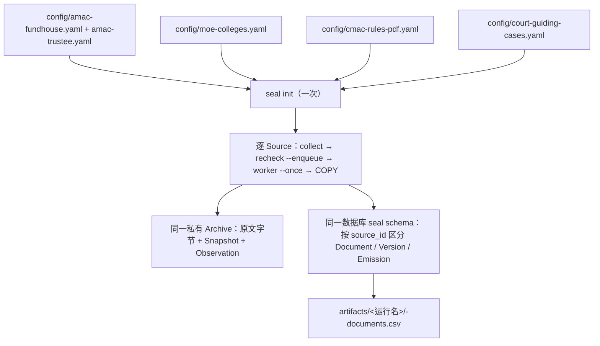

# SEAL 多来源闭环演示：四个站点、五个来源

统一入口对 `config/*.yaml` 的五个公开来源依次执行 **collect → recheck（入队 + worker）→ COPY 导出**，每轮共用一个独立数据库与私有归档，按 `source_id` 区分文档与血缘。法院来源使用共用 `recipes/business` 的 dd-017 适配器，有界采集最高人民法院指导案例前 10 页。

历史演示日期：2026-10-12。原四来源与法院闭环分别运行，均为 `complete`、错误为空、Recheck 全部 `unchanged`。以下历史结果不等同于合并后五来源同库验收；本次验收见末节。

| Source | 站点 | 适配器 | 展示能力 | Collect | 文档 |
|---|---|---|---|---|---|
| amac-fundhouse | amac.org.cn | business dd-247 | 空筛选 JSON API 枚举 | 19 次 HTTP | 18 个有版本 + 72 个 document_ref 引用 |
| amac-trustee | amac.org.cn | business dd-250 | JSON API 原生分页枚举 | 9 次 HTTP | 8 个有版本 + 72 个 document_ref 引用 |
| moe-colleges | moe.gov.cn | business dd-468 | HTML 通知 + 2 份 XLS 附件 | 4 次 HTTP | 3 |
| cmac-rules-pdf | cmac.org.cn | generic | 文本层 PDF（1.8MB） | 2 次 HTTP | 1 |
| court-guiding-cases | court.gov.cn | business dd-017 | HTML 列表前 10 页 + 案例详情 | 211 次 HTTP | 210 |

表中计数来自下文两组历史运行，不是固定预期或全站覆盖声明。

## 一、链路与产物



```text
multi-source/
├── config/*.yaml        # 每个 Source 一份配置，文件名即 source id
├── rerun.sh             # 一键整轮：init → 逐 Source 闭环 → 汇总 SQL
├── work/<运行名>/        # 私有原文归档
└── artifacts/<运行名>/   # 冻结配置、各 Source 回执、CSV 导出、environment.json
```

复跑前提：可用的 PostgreSQL 与本地建库权限、`uv` 和锁定依赖、五个来源的网络访问。法院配置包含对 robots 错误页原文字节的显式声明；该页变化时应失败关闭，不得为通过运行放宽合同。

复跑（每轮使用唯一运行名、独立数据库与归档；不再使用独立 court-loop 脚本）：

```bash
bash experiments/multi-source/rerun.sh            # 默认运行名 multi-<时间戳>
```

## 二、历史四来源运行结果（multi-4src-20261012）

环境：Python 3.12.13 / PostgreSQL 17.11，明细见 [environment.json](artifacts/multi-4src-20261012/environment.json)。数据库 `seal_multi_4src_20261012`。逐项人工验证记录见 [verification.md](artifacts/multi-4src-20261012/verification.md)（10 项全部 PASS）。

**amac-fundhouse**（dd-247）：入口页声明的 `findMutualFundHousePage` API 以空筛选枚举 17 页，共 19 次 HTTP。18 个有版本 Document（1 入口页 + 17 页 JSON）；JSON 行内 `document_ref` 引用 72 个站外路径附件，只登记血缘不抓取。

**amac-trustee**（dd-250）：入口页声明的 `findFundTrusteesPage` API 按源站 `total` 枚举 7 页，共 9 次 HTTP。8 个有版本 Document（1 入口页 + 7 页 JSON）；JSON 行内的 `document_ref` 指向全站 72 个公开附件 URL，登记为无版本的引用 Document——不抓取、不计入范围，但保留血缘。Recheck 冻结 8 个有版本文档重新核查，全部 `unchanged`，Version 复用。

**moe-colleges**（dd-468）：1 份通知 + 页面展示的 2 份 XLS 名单，共 4 次 HTTP。XLS 解析为 table 节点。Recheck 全部 `unchanged`。

**cmac-rules-pdf**（generic）：单份 70 页文本 PDF，2 次 HTTP（robots + PDF），解析为 article 节点。Recheck `unchanged`。

汇总 SQL：4 collect + 4 recheck 均 `complete`；各 Source 导出 `artifacts/multi-4src-20261012/<source>-documents.csv`（18 / 8 / 3 / 1 行）。

## 三、历史法院闭环与迁移

实际配置：[config/court-guiding-cases.yaml](config/court-guiding-cases.yaml)。入口为[最高人民法院指导案例栏目](https://www.court.gov.cn/shenpan/gengduo/77.html)，只允许 `/shenpan/gengduo/` 与 `/shenpan/xiangqing/`；`last_page: 10` 将列表分页限制为源站尾页与 10 的较小值，预算为 400 请求 / 1800 秒。

历史手工运行：[environment.json](artifacts/court-10pages-20261012/environment.json)。数据库仍为 `seal_court_loop_20261012`，不是五来源复跑数据库；迁移后读取该轮归档时使用：

```bash
export SEAL_DATABASE_URL='postgresql:///seal_court_loop_20261012'
export SEAL_ARCHIVE="$PWD/experiments/multi-source/work/court-10pages-20261012/archive"
```

- **Collect**：[collect.json](artifacts/court-10pages-20261012/collect.json)；211 次 HTTP（robots + 10 列表 + 200 详情），210 个 Document / Version / Revision，错误为空。
- **归档与解析**：HTML 先保存为内容寻址原文，再解析为 Document 节点；Observation → Snapshot → DocumentVersion → Emission 保留血缘。于欢案原文哈希为 `2dc9fef9e7839a59fdaf06982d2f6fccc6bb2a0f7adb3ffafe276cbdc4faa4d8`，可在该归档的 `objects/2d/c9fef9e7839a59fdaf06982d2f6fccc6bb2a0f7adb3ffafe276cbdc4faa4d8` 核对。
- **队列复查**：[recheck-enqueue.json](artifacts/court-10pages-20261012/recheck-enqueue.json) 与 [worker.json](artifacts/court-10pages-20261012/worker.json)；冻结 210 个已知文档，不扩展新链接，全部 `unchanged`，版本复用。
- **导出**：[documents-export.csv](artifacts/court-10pages-20261012/documents-export.csv) 为 210 行，包含解析内容，不包含归档原文字节。
- **失败边界**：缺少 robots 错误页声明的首次 collect 以 `robots_unavailable` 失败，保留 [first-failed-run.json](artifacts/court-10pages-20261012/first-failed-run.json)。未覆盖附件、OCR 或法律语义审核，`quality_status` 为 `not_evaluated`。
- **历史脚本运行**：[court-script-check2-20261012](artifacts/court-script-check2-20261012) 保留原独立脚本产物；它不代表当前统一入口已通过。

迁移记录：[migration.json](artifacts/court-merge-20261012-234523/migration.json)。原 `court-loop/work/<运行名>/` 与 `court-loop/artifacts/<运行名>/` 分别迁入 `multi-source` 对应目录，893 个文件逐一校验 SHA-256 与字节数，原回执、冻结配置和归档保持原样。历史 `environment.json` 中的旧 Archive 路径以迁移映射解析，不改写证据。旧演示和脚本冻结于同一迁移工件目录，仅供审计；当前唯一复跑入口为 `multi-source/rerun.sh`。

## 四、robots 政策实况

| 站点 | robots.txt 实况 | 处理 |
|---|---|---|
| amac.org.cn | 404 | 政策缺席，自动继续 |
| moe.gov.cn | 404 | 政策缺席，自动继续 |
| cmac.org.cn | 200 真实指令 | 归档并执行：`Disallow: /data/` 但 `Allow: /data/upload/`，PDF 路径在允许内 |
| court.gov.cn | 200 HTML 错误页，无 robots 指令 | `robots_absent_responses` 显式绑定 URL 与 SHA-256；字节变化即失败关闭 |

## 五、边界与探测排除记录

- 曾探测 nppa.gov.cn 的公开 PDF：其 `/robots.txt` 返回 **302 降级跳转到 `http://…/404.html`**（https→http）。运行时合同拒绝政策响应的协议降级跳转，该来源被放弃，不放宽合同。
- amac 两个来源的 JSON 行各引用 72 个 `allowed_path_prefixes` 之外的附件 URL，只登记不抓取；SQL 计数（90 / 80）与回执计数（18 / 8）的差异即来源于此，演示解读时应说明。
- 通过范围仅为各入口声明的有界集合，不代表任何站点的完整覆盖；`quality_status` 均为 `not_evaluated`。

## 六、合并后独立验收

验收要求：现场运行统一 CLI 入口，在隔离数据库与归档核对五来源的采集、队列复查、按来源导出和原文血缘；核对迁移清单、历史证据完整性与文档链接。源站变化或环境阻碍须分别记录 FAIL / UNVERIFIED / UNKNOWN，不能以完成状态或数量替代业务验收。

本次独立现场验收 **PASS（配置声明的有界范围内，无阻断项）**。运行名为 `multi-court-merge-accept-20261012-234743`，数据库为 `seal_multi_court_merge_accept_20261012_234743`。独立报告原样归档至 [verification.md](artifacts/multi-court-merge-accept-20261012-234743/verification.md)；环境、冻结输入、实际命令、SQL 与原文比对证据均保留在同一工件目录。

| 来源 | Collect 有版本文档 | Recheck 冻结目标 / unchanged | CSV 全内容与本来源数据库匹配 |
|---|---:|---:|---|
| amac-fundhouse | 18 | 18 / 18 | PASS |
| amac-trustee | 8 | 8 / 8 | PASS |
| cmac-rules-pdf | 1 | 1 / 1 | PASS |
| court-guiding-cases | 210 | 210 / 210 | PASS |
| moe-colleges | 3 | 3 / 3 | PASS |

通过依据不止状态与数量：五个复查任务实际消费成功，冻结目标无缺失或额外新增，版本 id 直接复用且血缘无跨来源混入；五份 CSV 逐条对照数据库的来源、URL、版本及完整内容。490 个 Observation 的 Snapshot 与原文对象逐一校验内容寻址哈希；真实 JSON、70 页 PDF 全文、两份 XLS、通知 HTML 与于欢案例正文均有原文到解析结果的比对证据。迁移清单 893 项的字节数与 SHA-256 全部匹配。

本次实际命令（再次复跑须使用新的唯一运行名）：

```bash
bash experiments/multi-source/rerun.sh multi-court-merge-accept-20261012-234743
```

Python 3.12.13、PostgreSQL 17.11、uv 0.11.23；运行时工作树并非纯提交状态，关键可执行输入已冻结为 `current-inputs.tar.gz`，不能仅依赖 Git HEAD 重放。最终 `seiso check` 与 `bash -n` 通过。

**未验证范围**：源站 robots 字节变化后的实时失败关闭（本次未变化）、队列故障与并发恢复、`updated` 分支、法院后续页及附件、OCR 和逐篇法律语义审核。历史缺少 robots 声明的真实失败已核验，但不替代未发生分支的现场验收。
