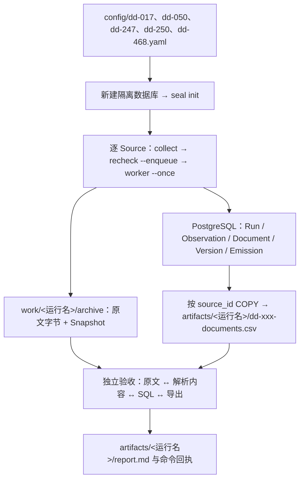

> 2026-10-13 清理记录：本页对应的旧版本原文和验收产物已按用户要求删除；以下数字、命令和结论保留为历史说明，本地工件已不能用于复算。

# SEAL 多来源闭环演示：四个站点、五个来源

统一入口读取 `config/*.yaml`，逐来源执行 **collect → recheck 入队 → worker 消费 → SQL COPY 导出**。每轮共用一个新建的隔离数据库与私有原文归档，按 `source_id` 区分文档、版本和血缘。活动配置 ID 与文件名统一使用[尽职调查核验入口地图](../../docs/reference/尽职调查核验入口地图.md)的稳定 ID。

## 一、链路与产物



| Source ID（链接地图对应行） | 采集分类 | 原来源链接 | 实际配置 | 站点 / 适配器 | 输入与有界范围 | 输出及下游用途 |
|---|---|---|---|---|---|---|
| [dd-017](../../docs/reference/尽职调查核验入口地图.md#dd-017) | A（静态正文/名单样本） | [最高法指导案例](https://www.court.gov.cn/shenpan/gengduo/77.html) | [dd-017.yaml](config/dd-017.yaml) | court.gov.cn / business dd-017 | 最高法指导案例前 10 页列表及关联详情；不采集全站 | HTML 文档与案例正文，用于回看原文和复查 |
| [dd-050](../../docs/reference/尽职调查核验入口地图.md#dd-050) | B（静态内容链接） | [中国海事仲裁委员会仲裁规则](https://www.cmac.org.cn/index.php?catid=20) | [dd-050.yaml](config/dd-050.yaml) | cmac.org.cn / generic | 从规则栏目发现本页全部规则 PDF；不扩展其他栏目、不使用 OCR | 栏目 HTML 与 PDF article 文本节点；保留栏目到 PDF 的发现证据 |
| [dd-247](../../docs/reference/尽职调查核验入口地图.md#dd-247) | C（公开参数/API 已取样） | [公募基金管理人名录](https://www.amac.org.cn/fwdt/wyc/jgcprycx/jgcx/gmjjglrml/) | [dd-247.yaml](config/dd-247.yaml) | amac.org.cn / business dd-247 | 公募基金管理人名录；空筛选，按原生 API 分页 | JSON 文档与附件引用，按版本导出 |
| [dd-250](../../docs/reference/尽职调查核验入口地图.md#dd-250) | C（公开参数/API 已取样） | [基金托管机构名录](https://www.amac.org.cn/fwdt/wyc/jgcprycx/jgcx/jjtgrjjgs/) | [dd-250.yaml](config/dd-250.yaml) | amac.org.cn / business dd-250 | 基金托管机构名录；页数以接口 total 为准 | JSON 文档与附件引用，复查已知有版本文档 |
| [dd-468](../../docs/reference/尽职调查核验入口地图.md#dd-468) | B（静态内容链接） | [全国高校名单公开通知](http://www.moe.gov.cn/jyb_xxgk/s5743/s5744/A03/202110/t20211025_574874.html) | [dd-468.yaml](config/dd-468.yaml) | moe.gov.cn / business dd-468 | 2021 年高校名单通知及页面展示的 XLS 附件 | HTML 与 table 节点；保留通知到附件的血缘 |

```text
multi-source/
├── config/dd-xxx.yaml    # 可编辑实际配置；文件名与 id 一致
├── rerun.sh              # 当前唯一统一运行入口
├── work/<运行名>/archive # 原文与审计输入，不是缓存
└── artifacts/<运行名>/   # 冻结输入、回执、SQL、导出、环境及验收报告
```

## 二、环境与运行命令

前提：可用的本地 PostgreSQL 与建库权限、`uv` 和 `uv.lock` 锁定依赖、五来源真实网络访问。每轮使用唯一运行名；已有数据库不会被脚本覆盖。当前 ID 不自动迁移旧数据库中的其他 Source ID。

```bash
bash experiments/multi-source/rerun.sh
# 也可显式指定新的唯一运行名：
bash experiments/multi-source/rerun.sh multi-dd-<唯一时间戳>
```

运行输入来自配置文件，不在脚本中硬编码站点；冻结配置为工件目录中的 `dd-xxx.yaml`。各来源回执为 `dd-xxx-collect.json`、`dd-xxx-recheck-enqueue.json` 和 `dd-xxx-worker.json`，导出为 `dd-xxx-documents.csv`。导出包含解析内容，不包含私有原文字节。

## 三、本次重新生成与独立验收

按用户要求，原 `artifacts/` 与 `work/` 已全部清空，不再保留或引用其历史回执、配置快照、导出和原文。旧数据库未删除，但不参与本次运行和验收；旧运行结果不作为本次通过依据。

历史运行名：`multi-dd-regenerate-20261013-103948`。以下保留当时的运行记录；该轮归档与验收工件现已缺失，当前无法据此复核历史结论。后续独立演示见本文末尾与 `playgroud/` 各来源说明。

- 命令：`bash experiments/multi-source/rerun.sh multi-dd-regenerate-20261013-103948`
- 数据库：`seal_multi_dd_regenerate_20261013_103948`
- 原文：`work/multi-dd-regenerate-20261013-103948/archive`
- 工件：`artifacts/multi-dd-regenerate-20261013-103948/`
- 当时记录的状态：**PASS（五来源声明的有界范围内，无业务阻断项）**；当前证据状态为 **UNVERIFIED（工件缺失）**。脚本原样执行一次，使用新数据库与新原文；未复原旧证据。
- 历史独立报告：`artifacts/multi-dd-regenerate-20261013-103948/report.md`（当前缺失）。
- 历史命令与回执：上述工件目录中的 `command.txt`、`rerun.log`、`environment.json`（当前均缺失）。

| Source ID | 有版本文档 / CSV 行 | 本次可见结果 | 冻结复查目标 / 直接复用版本 | 判断 |
|---|---:|---|---:|---|
| [dd-017](../../docs/reference/尽职调查核验入口地图.md#dd-017) | 210 | 10 列表页 + 200 详情；真实指导案例113号正文核对通过 | 210 / 210 | PASS |
| [dd-050](../../docs/reference/尽职调查核验入口地图.md#dd-050) | 1 | 70 页文本 PDF 全文一致 | 1 / 1 | PASS |
| [dd-247](../../docs/reference/尽职调查核验入口地图.md#dd-247) | 18 | HTML + 17 JSON 页，165 个管理人 | 18 / 18 | PASS |
| [dd-250](../../docs/reference/尽职调查核验入口地图.md#dd-250) | 8 | HTML + 7 JSON 页，67 个托管机构 | 8 / 8 | PASS |
| [dd-468](../../docs/reference/尽职调查核验入口地图.md#dd-468) | 3 | 通知 HTML + 两份 XLS，全部可见单元格核对通过 | 3 / 3 | PASS |

五个复查任务实际消费成功，冻结目标无扩展，240 个版本 ID 直接复用。五份 CSV 全部 240 行逐行匹配本来源 SQL，500 个 Archive 对象哈希匹配，Observation / Snapshot / Version 血缘无跨来源混入；正文、JSON、PDF 全文及 XLS 单元格分别与本轮原文核对，不只依赖状态或数量。

当时记录的入口地图渲染结果为 `artifacts/multi-dd-regenerate-20261013-103948/rendered-map.html`（当前缺失）。历史记录称其经实际 DOM 核对：只有一张表、491 数据行、每行 8 列，全部稳定 ID 锚点存在，五来源链接可定位；入口名称、URL、业务分类、顺序及重复均与原地图一致。`seiso check`、脚本语法和 Git diff 检查通过。

复跑须用新的唯一运行名，不能覆盖本次数据库；历史报告、冻结输入及环境工件当前缺失；重跑应使用现有脚本和新环境重新生成证据。未验证全地图网站可访问性、故障重试与并发恢复、PDF OCR、法律语义及生产质量，本次通过不扩展这些范围。

独立验收须核对五来源采集与队列消费、冻结复查目标、版本复用、按来源导出、Archive 原文字节和可见解析内容；同时实际渲染入口地图，确认 491 条连续大表、8 列及对应 ID 锚点。不能以 HTTP 200、complete 或计数单独宣称业务通过。

## 四、安全合同与边界

| 站点 | 配置合同 | 故障行为 |
|---|---|---|
| court.gov.cn | `robots_absent_responses` 显式绑定 robots HTML 错误页 URL 与 SHA-256 | 字节变化即失败关闭；需人工重新核对，不为通过运行放宽合同 |
| amac.org.cn / moe.gov.cn | 按运行时 robots 政策合同判断 | 当前实际响应须以本轮 Observation 为证据，不预设永久 404 |
| cmac.org.cn | 执行真实 robots 指令及 PDF 路径范围 | 被禁止或响应异常须记录失败，不绕过 |

- amac API 行中的范围外 `document_ref` 仅登记引用，不抓取、不混入有版本导出；不能将引用数量当作已采集文档数量。
- 法院只覆盖配置限定的前 10 页及关联详情；PDF 仅文本层，未使用 OCR；XLS 解析结果不代表逐项业务审核。
- 所有产物保持 `quality_status: not_evaluated`；解析及版本一致不等于法律语义、来源完整性或生产质量批准。
- 源站内容、robots、分页或模板变化可能导致失败。验收须保留 FAIL / UNVERIFIED / UNKNOWN 与实际诊断，不以历史成功补齐未验证范围。

当前 `dd-050` 配置已改为规则栏目入口，按栏目正文链接发现 PDF；本文历史验收中的“单份 70 页 PDF”仍表示当时的直接附件入口运行，不代表当前配置的验收结果。新运行使用独立数据库与根目录 `work/`、`artifacts/`，不改写历史归档。

本次栏目入口验收（`cmac-e2e-20261013-150121`）：Collect 8 次 HTTP（robots、栏目、6 份 PDF），生成 7 份 Document；Recheck 7 份全部 unchanged。全新子 agent 编写并执行根目录 `tests/cmac_column_e2e.py`，78 项断言通过，涵盖归档栏目公开 PDF 集合、发现父级关联、原文与内容哈希、版本观测关联、PDF 文本层对照和 7 行 CSV 导出。证据：验收（旧版本产物已删除）、PDF 血缘（旧版本产物已删除）、CSV（旧版本产物已删除）。

复现命令：`uv run --frozen python tests/cmac_column_e2e.py`（仓库根目录，Python 3.12、uv、本机 PostgreSQL/createdb 及公网访问；每次新建独立运行目录和数据库）。文本对照不验证 PDF 视觉排版或扫描内容，不使用 OCR，全站覆盖 UNKNOWN。`seiso check` 本次仍有前述历史文档 5 个失效工件链接诊断。
